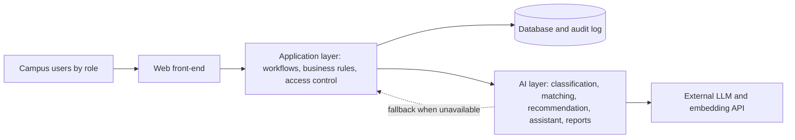

# Intelligent, AI-Powered Circular Campus Resource Exchange and Asset Life Cycle Management System

## Phase 3 – Requirements Document

**Khalifa University – Department of Computer Science**

**COSC 336 – Introduction to Software Engineering – Fall 2026**

**Prepared by:** Group 5 – Mohammed Alketbi (100067035), Abdulla, Mohammed Al Ali, Mubarak

**Prepared for:** Eng. Dina Atia, Lab Instructor

**Date:** October 2026

---

# 1. Introduction

## 1.1 Purpose

Phase 1 described the problem and Phase 2 showed that solving it is feasible. This document says exactly what the system shall do. It turns the ideas from the earlier phases into numbered, testable requirements that the design team can build against (Phases 4–5), the developers can implement (Phase 6) and the testers can verify (Phase 7). If a feature is not written here, it is not promised. If it is written here, it can be checked.

The document covers the whole prototype: the classic asset-management layer and the AI-enhanced layer.

## 1.2 Document Conventions

- **Identifiers.** Every item has a unique ID: `FR-<AREA>-nn` for functional requirements (for example `FR-AST-03` is the third asset-registration requirement), `NFR-nn` for non-functional requirements, `BR-nn` for business rules and `UC-nn` for use cases.
- **Wording.** "Shall" marks a mandatory requirement, "should" a desirable one and "may" an option.
- **Priority.** Every requirement is rated Essential (must be included in the prototype), Desirable (to be implemented if time permits) or Future (listed but not implemented). All priorities are described in Section 8.
- **Testable**: Each requirement describes exactly one testable thing. If a limit is relevant, it is stated numerically and not verbally (e.g., quickly).
- **Roles**: Roles are abbreviated in the permission matrix (Section 2.4). Definitions are provided in Appendix A.

  ## 1.3 Intended Audience and Reading Suggestions

| Reader | What they use this document for |
|---|---|
| Instructors (client) | To verify that the requirements are consistent with the project description and to evaluate the document |
| Developers | To design and implement features; every feature has listed requirements |
| Testers | To develop test cases in Phase 7; every requirement is formulated so that it can be verified |
| Project coordinator | To control the scope and priorities |

Sections 1–2 provide background and actors. Read Sections 4 (features), 5 (quality requirements) and Sections 7–8 about use cases and priorities.

## 1.4 Product Scope

The product is an internal web-based platform that enables registration of campus assets, publication of surplus, requests and reservations, approval and management of transfer, inspections, maintenance and tracking of each asset throughout its lifecycle. Semantic classification and matching, sustainability advice, natural language assistant and generation of reports is provided by an additional AI layer. The full scope of the product, both in-scope and out-of-scope functionalities, is described in Phase 1 (Section 3.7). Only the in-scope prototype is specified in this document.

## 1.5 References

1. Phase 1 – Initial Plan and Requirement Gathering Document, Group 5, 2026.
2. Phase 2 – Feasibility Document, Group 5, 2026.
3. COSC 336 Lab-based Running Project description, Fall 2026 (including the Software Requirements Specification template in its appendix).
4. COSC 336 Circular Campus Project slides, Fall 2026.
5. I. Sommerville, *Software Engineering*, Pearson.

# 2. Overall Description

## 2.1 Product Perspective

The software will be a new stand-alone product. It does not extend or interface to the existing university system, the authentication, departments and assets will exist only in the prototype (see Phase 2, Section 4.3). External dependencies are limited to AI service only.

AI layer is separated from the application layer. In case of unavailable service or low confidence of returned results, the application will fall back to simple keyword search and rules-based logic, and all the results of the AI layer are only recommendations for a human to accept or reject.

## 2.2 Product Functions

| Section | Feature | ID prefix | Layer |
|---|---|---|---|
| 4.1 | Asset registration and inventory | FR-AST | Classic |
| 4.2 | Resource publication (marketplace) | FR-MKT | Classic |
| 4.3 | Resource request submission | FR-REQ | Classic |
| 4.4 | Search and filtering | FR-SRC | Classic |
| 4.5 | Reservation and request management | FR-RSV | Classic |
| 4.6 | Approval workflows | FR-APR | Classic |
| 4.7 | Transfer management | FR-TRF | Classic |
| 4.8 | Inspection, maintenance and repair | FR-MNT | Classic |
| 4.9 | Life-cycle history | FR-HST | Classic |
| 4.10 | Donation, recycling and disposal | FR-DSP | Classic |
| 4.11 | User and access management | FR-USR | Classic |
| 4.12 | Notifications | FR-NTF | Classic |
| 4.13 | Operational reports | FR-RPT | Classic |
| 4.14 | Audit logging | FR-AUD | Classic |
| 4.15–4.19 | AI classification, matching and ranking, sustainable-action recommendation, LLM assistant, generative reporting | FR-AI | AI |
| 4.20 | Sustainability indicators | FR-SUS | AI / analytics |

## 2.3 Actors and Roles

| Role | Code | Who they are | Key responsibilities |
|---|---|---|---|
| Department Representative | DR | Represents the department and makes decisions about its needs and disposals | Makes requests, approves releases and transfers of the department, tracks the process |
| Asset Custodian | AC | The owner of the physical assets of a particular department, lab or store | Registers and manages the assets, publishes the surplus, transfers assets |
| Requester | RQ | Staff member in need of a resource for learning, research or working | Searches, requests, reserves and tracks requests |
| Administrator | AD | Administrative manager of the exchange | Manages workflow, approves high-impact actions, manages the accounts, reads reports |
| Procurement Officer | PO | In charge of purchases | Looks for alternative options inside the university before buying, reads the cost information |
| Finance Officer | FO | Evaluates the cost and savings information | Reviews the financial impact, co-approves the disposal of high value |
| Maintenance Staff | MS | Inspects and fixes assets | Reports defects, records inspections and fixes, manages the condition |
| Sustainability Officer | SO | Tracks the environmental effects | Reads the sustainability dashboard and reports |
| System Administrator | SA | Maintains the platform from technical side | Security, configurations, versions of the AI model and prompts, logs |

There are two secondary actors that participate too: the **AI Service**, which is the external LLM and embedding API used by the AI layer, and the **Notification Service**, which sends messages by e-mail and in-app.

## 2.4 Permission Matrix

Legend: **Y** = allowed, **D** = allowed for one’s own department/assigned items only, **-** = not allowed. Unauthenticated users are allowed to access the login page only.

**Table A – Assets, marketplace and requests**

| Action | DR | AC | RQ | AD | PO | FO | MS | SO | SA |
|---|---|---|---|---|---|---|---|---|---|
| View the listings published in the marketplace | Y | Y | Y | Y | Y | Y | Y | Y | - |
| View the full record of the asset | D | D | - | Y | - | - | D | - | - |
| View the financial information (purchase value, estimated value, costs) | D | D | - | Y | Y | Y | - | - | - |
| Register a new asset | D | D | - | Y | - | - | - | - | - |
| Edit the record and status of an asset | - | D | - | Y | - | - | - | - | - |
| Publish or withdraw a surplus listing | D | D | - | Y | - | - | - | - | - |
| Make or cancel a request for resources | D | - | D | - | - | - | - | - | - |
| Search and filter the listings | Y | Y | Y | Y | Y | Y | Y | Y | - |
| Reserve an available asset | D | - | D | - | - | - | - | - | - |
| Track the status of the request | D | - | D | Y | Y | - | - | - | - |
| View the AI recommendations of matching | D | D | D | Y | Y | - | - | - | - |
| Accept, edit or reject the AI classification of the asset | D | D | - | Y | - | - | - | - | - |

**Table B – Workflows, maintenance, reporting and administration**

| Action | DR | AC | RQ | AD | PO | FO | MS | SO | SA |
|---|---|---|---|---|---|---|---|---|---|
| Approve the asset release or reservation | D | - | - | Y | - | - | - | - | - |
| Approve a transfer | D | - | - | Y | - | - | - | - | - |
| Confirm the receipt of the transferred asset | D | D | - | Y | - | - | - | - | - |
| Approve donation or recycling | - | - | - | Y | - | - | - | - | - |
| Approve disposal | - | - | - | Y | - | Y | - | - | - |
| Report a defect or make a request for inspection | D | D | D | Y | - | - | D | - | - |
| Record an inspection and fixing actions | - | - | - | Y | - | - | D | - | - |
| View the history of maintenance actions | D | D | - | Y | - | Y | Y | Y | - |
| View the financial and savings reports | - | - | - | Y | Y | Y | - | Y | - |
| View the sustainability dashboard | D | - | - | Y | Y | Y | - | Y | - |
| Generate operational reports | D | D | - | Y | Y | Y | D | Y | - |
| Generate AI summary reports | - | - | - | Y | Y | Y | - | Y | - |
| Using the AI assistant within the scope of his/her permissions | Y | Y | Y | Y | Y | Y | Y | Y | - |
| Creating, editing or deactivating the accounts and assigning roles | - | - | - | Y | - | - | - | - | Y |
| Configuring the system settings, AI model and prompt versions | - | - | - | - | - | - | - | - | Y |
| View the audit log | - | - | - | Y | - | - | - | - | Y |

System Administrator doesn’t have routine access to the asset, request or financial data. This reduces the amount of the data accessible to the administrator having technical access (data minimisation). This permission matrix serves as the base while the real rules will be determined by the requirements in section 4.11.

## 2.5 Business Rules

The business rules are the operating principles of the university that need to be enforced by the system. These are not functional requirements themselves, but a lot of the functional requirements serve to enforce them. References to the business rules are made via ID.

| ID | Rule |
|---|---|
| BR-01 | Each asset is associated with exactly one department, which owns it, and has exactly one person responsible for it as custodian. |
| BR-02 | Only the Asset Custodian or Department Representative of the owning department, or the Administrator, can register and/or update the asset record. |
| BR-03 | An asset can be published on the marketplace only if it is registered in the system, has its condition recorded, and is neither in maintenance nor in transfer. |
| BR-04 | An asset can have only one unexpired reservation. A reservation that is not accepted expires after 7 days (configurable). |
| BR-05 | An asset, while in the state In Maintenance or In Transfer, cannot be reserved, transferred, donated, recycled or disposed. |
| BR-06 | The owner, custodian or location of an asset change only after a transfer is accepted by one of the authorised approvers of the owning department or by the Administrator. |
| BR-07 | A person does not have the permission to approve his own request or transfer he requested. |
| BR-08 | The transfer is completed only after the acceptance of receipt of the transferring party. A transfer not completed within 14 days is reported to the Administrator. |
| BR-09 | The donation, recycling or disposal of an asset needs the reason to be entered and the approval of the Administrator. If the estimated value of the asset is above AED 5,000 (configurable), then the approval of the Finance Officer is additionally required. |
| BR-10 | The disposal is a possible choice only after a user has reviewed other possible actions: reusing, transferring, repairing, refurnishing, donating, recycling; and recorded the reasons why they did not suit him. |
| BR-11 | AI never accepts, denies, performs transfers, donates, recycles or disposes of an asset. AI's output is only recommendation. |
| BR-12 | Every AI recommendation is stated with a confidence level and key factors, that form it. The user can accept it, reject or modify it. Every rejection and modification of recommendation is logged, with user and time. In case a high-impact recommendation is rejected, a justification is also logged. |
| BR-13 | Life-cycle events and audits cannot be changed or deleted. Instead, the correction is recorded as an additional entry with a link to the original entry. |
| BR-14 | Every creation and modification of an asset record, request, transfer, maintenance record, user's role is recorded in audit log with user, timestamp, previous value, and new value. |
| BR-15 | The financial information (values, cost savings) is available only to those roles, specified in the permission matrix (Section 2.4). |
| BR-16 | Only published listings are visible campus-wide. The complete listing of an unpublished asset is available only to the owning department and to Administrators. |
| BR-17 | All sustainability and savings data is displayed as estimates, accompanied by the assumptions. |
| BR-18 | Every user has at least one role and one owning department; permissions are union of the roles. Deactivated users cannot log in, but keep history of their past actions. |
| BR-19 | Each request has to contain the category, the purpose, the number of assets, and the required date. If the required date passed without a fulfillment, the request expires. |

## 2.6 Operating Environment

The system is a web application used through a modern browser (current versions of Chrome, Edge and Firefox). The server runs on Python 3.10 or later on Windows, macOS or Linux, with SQLite for development and PostgreSQL for the demonstration. The prototype runs on a local machine or a free-tier cloud service and needs internet access only to reach the AI service.

## 2.7 Design and Implementation Constraints

- Only free or education-tier tools, libraries, hosting and AI services may be used.
- The prototype is not integrated with real university systems. Authentication is local, and all data is synthetic.
- The AI layer must sit behind an interface with a rule-based fallback so the system works without the AI service.
- No personal data (names, e-mail addresses) may be sent to an external AI service.
- Work is developed with Git and GitHub, with regular commits by each member.
- The course policy on AI tools applies to the code and documentation.
- All phases must be delivered by the course deadlines within one semester.

## 2.8 Assumptions and Dependencies

**Assumptions**

- A free-tier LLM and embedding service remains available during the semester. If not, the fallback behaviour is used.
- Synthetic data can represent the variety of real assets and requests well enough to demonstrate and test the system.
- A shared category list and asset identifier scheme can be defined for the prototype.
- Users have a modern browser and network access.

**Dependencies**

- The external LLM and embedding API (the only external service).
- Published average emission and weight factors per asset category for sustainability estimates.
- Instructor approval of this document before design (Phases 4–5) starts.

# 3. External Interface Requirements

## 3.1 User Interfaces

The system has one web interface. After login, each user sees only the menu items allowed for their role (Section 2.4). The main screens are:

- Login and account page.
- Asset registration and edit form, with photo and document upload.
- Marketplace listing page with search and filters.
- Request form and "my requests" page.
- Match recommendation review page (shows score, confidence and explanation).
- Approval and transfer pages, including receipt confirmation.
- Maintenance and inspection pages.
- Asset history timeline.
- Sustainability dashboard and report pages.
- Assistant chat panel, available on every page.
- Administration pages (users, roles, audit log, settings).

All screens shall follow the same layout, put the main navigation in the same place, show validation errors next to the field that caused them, and offer a help link. The main workflows shall be usable with the keyboard only (see NFR-21).

## 3.2 Hardware Interfaces

None. The prototype uses no special hardware. Barcode and RFID scanners are out of scope, so asset IDs are entered manually.

## 3.3 Software Interfaces

| Interface | Direction | Purpose |
|---|---|---|
| Relational database (SQLite / PostgreSQL) | Application ↔ database | Stores users, departments, assets, categories, requests, matches, approvals, transfers, maintenance records, sustainability impacts, notifications, model versions and audit logs |
| Vector index (pgvector or in-memory) | AI layer ↔ index | Stores embeddings of asset listings and requests for semantic matching |
| External LLM and embedding API | AI layer → service → AI layer | Sends asset or request text (never personal data) and receives embeddings, categories, explanations, answers and report text |
| File storage | Application ↔ storage | Stores asset photos and supporting documents |
| Notification service | Application → users | Delivers in-app and e-mail notifications |

## 3.4 Communications Interfaces

- The browser communicates with the server over HTTP/HTTPS. Application programming interfaces use REST with JSON.
- Calls to the external AI API use HTTPS with an API key kept in an environment variable, never in the repository.
- Uploaded files are limited to 10 MB per file, in JPG, PNG or PDF format.
- E-mail notifications use standard SMTP or an e-mail API.

# 5. Other Non-Functional Requirements

The limits stated below pertain to the prototype tested using synthetic data of up to 5,000 resources and 500 users.

## 5.1 Performance Requirements

- **NFR-01:** For no less than 95% of page requests the system will respond within 3 seconds when there are up to 50 concurrent users.
- **NFR-02:** For at least 95% of search and filter queries the result will be returned within 2 seconds for 5,000 asset records.
- **NFR-03:** For at least 90% of requests the AI match recommendations will be returned within 10 seconds.
- **NFR-04:** In case the AI service call exceeds 15 seconds or is unsuccessful, the system will fallback to the keyword search or rules and will inform the user about the unavailability of AI results.
- **NFR-05:** For at least 90% of requests an AI classification recommendation will be provided within 8 seconds following user input of the asset details.

## 5.2 Safety Requirements

- **NFR-06:** Transfer, donation, recycling or disposal operations cannot be performed by the system until authorised users confirm their intention to perform such operations in the confirmation dialog and the confirmation is recorded in the logs.
- **NFR-07:** Assets tagged as safety-related (e.g. electrical equipment, assets dealing with hazardous chemicals or under high pressure) cannot be transferred until there is a record of the inspection of the asset and it has been passed successfully.

## 5.3 Security Requirements

- **NFR-08:** Only hashed passwords are going to be stored (using bcrypt or Argon2 algorithms).
- **NFR-09:** The role and department permissions described in section 2.4 will be validated on the server side for every request and an invalid request will be blocked and logged.
- **NFR-10:** Sessions are going to expire 30 minutes after being inactive.
- **NFR-11:** Accounts are going to be blocked 15 minutes after 5 failed login attempts.
- **NFR-12:** No passwords, API keys and similar credentials are going to be stored in the source control repository but read from the environment variables.
- **NFR-13:** In the demonstration deployment mode all traffic between the browser and the server will use the HTTPS protocol.

## 5.4 Privacy and Compliance Requirements

- **NFR-14:** Requests sent to the external AI service will contain asset and request descriptions only, and shall not contain usernames, emails or any other personal information.
- **NFR-15:** The system will store only necessary personal data (name, university email, department, role), and the data of the deactivated users shall be obscured while maintaining their identification in the audit log.

## 5.5 Software Quality Attributes

- **NFR-16 (Usability):** In the process of user acceptance testing at least 80% of users who make the resource request the first time should be able to submit a resource request in less than 5 minutes.
- **NFR-17 (Explainability):** All the recommendations of the AI component will be accompanied by a confidence level and explanation of the key reasons influencing the AI decision making.
- **NFR-18 (Availability):** In the course of demonstration and testing, the system will have to be available no less than 95% of time.
- **NFR-19 (Maintainability):** The AI module will have to be encapsulated in a certain interface and could be easily changed to another AI service provider without having to change the application logic itself; in Phase 7 at least 60% of business-logic code will have to be covered by automated tests.
- **NFR-20 (Portability):** The software will have to be compatible with Windows, macOS and Linux operating systems with Python 3.10 or higher and recent Chrome, Edge, and Firefox browsers.
- **NFR-21 (Accessibility):** Text is going to follow WCAG 2.1 AA criteria, and registration of the asset, requests submissions and approvals will have to be available via keyboard only.
- **NFR-22 (Data integrity):** Database will be possible to restore from a backup no older than 24 hours old, and audit log and life cycle entries will be append only.

