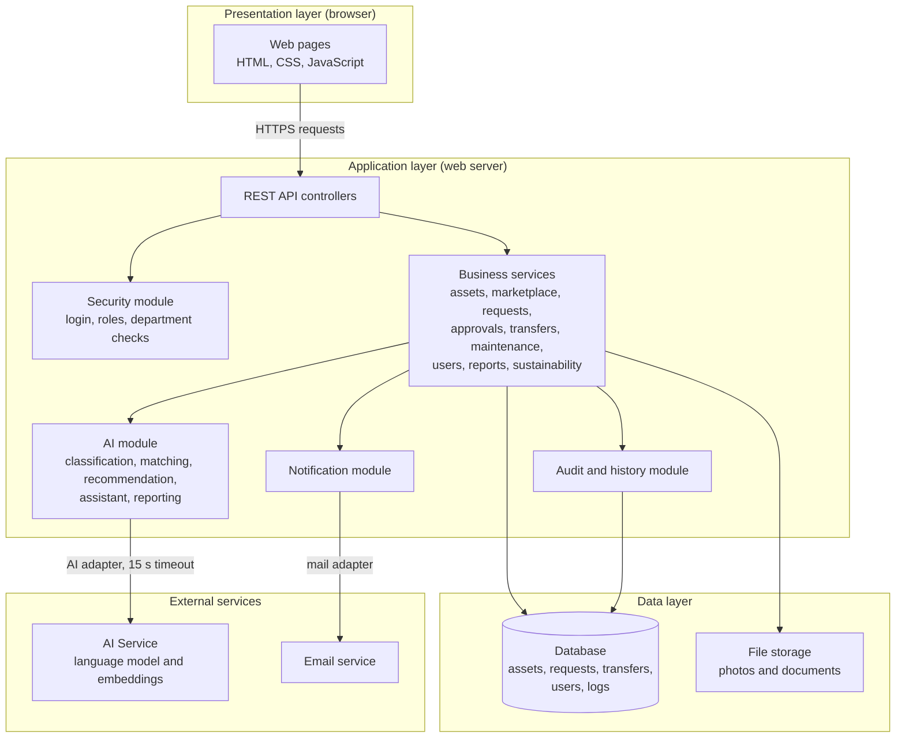
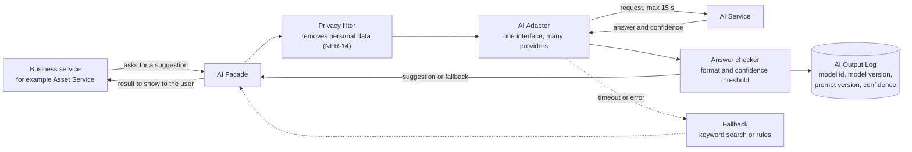
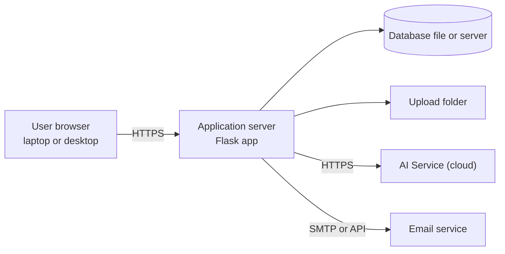

# Phase 4 & 5 - Design Document (Shared Part)

**Project:** Intelligent, AI-Powered Circular Campus Resource Exchange and Asset Life Cycle Management System
**Course:** COSC 336, Khalifa University, Fall 2026 | **Group:** 5 | **Lab instructor:** Eng. Dina Atia

This file holds what all four of us share: the architecture, the context diagram, the Level 0 DFD, the ER diagram and the data rules. Each member has their own file with sequence diagrams, a class diagram and UI mockups.


| File | Owner | Use cases covered |
|---|---|---|
| `00_architecture_and_shared_design.md` | All | Whole system |
| `01_part1_assets_marketplace_requests.md` | Mohammed Al Ali | UC-01 to UC-10 |
| `02_part2_approvals_transfers_maintenance.md` | Mubarak | UC-11 to UC-16, UC-24, UC-25 |
| `03_part3_users_reports_notifications_audit.md` | Mohammed Alketbi | UC-17 to UC-23 |
| `04_part4_ai_and_sustainability.md` | Abdulla | UC-26 to UC-35 |

---

# 1. Introduction

## 1.1 Purpose

This document describes how the system will be built. Phase 3 said what the system must do. Phases 4 and 5 say how: the architecture (Phase 4) and the detailed design (Phase 5).

## 1.2 Design Goals

| Goal | What it means | Phase 3 link |
|---|---|---|
| Keep the classic layer and the AI layer apart | The system must still work if the AI Service is down | NFR-04, FR-AI-X-08 |
| Human decides | AI only suggests. A person approves | BR-11, FR-AI-X-14 to 17 |
| Everything is traceable | History and audit records can never be edited | BR-13, BR-14, FR-HST-03, FR-AUD-03 |
| Role based access | Every action checks the user's role and department | BR-16, NFR-08 to 11, FR-USR-06 |
| Easy to change | The AI provider can be swapped without changing the business logic | Phase 1 design goal |
| Simple to test | Business logic is separate from the screens and the database | Phase 7 plan |

---

# 2. System Architecture (Phase 4)

## 2.1 Architecture Style

We use a **layered (three-tier) web architecture**: a browser front end, an application server with the business logic, and a database. The AI layer and the notification service are outside services that are reached only through adapters.



## 2.2 Layers and Their Jobs

| Layer | Job | Main rule |
|---|---|---|
| Presentation | Shows pages, checks simple input (empty fields, wrong format) and calls the API | No business rules here |
| API controllers | Receive requests, call the security module, call one service, return the answer | One controller per feature group |
| Security module | Checks login, role and department before every action (FR-USR-06) | Denied attempts go to the audit log (FR-AUD-01) |
| Business services | Hold all the rules: BR-01 to BR-19, state changes, validation | Only layer that talks to the database |
| AI module | Builds the AI request, removes personal data, calls the AI Service, checks the answer, saves it in the AI log | AI never changes data by itself (BR-11) |
| Audit and history module | Writes history and audit entries after every change | Entries are append-only (BR-13, BR-14) |
| Notification module | Creates in-app messages and optional emails | A failed email never stops a workflow (FR-NTF error rules) |
| Data layer | Stores data and uploaded files | Passwords are stored as hashes (NFR-08) |

## 2.3 Proposed Technology

These choices can change. They follow the Phase 1 resources list (Python and/or JavaScript, a database, an AI/LLM service, GitHub, draw.io).

| Part | Choice | Why |
|---|---|---|
| Front end | HTML, CSS, JavaScript | Simple. Runs in any browser (Phase 1 assumption) |
| Back end | Python with Flask (or FastAPI) | Easy to learn. Good AI libraries |
| Database | SQLite for the prototype. Same tables work in PostgreSQL | No server to install. Synthetic data only |
| AI Service | Any free or student-tier language model with an embeddings API, used only through the adapter | Free tier only (Phase 1 constraint) |
| Email | SMTP or a mail API behind a mail adapter | Optional channel (FR-NTF-03) |
| Tests | pytest (back end) | Needed for the 60% coverage goal in Phase 7 |
| Version control | GitHub, small commits by each member | 10% of every phase mark |

## 2.4 AI Integration Design

The AI module is built around one interface, so the AI provider can be changed without touching the business services.



| Rule | Design decision | Requirement |
|---|---|---|
| AI never decides | The AI module has no write access to assets, requests, transfers or approvals. It only returns suggestions | BR-11, FR-AI-X-14 to 17 |
| Show confidence | Every result carries a confidence value. Low confidence shows a warning | FR-AI-X-01, FR-AI-X-02 |
| Fallback | If the AI Service is slow (over 15 s) or down, the system uses keyword search or fixed rules and tells the user | NFR-04, FR-AI-X-08 to 10 |
| Log everything | Model id, model version, prompt version, time and result are saved for every output | FR-AI-X-05 to 07, FR-AI-X-11 to 13 |
| Override is saved | When a user changes a suggestion, the final value and reason are saved | FR-AI-X-03, FR-AI-X-04, BR-12 |
| No personal data | Names, emails and IDs of people are removed before the request leaves the system | NFR-14 |

## 2.5 Security Design

| Topic | Design | Requirement |
|---|---|---|
| Login | Email and password. Passwords of 12 to 128 characters, stored as hashes | FR-USR-03, FR-USR-04 |
| Roles | Nine roles (DR, AC, RQ, AD, PO, FO, MS, SO, SA). The permission matrix of Phase 3 (Section 2.4) is stored as a table and checked in the security module | BR-16, FR-USR-06 |
| Department rule | A user only changes records of their own department unless the role allows more | BR-16 |
| No self approval | The approver can never be the requester | BR-07 |
| Audit | Every change, approval, role change, export and denied attempt creates an audit row | BR-14, FR-AUD-01 |
| Upload safety | Photos only JPG, JPEG or PNG up to 5 MB. Documents only PDF or DOCX up to 10 MB | FR-AST-07, FR-AST-08 |

## 2.6 Deployment View



For the prototype everything except the AI Service and email runs on one machine.

## 2.7 Module Layout and Ownership

```text
circular-campus/
  app/
    controllers/        one file per feature group
    services/           business rules (assets, marketplace, requests, approvals,
                        transfers, maintenance, users, reports, sustainability)
    ai/                 facade, privacy filter, adapter, fallback, output log
    security/           login, roles, department checks
    audit/              history and audit writers
    notifications/      in-app and email
    models/             database classes (see ER diagram)
  templates/ static/    web pages
  tests/
  docs/phase4-5/        this design
```

| Module | Owner (design part) |
|---|---|
| Asset, marketplace, request, search, reservation | Part 1 - Mohammed Al Ali |
| Approval, transfer, maintenance, history, end of life | Part 2 - Mubarak |
| Users, security, reports, notifications, audit | Part 3 - Mohammed Alketbi |
| AI module and sustainability | Part 4 - Abdulla |

---

# 3. Context Diagram

The context diagram shows the whole system as one process and everything outside it. It has no data stores. Every arrow has its own name.


| External entity | Type | Sends to the system | Receives from the system |
|---|---|---|---|
| Administrator (AD) | Person | Approval decisions | Approval requests and reports |
| Department Representative (DR) | Person | Asset and request data | Request status and reports |
| Asset Custodian (AC) | Person | Asset records | Asset history |
| Requester (RQ) | Person | Search and request details | Search results |
| Procurement Officer (PO) | Person | Report request | Purchase reports |
| Finance Officer (FO) | Person | Disposal approval | Cost reports |
| Maintenance Staff (MS) | Person | Repair records | Maintenance tickets |
| Sustainability Officer (SO) | Person | Recommendation review | Sustainability dashboard |
| Notification Service | External system | Delivery status | Notification messages |
| AI Service | External system | AI result | AI request |
| System Administrator (SA) | Person | Role settings | Audit logs |

---|---|---|---|
| Department Representative (DR) | Person | Asset, listing and request data | Request status and department reports |
| Asset Custodian (AC) | Person | Asset records and receipt confirmations | Asset history and inspection notices |
| Requester (RQ) | Person | Search queries and request details | Search results and reservation status |
| Administrator (AD) | Person | Approval decisions and account data | Approval requests, reports and audit logs |
| Procurement Officer (PO) | Person | Report requests | Reuse options and purchase reports |
| System Administrator (SA) | Person | Role settings and model settings | Audit logs and system status |
| Finance Officer (FO) | Person | Disposal approvals | Cost and savings reports |
| Maintenance Staff (MS) | Person | Inspection and repair records | Maintenance tickets |
| Sustainability Officer (SO) | Person | Recommendation reviews | Sustainability dashboard |
| AI Service | External system | AI results with confidence | AI requests without personal data |
| Notification Service | External system | Delivery status | Notification messages |

---

# 4. Data Flow Diagram, Level 0

## 4.1 DFD Rules Used

These come from the lecture slides:

- A process name starts with a verb. Every process has at least one input and one output.
- A data flow has one direction and a noun phrase as its label.
- No data flow goes between two data stores.
- No data flow goes between a data store and an external entity. A process is always in between.
- No data flow goes between two external entities.
- Every object has a unique name.

Drawing symbols in the Level 0 picture: a rounded box with a number on top is a process, a black number box with a name beside it is a data store, and a plain box is an external entity.

## 4.2 Level 0 Diagram

The picture follows the lecture notation. To keep it readable, roles of the same kind are grouped in two boxes (the context diagram above shows each role on its own): "Department Staff" means DR and AC, and "Procurement and Sustainability Officers" means PO and SO. The picture is large, so click it on GitHub to zoom in.


## 4.3 Process List

| No. | Process | Main inputs | Main outputs | Data stores | Design part |
|---|---|---|---|---|---|
| 1.0 | Manage Users and Access | Account and role settings | User records, login result | D1 | Part 3 |
| 2.0 | Manage Assets | Asset details, suggestions | Asset records, asset events | D2, D3 | Part 1 |
| 3.0 | Handle Marketplace and Requests | Listing and request details, search queries | Listings, requests, search results | D4, D5 | Part 1 |
| 4.0 | Process Approvals and Transfers | Pending requests, decisions, receipt confirmation | Approval and transfer records | D6, D7 | Part 2 |
| 5.0 | Manage Maintenance and End of Life | Defect and repair records, disposal approval | Maintenance and end of life records | D8, D9 | Part 2 |
| 6.0 | Run AI Functions | Classification and match requests, reviews | Suggestions, recommendations, AI output records | D10 | Part 4 |
| 7.0 | Calculate Sustainability Figures | Reuse and repair data | Sustainability figures, dashboard | D11 | Part 4 |
| 8.0 | Generate Reports | Report requests, figures | Reports | D12 | Part 3 |
| 9.0 | Send Notifications | Notification events | Notification messages and records | D13 | Part 3 |
| 10.0 | Record Audit Events | Audit events | Audit entries, audit log view | D14 | Part 3 |

---

# 5. Entity Relationship Diagram

The ER diagram is the shared database design. Each member uses the tables that belong to their part (see the table after the diagram).

```mermaid
erDiagram
    DEPARTMENT ||--o{ USER : "has"
    DEPARTMENT ||--o{ ASSET : "owns"
    DEPARTMENT ||--o{ REQUEST : "makes"
    USER ||--o{ ASSET : "is custodian of"
    USER ||--o{ REQUEST : "submits"
    CATEGORY ||--o{ ASSET : "classifies"
    ASSET ||--o{ ASSET_MEDIA : "has"
    ASSET ||--o{ LISTING : "is published as"
    ASSET ||--o{ RESERVATION : "is reserved in"
    REQUEST ||--o{ RESERVATION : "creates"
    USER ||--o{ WATCHLIST_ITEM : "follows"
    ASSET ||--o{ WATCHLIST_ITEM : "is followed in"
    REQUEST ||--o{ APPROVAL : "needs"
    ASSET ||--o{ APPROVAL : "is subject of"
    USER ||--o{ APPROVAL : "decides"
    REQUEST ||--o| TRANSFER : "results in"
    ASSET ||--o{ TRANSFER : "moves in"
    ASSET ||--o{ MAINTENANCE_TICKET : "has"
    MAINTENANCE_TICKET ||--o{ REPAIR_RECORD : "contains"
    ASSET ||--o{ END_OF_LIFE_REQUEST : "ends with"
    ASSET ||--o{ ASSET_HISTORY : "records"
    USER ||--o{ AUDIT_LOG : "performs"
    USER ||--o{ NOTIFICATION : "receives"
    ASSET ||--o{ AI_OUTPUT : "gets"
    REQUEST ||--o{ AI_OUTPUT : "gets"
    AI_OUTPUT ||--o{ AI_OVERRIDE : "is changed by"
    AI_OUTPUT ||--o{ AI_FEEDBACK : "gets"
    REQUEST ||--o{ REUSE_EVENT : "causes"
    ASSET ||--o{ REUSE_EVENT : "is reused in"
    CATEGORY ||--o{ EMISSION_FACTOR : "has"
    USER ||--o{ REPORT : "generates"

    DEPARTMENT {
        int dept_id PK
        string name
        int rep_user_id FK
    }
    USER {
        int user_id PK
        string name
        string email UK
        string password_hash
        string role
        int dept_id FK
        string status
        boolean email_notifications
    }
    CATEGORY {
        int category_id PK
        string name
        string subcategory
    }
    ASSET {
        int asset_id PK
        string tag_number UK
        string name
        string description
        int category_id FK
        int quantity
        int owner_dept_id FK
        int custodian_id FK
        string location
        date purchase_date
        decimal est_value_aed
        string condition
        string material_type
        string status
        boolean active
    }
    ASSET_MEDIA {
        int media_id PK
        int asset_id FK
        string kind
        string file_path
        int size_kb
    }
    LISTING {
        int listing_id PK
        int asset_id FK
        int published_by FK
        datetime published_at
        datetime expires_at
        string status
    }
    REQUEST {
        int request_id PK
        int requester_id FK
        int dept_id FK
        string category
        string purpose
        string specifications
        int quantity
        string preferred_condition
        string urgency
        string location
        date required_date
        string status
    }
    RESERVATION {
        int reservation_id PK
        int asset_id FK
        int request_id FK
        int quantity
        datetime reserved_at
        datetime expires_at
        string status
    }
    WATCHLIST_ITEM {
        int watch_id PK
        int user_id FK
        int asset_id FK
        string saved_search
    }
    APPROVAL {
        int approval_id PK
        string action_type
        int asset_id FK
        int request_id FK
        int approver_id FK
        string decision
        string reason
        datetime decided_at
        string status
    }
    TRANSFER {
        int transfer_id PK
        int asset_id FK
        int request_id FK
        int from_dept_id FK
        int to_dept_id FK
        date handover_date
        string handover_location
        string status
        int received_by FK
        datetime received_at
        string discrepancy_note
    }
    MAINTENANCE_TICKET {
        int ticket_id PK
        int asset_id FK
        int reported_by FK
        int assigned_to FK
        string description
        datetime inspection_at
        string status
    }
    REPAIR_RECORD {
        int repair_id PK
        int ticket_id FK
        int performed_by FK
        string action
        decimal cost_aed
        date repair_date
    }
    END_OF_LIFE_REQUEST {
        int eol_id PK
        int asset_id FK
        string action
        string reason
        string alternatives_assessment
        string status
        string recipient
    }
    ASSET_HISTORY {
        int event_id PK
        int asset_id FK
        string event_type
        int actor_id FK
        datetime event_time
        string related_record
        string details
    }
    ROLE_PERMISSION {
        int permission_id PK
        string role
        string function_name
        boolean allowed
    }
    AUDIT_LOG {
        int audit_id PK
        int actor_id FK
        string action
        string record_ref
        string outcome
        string old_value
        string new_value
        datetime event_time
    }
    NOTIFICATION {
        int notification_id PK
        int user_id FK
        string event_type
        string message
        string status
        datetime created_at
    }
    AI_OUTPUT {
        int ai_output_id PK
        string function_name
        int asset_id FK
        int request_id FK
        string model_id
        string model_version
        string prompt_version
        decimal confidence
        string content
        datetime created_at
    }
    AI_OVERRIDE {
        int override_id PK
        int ai_output_id FK
        int user_id FK
        string final_value
        string reason
        datetime created_at
    }
    AI_FEEDBACK {
        int feedback_id PK
        int ai_output_id FK
        int user_id FK
        int rating
        string comment
    }
    REUSE_EVENT {
        int reuse_id PK
        int asset_id FK
        int request_id FK
        string event_type
        decimal avoided_value_aed
        datetime event_time
    }
    EMISSION_FACTOR {
        int factor_id PK
        int category_id FK
        decimal kg_co2e_per_unit
        string source
    }
    REPORT {
        int report_id PK
        string report_type
        int generated_by FK
        date period_start
        date period_end
        boolean ai_generated
        boolean reviewed
        string content
    }
```



## 5.1 Tables by Design Part

| Part | Tables | Data stores |
|---|---|---|
| Part 1 | CATEGORY, ASSET, ASSET_MEDIA, LISTING, REQUEST, RESERVATION, WATCHLIST_ITEM (kept in D5) | D2, D4, D5 |
| Part 2 | APPROVAL, TRANSFER, MAINTENANCE_TICKET, REPAIR_RECORD, END_OF_LIFE_REQUEST, ASSET_HISTORY | D3, D6, D7, D8, D9 |
| Part 3 | DEPARTMENT, USER, REPORT, NOTIFICATION, AUDIT_LOG | D1, D12, D13, D14 |
| Part 4 | AI_OUTPUT, AI_OVERRIDE, AI_FEEDBACK, REUSE_EVENT, EMISSION_FACTOR | D10, D11 |

## 5.2 Main Data Rules

| Rule | Table and column | Source |
|---|---|---|
| Asset ID is unique and created by the system | ASSET.asset_id | FR-AST-02 |
| Quantity is a whole number of 1 or more | ASSET.quantity, REQUEST.quantity | FR-AST-04, FR-REQ-03 |
| Estimated value is 0 AED or more | ASSET.est_value_aed | FR-AST-05 |
| Purchase date is not in the future | ASSET.purchase_date | FR-AST-06 |
| Urgency is only Low, Medium or High | REQUEST.urgency | FR-REQ-05 |
| A listing expires 30 days after publishing | LISTING.expires_at | FR-MKT-04 |
| A reservation expires 7 days after it is made if not approved | RESERVATION.expires_at | BR-04, FR-RSV-05 |
| Repair cost is not negative | REPAIR_RECORD.cost_aed | FR-MNT error rules |
| History and audit rows are never edited or deleted. A correction is a new row | ASSET_HISTORY, AUDIT_LOG | BR-13, BR-14, FR-HST-03, FR-AUD-03 |
| Approver is not the requester | APPROVAL.approver_id | BR-07 |
| One active transfer per asset | TRANSFER.asset_id + status | Phase 3, 6.2.3 |
| Emission factor is stored with its source | EMISSION_FACTOR.source | FR-SUS-25 |

---

# 6. State Models Used by the Design

The allowed states are the ones from Phase 3, Section 6.2. The classes and sequence diagrams in the member files use the same names.

| Object | States |
|---|---|
| Asset | Draft, Registered, Available / Published, Reserved, In Transfer, In Maintenance, Retired, Donated, Recycled, Disposed |
| Request | Draft, Submitted, Matched / Reserved, Approved, Rejected, Cancelled, Expired, Fulfilled |
| Transfer | Requested, Pending Approval, Approved, Rejected, Cancelled, Scheduled, In Transit, Received, Completed |
| Maintenance ticket | Reported, Inspected, Repair Approved, In Repair, Completed, Verified, Not Repairable |
| Reservation | Active, Expired, Released, Converted |
| Listing | Active, Withdrawn, Expired |

---
