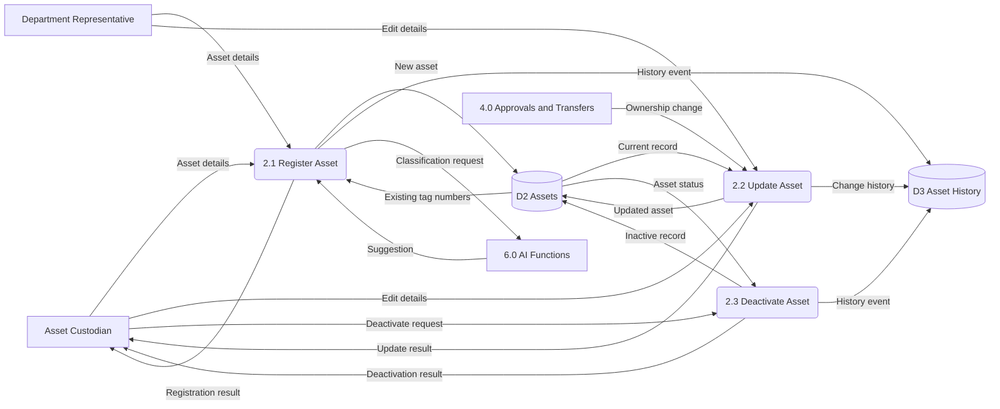
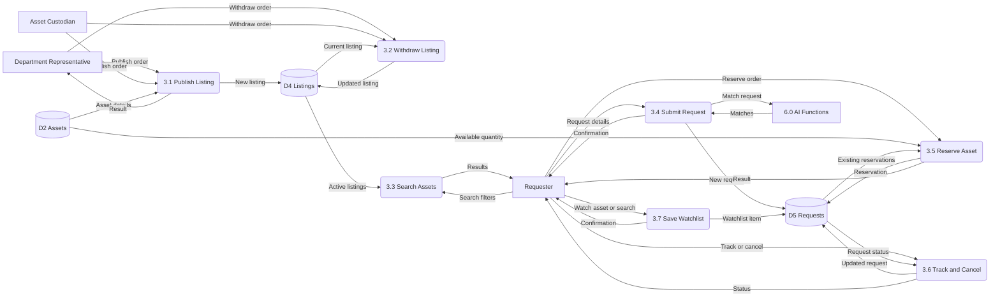
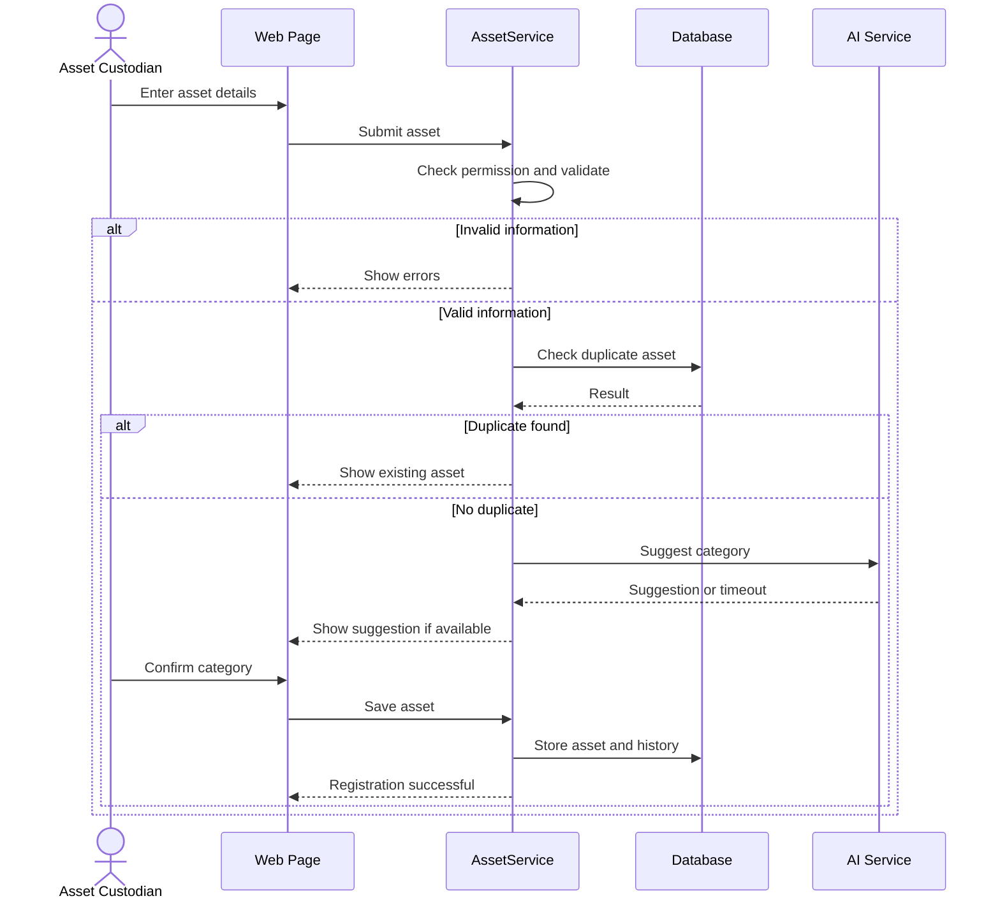
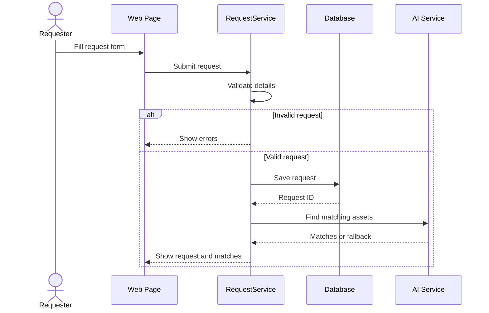
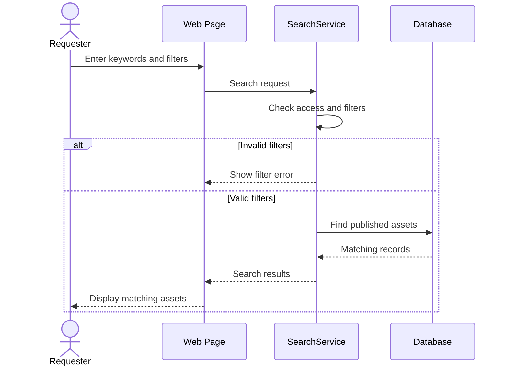

# Phase 4 & 5 – Part 1: Assets, Marketplace and Requests

**Use Cases:** UC-01 to UC-10

**Requirement Groups:** FR-AST, FR-MKT, FR-REQ, FR-SRC, FR-RSV

**Data Stores:** D2 Assets, D4 Listings, D5 Requests and Reservations. D3 Asset History is also updated, but belongs to Part 2.

**Tables:** CATEGORY, ASSET, ASSET_MEDIA, LISTING, REQUEST, RESERVATION, WATCHLIST_ITEM

The shared architecture, context diagram, Level 0 DFD, and ER diagram are in `00_architecture_and_shared_design.md`.

---

# 1. Data Flow Diagrams – Level 1

Level 1 Data Flow Diagrams show how the main processes from the Level 0 DFD are divided into smaller processes.

This part covers Process 2.0 (Manage Assets) and Process 3.0 (Handle Marketplace and Requests).

## 1.1 Process 2.0 – Manage Assets

This process handles asset registration, editing, and deactivation.

Asset Custodians and Department Representatives provide asset details. The system validates and saves the information in D2 Assets.

Important changes are also recorded in D3 Asset History.

### Process Description

| Process | Description | Requirements |
|---|---|---|
| 2.1 Register Asset | Checks asset information, prevents duplicate tag numbers, gets an optional AI category suggestion, and saves the asset | FR-AST-01 to 08, FR-AI-01 to 15 |
| 2.2 Update Asset | Changes asset information and records the previous values in history | FR-AST-09, BR-13 |
| 2.3 Deactivate Asset | Marks an asset as inactive | FR-AST-10 |

The main data stores used by this process are:

- **D2 Assets:** Contains the current asset information.
- **D3 Asset History:** Stores important changes made to assets.

The AI module can suggest asset categories during registration, but the user confirms the final category.

---

## 1.2 Process 3.0 – Handle Marketplace and Requests

This process handles publishing assets, withdrawing listings, searching, submitting requests, making reservations, tracking requests, cancelling requests, and saving watchlists.

### Process Description

| Process | Description | Requirements |
|---|---|---|
| 3.1 Publish Listing | Publishes a registered asset on the marketplace | FR-MKT-01, FR-MKT-02 |
| 3.2 Withdraw Listing | Removes an active listing from the marketplace | FR-MKT-03 |
| 3.3 Search Assets | Searches and filters published assets | FR-SRC-01 to 05 |
| 3.4 Submit Request | Creates a resource request and asks AI for matching assets | FR-REQ-01 to 06 |
| 3.5 Reserve Asset | Reserves an available asset after checking quantity and conflicts | FR-RSV-01 to 05 |
| 3.6 Track and Cancel | Displays request status and processes cancellation when allowed | FR-REQ-07 to 09 |
| 3.7 Save Watchlist | Saves an asset or search to the user's watchlist | FR-SRC-06, FR-SRC-07 |

The marketplace module also supports automatic listing expiry according to FR-MKT-04.

The main data stores are:

- **D2 Assets:** Contains the asset records.
- **D4 Listings:** Contains published marketplace listings.
- **D5 Requests and Reservations:** Contains requests, reservations, and watchlist information.

---

# 2. Sequence Diagrams

Sequence diagrams show how the user interface, services, and database interact when a user performs a function.

The following diagrams focus on the main actions and alternative outcomes.

## 2.1 UC-01 Register Asset

An Asset Custodian enters asset details. The system validates the information, checks for duplicates, and may use AI to suggest a category.

### Explanation

The Asset Custodian fills in the registration form.

The AssetService validates the submitted details and checks whether the asset already exists.

If the information is valid, the AI service may suggest a category. The user reviews the suggestion before the asset is saved.

If the AI service does not respond within 15 seconds, the user can choose the category manually.

The system then saves the asset and records the registration event in history.

---

## 2.2 UC-05 Submit Request

A Requester fills in a resource request. The system checks the details, saves the request, and looks for matching assets.

### Explanation

The Requester enters the category, purpose, quantity, urgency, location, and required date.

The system validates the input before saving the request.

If the information is valid, a request ID is generated and the request status becomes **Submitted**.

The AI service can suggest suitable assets based on the request information.

If AI is unavailable, the system can use normal search to find possible matches.

---

## 2.3 UC-06 Search and Filter Assets

The Requester enters keywords and filters. The system checks the input and searches published assets.

### Explanation

The Requester enters a keyword and may select filters such as category, department, condition, or location.

The SearchService checks the filters and retrieves matching published assets.

Only assets that the user is authorized to view are displayed.

If no assets match, the system displays **"No matching resources found"**.

---
