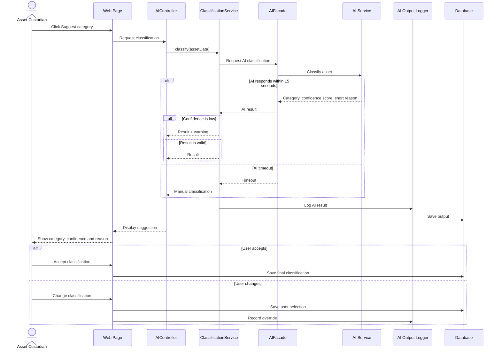
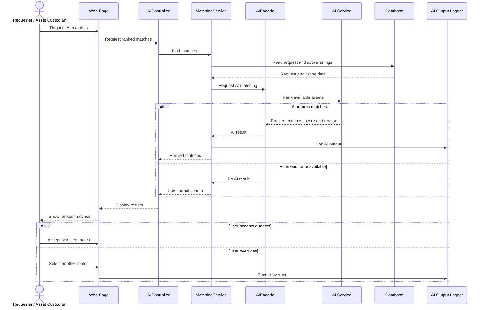
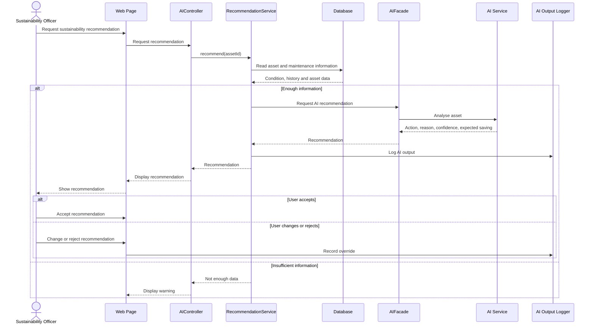
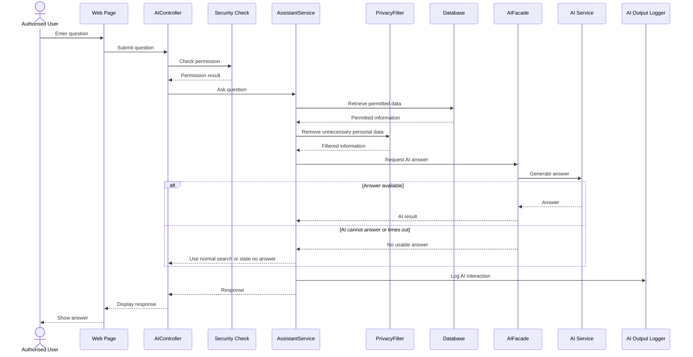
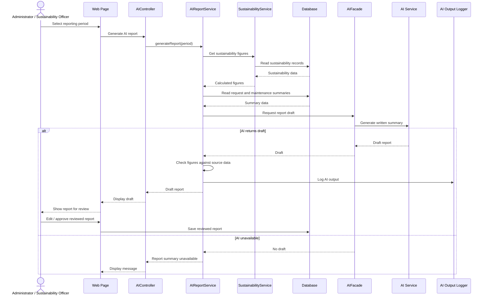
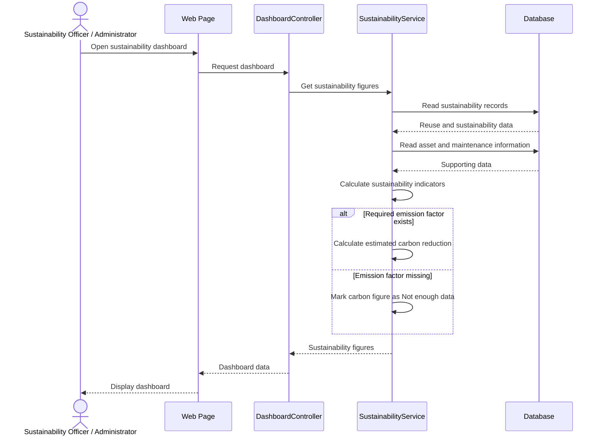
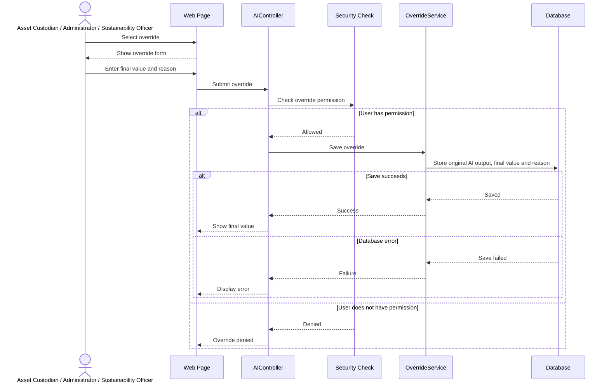
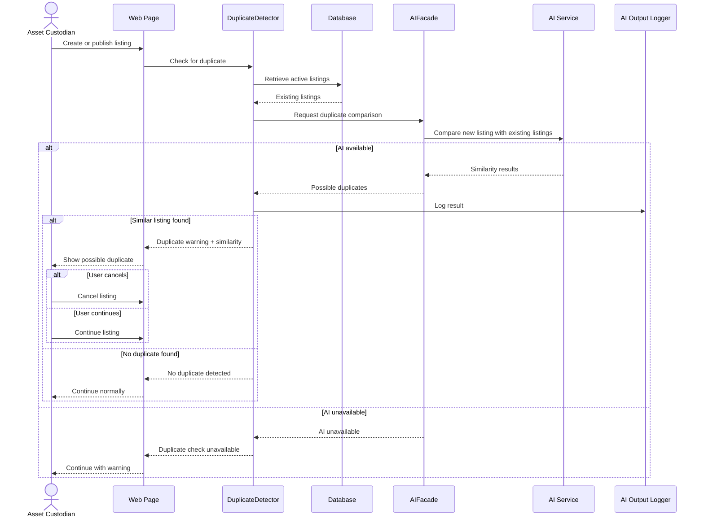
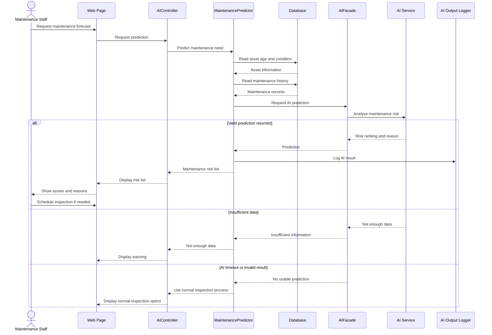
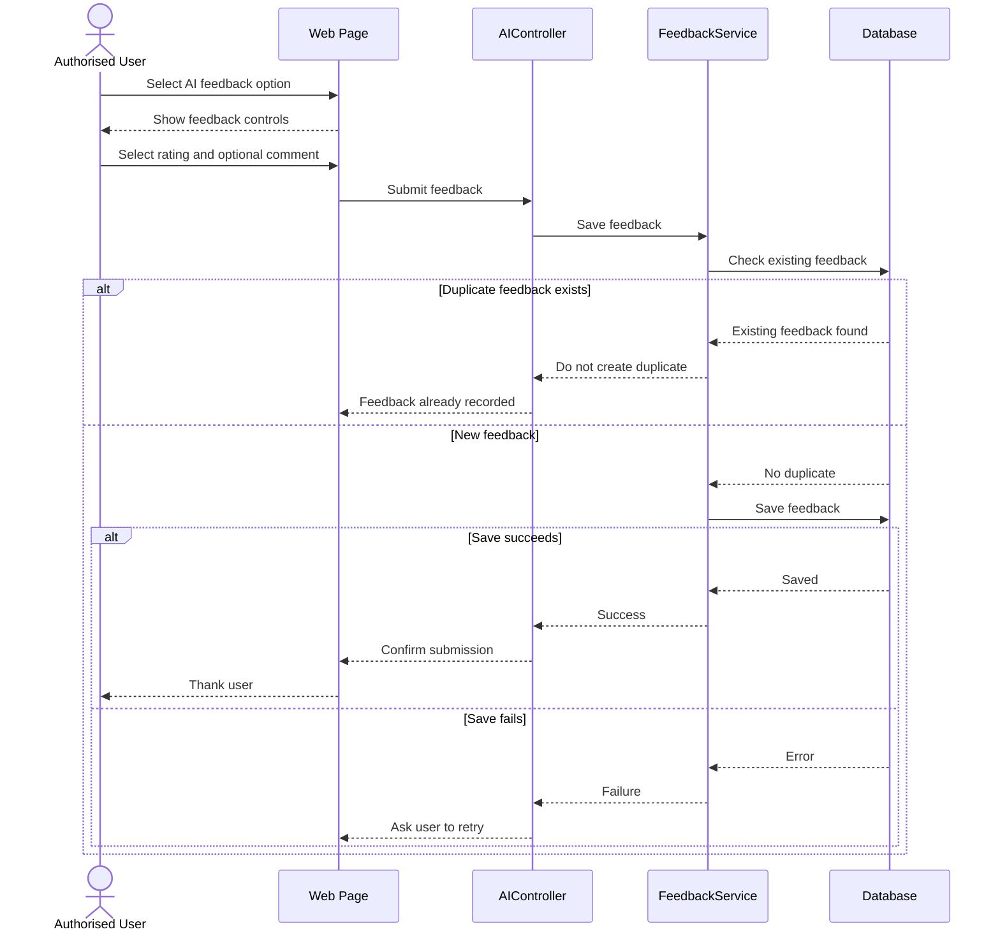

# Phase 4 & 5 – Part 4: AI Layer and Sustainability

**Owner:** Abdulla

**Use cases:** UC-26 to UC-35

**Requirement groups:** FR-AI-01 to FR-AI-70, FR-AI-X-01 to FR-AI-X-17, FR-SUS-01 to FR-SUS-31

**Data stores:** D10 AI Output Log, D11 Sustainability Records

**Tables:** AI_OUTPUT, AI_OVERRIDE, AI_FEEDBACK, REUSE_EVENT, EMISSION_FACTOR

**Common AI Integration Path:**

Service → AI Facade → Privacy Filter → AI Adapter → AI Service → Answer Checker → AI Output Log

# 1. Sequence Diagrams and Use Cases

## 1.1 UC-26 – Classify Asset

### Use Case Details

| Field | Description |
|---|---|
| Use Case ID | UC-26 |
| Name | Classify Asset |
| Primary Actor | Asset Custodian |
| Secondary Actor | AI Service |
| Goal | Obtain an AI-generated suggested category for an asset. |
| Preconditions | The asset has a name or description available for classification. |
| Trigger | The Asset Custodian registers or edits an asset and requests a category suggestion. |
| Main Flow | 1. The Asset Custodian requests a category suggestion. 2. The system sends the available asset text or photo information to the AI function. 3. The AI returns a suggested category, confidence score and short reason. 4. The system displays the result. 5. The Asset Custodian reviews the suggestion. 6. The user accepts or changes the category. 7. The system saves the final category and the AI suggestion. |
| Alternative Flow | A1. The AI does not answer within 15 seconds: the user selects a category manually. A2. The confidence is low: the system displays a warning. |
| Postconditions | The asset has a category selected by a person. |
| Business Rules | BR-11, BR-12 |
| Related Requirements | FR-AI-01 to FR-AI-15, FR-AI-X-01 to FR-AI-X-02 |

## 1.2 UC-27 – View, Accept or Override Match

### Use Case Details

| Field | Description |
|---|---|
| Use Case ID | UC-27 |
| Name | View, Accept or Override Match |
| Primary Actor | Requester / Asset Custodian |
| Secondary Actor | AI Service |
| Goal | Show ranked asset matches that may satisfy a request. |
| Preconditions | A valid request exists and suitable active listings are available for comparison. |
| Trigger | The user requests matching assets. |
| Main Flow | 1. The system retrieves the request and active listings. 2. The information is passed to the AI matching function. 3. The AI returns ranked matches with a score and reason. 4. The system displays the matches. 5. The user reviews the suggested matches. 6. The user accepts a match or selects another option. |
| Alternative Flow | A1. The AI does not return a usable result: the system falls back to the normal search process. A2. The user disagrees with the suggested match: the user overrides the result using UC-32. |
| Postconditions | The user has reviewed the AI-generated matches and may continue with a selected asset. |
| Business Rules | The AI recommendation does not automatically reserve, approve or transfer an asset. |
| Related Requirements | FR-AI-16 to FR-AI-35 |

## 1.3 UC-28 – Review Sustainability Recommendation

### Use Case Details

| Field | Description |
|---|---|
| Use Case ID | UC-28 |
| Name | Review Sustainability Recommendation |
| Primary Actor | Sustainability Officer |
| Secondary Actor | AI Service |
| Goal | Provide a sustainability recommendation for the next action that may be taken for an asset. |
| Preconditions | The asset exists and relevant asset condition or maintenance information is available. |
| Trigger | The Sustainability Officer requests a sustainability recommendation. |
| Main Flow | 1. The system retrieves the asset condition and history. 2. The information is passed to the AI function. 3. The AI generates a recommendation, reason, confidence and expected saving. 4. The system displays the recommendation. 5. The Sustainability Officer reviews it. 6. The officer accepts, changes or rejects the recommendation. |
| Alternative Flow | A1. There is not enough information to generate a useful recommendation: the system displays a warning. |
| Postconditions | The recommendation has been reviewed by the Sustainability Officer. |
| Business Rules | AI recommendations require human review. Disposal is treated as the last option. |
| Related Requirements | FR-AI-36 to FR-AI-49, FR-SUS-27 to FR-SUS-31 |

## 1.4 UC-29 – Ask the Assistant

### Use Case Details

| Field | Description |
|---|---|
| Use Case ID | UC-29 |
| Name | Ask the Assistant |
| Primary Actor | Authorised User |
| Secondary Actor | AI Service |
| Goal | Allow users to ask questions about the system using natural language. |
| Preconditions | The user is logged in and has permission to access the requested information. |
| Trigger | The user submits a question to the assistant. |
| Main Flow | 1. The user enters a natural-language question. 2. The system checks the user's permissions. 3. Only permitted data is retrieved. 4. The information is passed through the privacy filter. 5. The AI generates an answer. 6. The system displays the answer to the user. 7. The AI output is logged. |
| Alternative Flow | A1. The requested information is not available: the assistant states that it does not have enough information. A2. The AI does not respond: the system falls back to normal search where appropriate. |
| Postconditions | The user receives an answer or an indication that the information is unavailable. |
| Business Rules | The assistant must not guess when information is unavailable. The assistant cannot change asset data or perform approval actions. |
| Related Requirements | FR-AI-50 to FR-AI-59 |

## 1.5 UC-30 – Generate AI Report

### Use Case Details

| Field | Description |
|---|---|
| Use Case ID | UC-30 |
| Name | Generate AI Report |
| Primary Actor | Administrator / Sustainability Officer |
| Secondary Actor | AI Service |
| Goal | Generate a draft written report using recorded system information. |
| Preconditions | The user has permission to generate the report and the required source data is available. |
| Trigger | The user selects a reporting period and requests an AI-generated report. |
| Main Flow | 1. The system gathers the required sustainability, request and maintenance information. 2. The information is passed to the AI report function. 3. The AI generates a draft summary. 4. Important figures are checked against the underlying data. 5. The draft is displayed to the user. 6. The user edits and reviews the draft. 7. The reviewed report is saved. |
| Alternative Flow | A1. The AI does not respond: the report summary is not generated. A2. A figure does not agree with the source data: the user is informed so the report can be checked. |
| Postconditions | A human-reviewed report may be saved. |
| Business Rules | AI-generated reports remain drafts until checked by an authorised person. |
| Related Requirements | FR-AI-60 to FR-AI-70 |

## 1.6 UC-31 – View Sustainability Dashboard

### Use Case Details

| Field | Description |
|---|---|
| Use Case ID | UC-31 |
| Name | View Sustainability Dashboard |
| Primary Actor | Sustainability Officer / Administrator |
| Goal | Display sustainability information calculated from recorded reuse and asset lifecycle activity. |
| Preconditions | Relevant sustainability information is available in the system. |
| Trigger | The authorised user opens the Sustainability Dashboard. |
| Main Flow | 1. The user opens the dashboard. 2. The system retrieves sustainability records. 3. The system calculates the available sustainability figures. 4. Estimated figures and assumptions are identified. 5. The dashboard displays the results. |
| Alternative Flow | A1. Required information such as an emission factor is unavailable: the affected figure is shown as unavailable or not enough data. |
| Postconditions | The user can view the available sustainability information. |
| Business Rules | Estimated figures must be shown as estimates and the source or assumptions must be available. |
| Related Requirements | FR-SUS-01 to FR-SUS-31 |

## 1.7 UC-32 – Override an AI Output

### Use Case Details

| Field | Description |
|---|---|
| Use Case ID | UC-32 |
| Name | Override an AI Output |
| Primary Actor | Asset Custodian / Administrator / Sustainability Officer |
| Goal | Allow an authorised person to reject or change an AI-generated output. |
| Preconditions | An AI output exists and the user has permission to override it. |
| Trigger | The user chooses to change or reject an AI output. |
| Main Flow | 1. The system displays the AI output. 2. The user selects the override option. 3. The user provides the final value and reason. 4. The system checks permission. 5. The override is stored. 6. The original AI output and final human decision remain recorded. |
| Alternative Flow | A1. The user cancels the override: no change is saved. |
| Postconditions | The final human-selected value and override reason are recorded. |
| Business Rules | The authorised human decision is the final decision. |
| Related Requirements | FR-AI-X-03 to FR-AI-X-04, BR-12 |

## 1.8 UC-33 – Detect Duplicate Listings

### Use Case Details

| Field | Description |
|---|---|
| Use Case ID | UC-33 |
| Name | Detect Duplicate Listings |
| Primary Actor | Asset Custodian |
| Secondary Actor | AI Service |
| Goal | Warn the Asset Custodian when a new listing may duplicate an existing listing. |
| Preconditions | A new listing has been entered and existing listings are available for comparison. |
| Trigger | The Asset Custodian creates or publishes a listing. |
| Main Flow | 1. The system retrieves existing listings. 2. The new listing is compared with existing listings. 3. The AI returns similarity information. 4. If a possible duplicate exists, the system displays a warning. 5. The Asset Custodian decides whether to cancel or continue. |
| Alternative Flow | A1. No duplicate is found: the listing continues normally. A2. The AI service is unavailable: the user is informed that the duplicate check could not be completed. |
| Postconditions | The Asset Custodian decides whether the new listing should continue. |
| Business Rules | The system does not automatically merge or delete listings. A human makes the final decision. |
| Related Requirements | No dedicated functional requirement was assigned in Phase 3. This must be confirmed with the group. |

## 1.9 UC-34 – Predict Maintenance Need

### Use Case Details

| Field | Description |
|---|---|
| Use Case ID | UC-34 |
| Name | Predict Maintenance Need |
| Primary Actor | Maintenance Staff |
| Secondary Actor | AI Service |
| Goal | Identify assets that may need maintenance or inspection. |
| Preconditions | Asset age, condition or maintenance history is available. |
| Trigger | Maintenance Staff requests the maintenance prediction view. |
| Main Flow | 1. The system retrieves asset and maintenance information. 2. The AI analyses the available data. 3. The AI returns a risk ranking and reason. 4. The system displays the result. 5. Maintenance Staff reviews the prediction. 6. Maintenance Staff may schedule an inspection. |
| Alternative Flow | A1. There is insufficient data: the system displays that there is not enough information. A2. The AI does not return a valid result: normal inspection procedures are used. |
| Postconditions | Maintenance Staff has reviewed the predicted maintenance risks. |
| Business Rules | AI maintenance predictions are advisory. Maintenance actions remain under human control. |
| Related Requirements | No dedicated functional requirement was assigned in Phase 3. This must be confirmed with the group. |

## 1.10 UC-35 – Submit AI Feedback

### Use Case Details

| Field | Description |
|---|---|
| Use Case ID | UC-35 |
| Name | Submit AI Feedback |
| Primary Actor | Authorised User |
| Goal | Allow users to provide feedback about an AI-generated output. |
| Preconditions | An AI output exists for the user to review. |
| Trigger | The user chooses to provide feedback on an AI output. |
| Main Flow | 1. The system displays the feedback controls. 2. The user chooses a rating and may enter a comment. 3. The system associates the feedback with the relevant AI output. 4. The feedback is saved. 5. The system confirms the submission. |
| Alternative Flow | A1. Feedback for the same output has already been submitted: the system avoids creating a duplicate. A2. The feedback cannot be stored: the user is allowed to retry. |
| Postconditions | The feedback is associated with the relevant AI output. |
| Business Rules | Feedback is linked to the specific AI output being reviewed. |
| Related Requirements | No dedicated functional requirement was assigned in Phase 3. This must be confirmed with the group. |

# 2. Class Diagrams

## 2.1 AI Module

The AI module contains the shared components used by the AI-enabled functions.

### Main Classes

| Class | Responsibility |
|---|---|
| AIFacade | Provides a controlled entry point to AI functionality. |
| PrivacyFilter | Removes unnecessary personal information before external AI processing. |
| AIAdapter | Defines a common interface for AI providers. |
| LlmAdapter | Connects the system to the selected LLM service. |
| FallbackService | Provides non-AI behaviour when the AI service is unavailable. |
| AnswerChecker | Checks AI results before they are returned to the user. |
| AIOutputLogger | Records AI outputs and related information. |
| AIResult | Represents the result returned by an AI function. |
| AIOutput | Represents a stored AI output. |
| AIOverride | Records a human override of an AI output. |
| AIFeedback | Stores feedback about an AI output. |

### AI Design Rules

- AI outputs are recommendations.
- Human approval remains required for controlled decisions.
- Personal information should be removed before external AI processing where possible.
- AI outputs should be logged.
- Model and prompt versions should be recorded where available.
- AI functions should have fallback behaviour where appropriate.
- Low-confidence outputs should be clearly indicated.

## 2.2 AI Functions and Sustainability

### Main Services

| Service | Responsibility |
|---|---|
| ClassificationService | Performs AI-assisted asset classification. |
| MatchingService | Matches requests with available assets. |
| RecommendationService | Generates sustainability recommendations. |
| AssistantService | Handles natural-language questions. |
| AIReportService | Generates AI-assisted reports. |
| DuplicateDetector | Detects possible duplicate listings. |
| MaintenancePredictor | Identifies possible maintenance needs. |
| OverrideService | Records human overrides of AI outputs. |
| FeedbackService | Stores user feedback about AI outputs. |
| SustainabilityService | Calculates sustainability figures. |

### Sustainability Data Classes

| Class | Responsibility |
|---|---|
| ReuseEvent | Records reuse activity. |
| EmissionFactor | Stores carbon-emission factors and their sources. |
| Figures | Represents calculated sustainability figures and assumptions. |

# 3. User Interface Mockups

## 3.1 AI Match Review

The AI Match Review interface contains:

- Ranked asset matches
- Compatibility score
- Match explanation
- Confidence information
- Low-confidence warning
- Accept match option
- Choose another asset option
- Feedback control

## 3.2 Sustainability Recommendation

The Sustainability Recommendation interface contains:

- Recommended action
- Confidence
- Explanation
- Expected saving where available
- Accept option
- Change option
- Reject option
- Override reason

The AI recommendation does not automatically approve the action.

## 3.3 Assistant Interface

The Assistant interface contains:

- Natural-language question input
- AI answer
- Relevant asset or system information where permitted
- A message when information is unavailable
- Feedback controls

## 3.4 AI Report Review

The AI Report Review interface contains:

- Report title
- Reporting period
- AI-generated draft
- Generated summary
- Figure-check warnings
- Edit option
- Regenerate option
- Mark as reviewed option

## 3.5 Sustainability Dashboard

The Sustainability Dashboard displays available sustainability figures including:

- Assets reused
- Avoided purchases
- Waste diversion
- Reuse rate
- Repair rate
- Estimated financial savings
- Estimated carbon reduction
- Asset-life extension
- Assumptions and data-source information

## 3.6 Duplicate Warning and Maintenance Forecast

The Duplicate Warning interface contains:

- New listing information
- Possible existing duplicate
- Similarity information
- Cancel option
- Continue option

The Maintenance Forecast interface contains:

- Asset information
- Maintenance risk
- Reason
- Not enough data indicator where required
- Schedule inspection option

# 4. Traceability

| Design Element | Use Case | Related Requirements |
|---|---|---|
| Sequence 1.1 | UC-26 Classify Asset | FR-AI-01 to FR-AI-15, FR-AI-X-01 to FR-AI-X-02 |
| Sequence 1.2 | UC-27 AI Match | FR-AI-16 to FR-AI-35 |
| Sequence 1.3 | UC-28 Sustainability Recommendation | FR-AI-36 to FR-AI-49, FR-SUS-27 to FR-SUS-31 |
| Sequence 1.4 | UC-29 Assistant | FR-AI-50 to FR-AI-59 |
| Sequence 1.5 | UC-30 AI Report | FR-AI-60 to FR-AI-70 |
| Sequence 1.6 | UC-31 Sustainability Dashboard | FR-SUS-01 to FR-SUS-31 |
| Sequence 1.7 | UC-32 AI Override | FR-AI-X-03 to FR-AI-X-04, BR-12 |
| Sequence 1.8 | UC-33 Duplicate Detection | No dedicated FR in Phase 3 – confirm with group |
| Sequence 1.9 | UC-34 Maintenance Prediction | No dedicated FR in Phase 3 – confirm with group |
| Sequence 1.10 | UC-35 AI Feedback | No dedicated FR in Phase 3 – confirm with group |
| AI Module | All AI use cases | FR-AI-X-05 to FR-AI-X-17 |
| Sustainability Module | UC-28 and UC-31 | FR-SUS-01 to FR-SUS-31 |
