# Phase 4 & 5 – Part 1: Assets, Marketplace and Requests

**Use Cases:** UC-01 to UC-10

**Requirement Groups:** FR-AST, FR-MKT, FR-REQ, FR-SRC, FR-RSV

**Main Classes:** Asset, Category, AssetMedia, Listing, Request, Reservation, WatchlistItem

The shared architecture, context diagram, Level 0 DFD, and ER diagram are documented in `00_architecture_and_shared_design.md`.

The Data Flow Diagrams for this part are handled separately by another team member.

---

# 1. Sequence Diagrams

Sequence diagrams show how users interact with the system and how information moves between the website, services, and database.

The diagrams below cover UC-01 to UC-10.

## 1.1 UC-01 Register Asset

This use case allows an Asset Custodian or Department Representative to register a new asset.

The system checks the asset details, prevents duplicates, and may use AI to suggest a category.

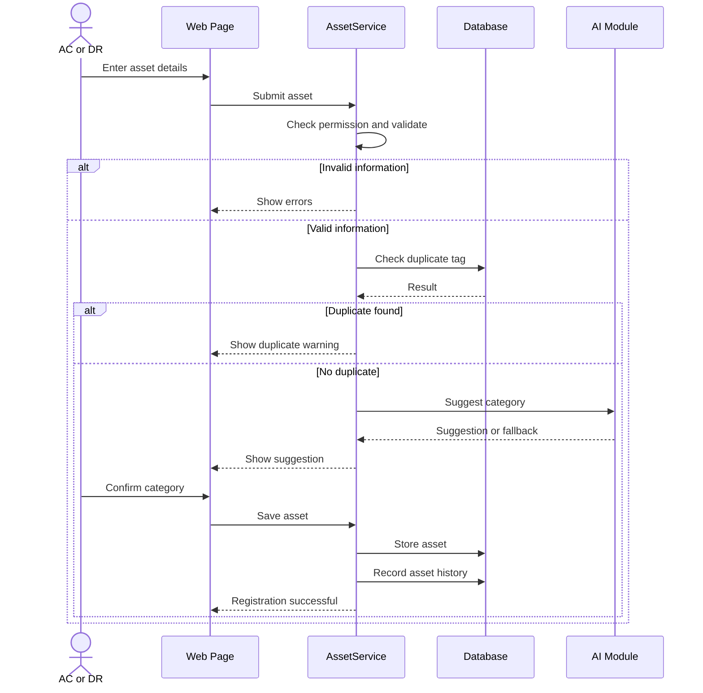

### Explanation

The user enters the asset information, such as name, category, quantity, condition, location, and department.

The system validates the information and checks whether the asset tag already exists.

AI may suggest a category, but the user confirms the final category.

If AI does not respond within 15 seconds, the user can choose the category manually.

Finally, the asset is saved and its registration is recorded in history.

**Related Requirements:** FR-AST, FR-AI, BR-11, BR-13.

---

## 1.2 UC-02 Edit Asset

This use case allows an authorized user to update an existing asset record.

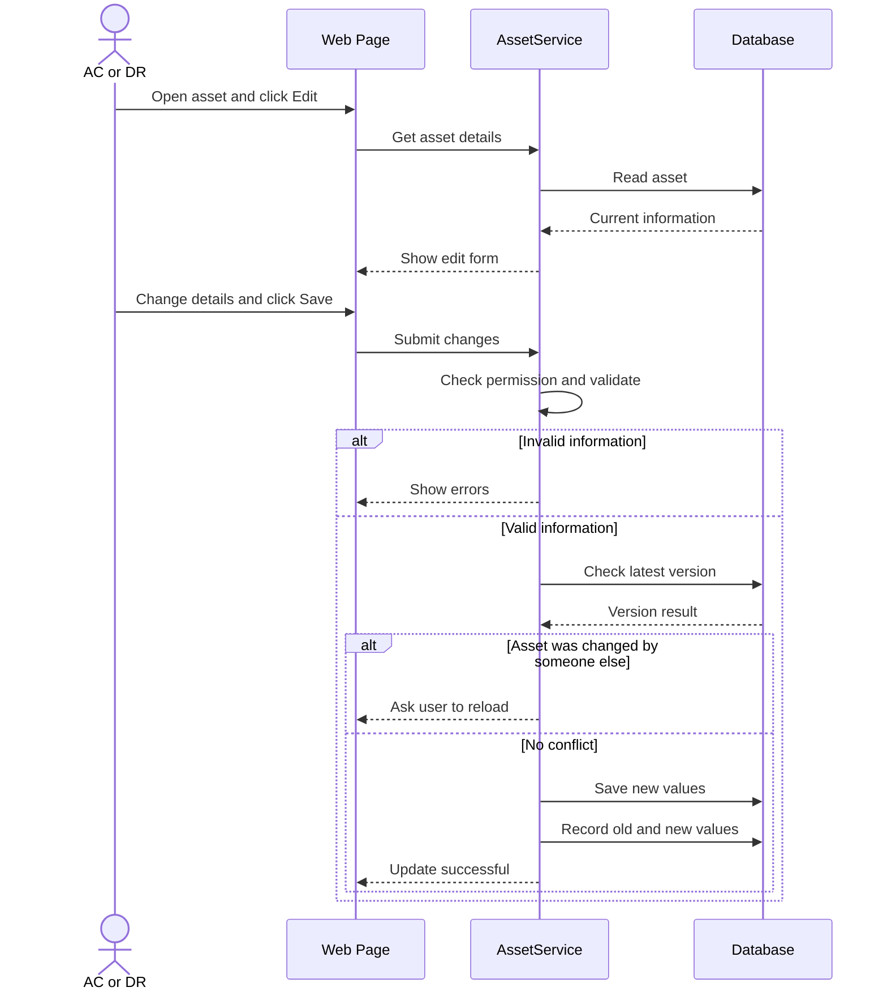

### Explanation

The user opens an existing asset and clicks Edit.

The system displays the current asset information.

After the user makes changes, the system validates them.

If the asset was already modified by another user, the system asks the user to reload the latest version.

Otherwise, the changes are saved and the previous information remains in history.

**Related Requirements:** FR-AST, FR-HST, FR-AUD, BR-13, BR-14.

---

## 1.3 UC-03 Publish Surplus Asset

This use case allows an Asset Custodian or Department Representative to publish an unused asset in the marketplace.

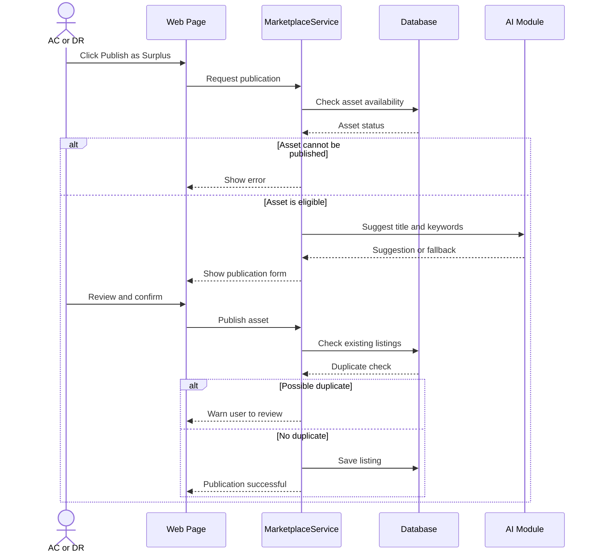

### Explanation

The user selects an asset and chooses Publish as Surplus.

The system checks whether the asset can be published.

AI may suggest a better title or keywords, but the user can change them.

The system also checks for possible duplicate listings.

If a duplicate is found, the user is warned and can review it before deciding whether to continue.

When publication is confirmed, the listing becomes available to authorized users.

**Related Requirements:** FR-MKT, FR-AI, FR-NTF, BR-11, BR-13.

---

## 1.4 UC-04 Withdraw Listing

This use case allows an authorized user to remove a marketplace listing.

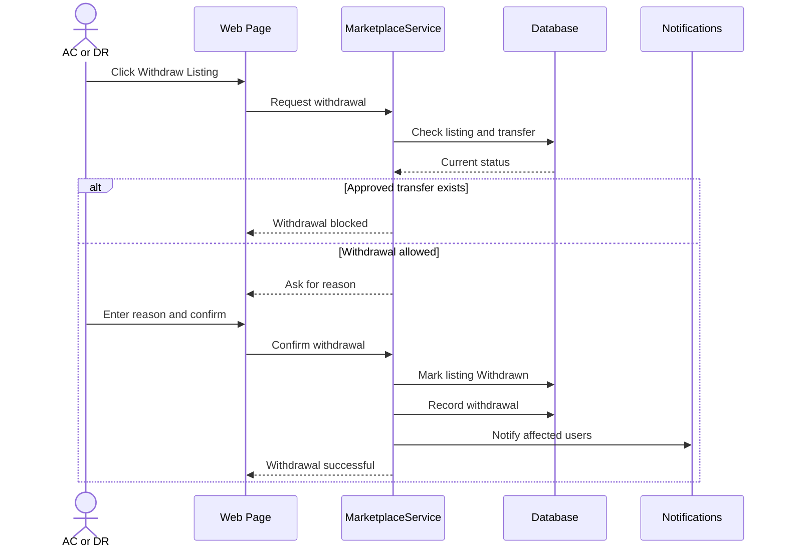

### Explanation

The user selects Withdraw Listing.

The system checks whether an approved transfer is already in progress.

If an approved transfer exists, withdrawal is blocked.

Otherwise, the user enters a reason and confirms.

The system marks the listing as Withdrawn and notifies affected requesters.

**Related Requirements:** FR-MKT, FR-NTF, BR-06, BR-14.

---

## 1.5 UC-05 Submit Request

This use case allows a Requester to submit a request for a resource.

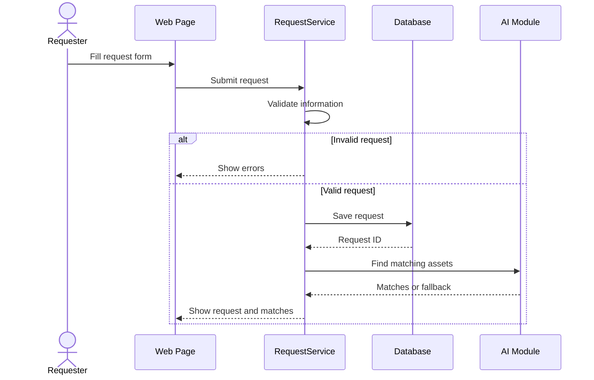

### Explanation

The Requester enters the category, purpose, quantity, urgency, location, and required date.

The system checks the information and creates the request.

The request receives a unique ID and its status becomes Submitted.

AI may suggest matching assets based on the request details.

If AI is unavailable, the system uses normal search as a fallback.

**Related Requirements:** FR-REQ, FR-AI, NFR-04.

---

## 1.6 UC-06 Search and Filter Assets

This use case allows users to search for available assets using keywords and filters.

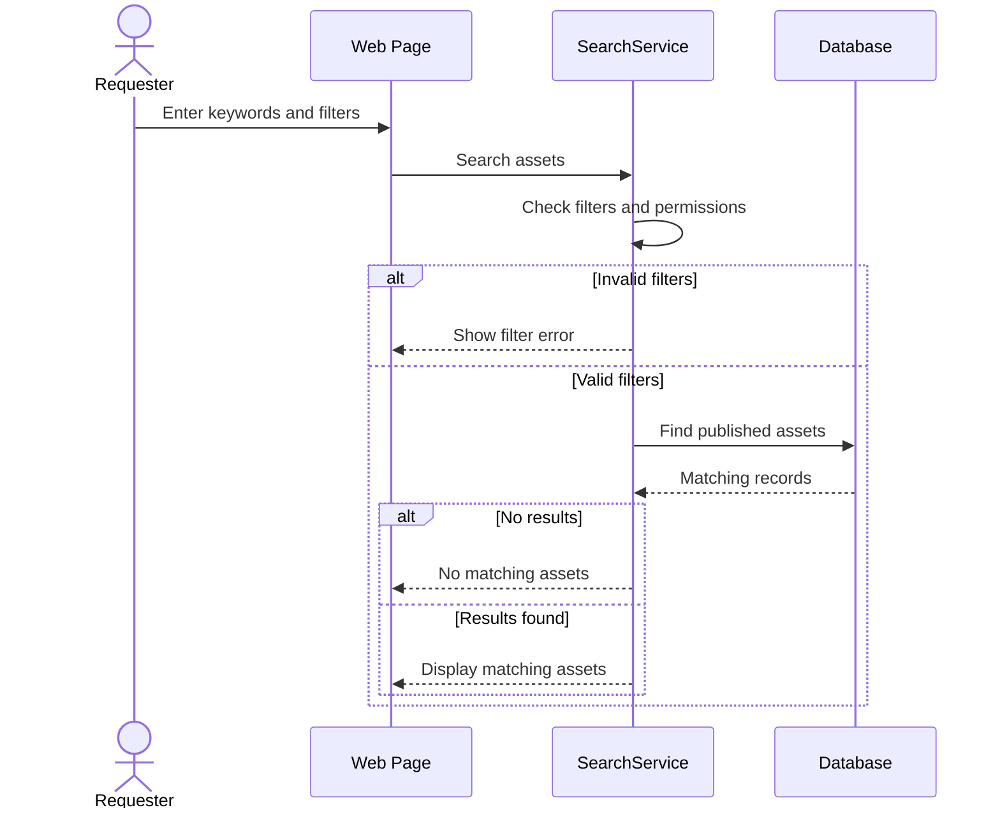

### Explanation

The user enters keywords and may filter assets by category, condition, department, location, quantity, or other criteria.

The system validates the filters and searches available listings.

Only assets that the user is authorized to view are displayed.

If no assets match, the system displays "No matching resources found".

**Related Requirements:** FR-SRC, FR-MKT, NFR-02.

---

## 1.7 UC-07 Reserve Asset

This use case allows a Requester to reserve an available asset.

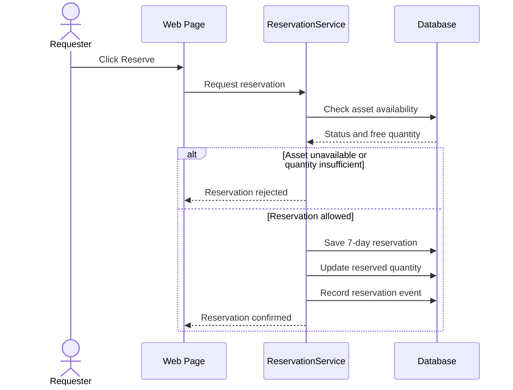

### Explanation

The Requester selects an available asset and clicks Reserve.

The system checks the asset's availability and existing reservations.

If the requested quantity is not available, the reservation is rejected.

Otherwise, the system creates the reservation.

The reservation expires after seven days if the required approval is not completed.

**Related Requirements:** FR-RSV, BR-04.

---

## 1.8 UC-08 Track Request

This use case allows a Requester to check the progress of an existing request.

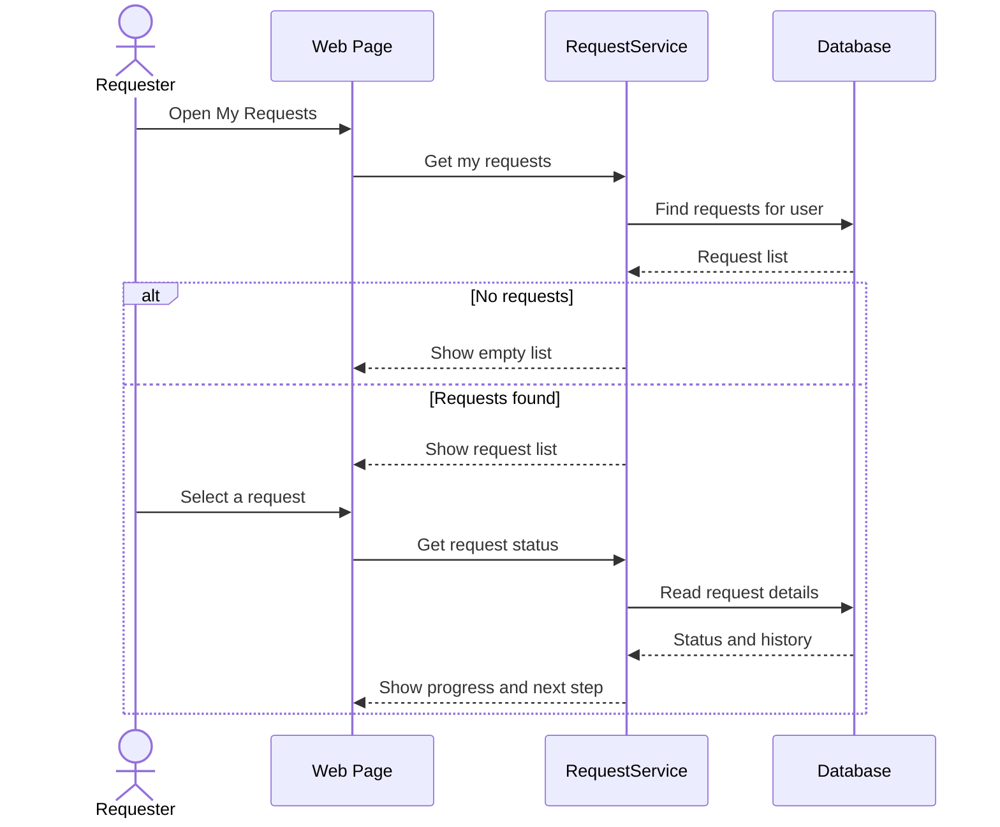

### Explanation

The Requester opens the My Requests page.

The system retrieves the user's requests and displays their current statuses.

When the user selects a request, the system shows the status, progress, and next required action.

If the user has no requests, an empty-list message is displayed.

**Related Requirements:** FR-REQ, FR-HST.

---

## 1.9 UC-09 Cancel Request

This use case allows a Requester to cancel a request that is no longer needed.

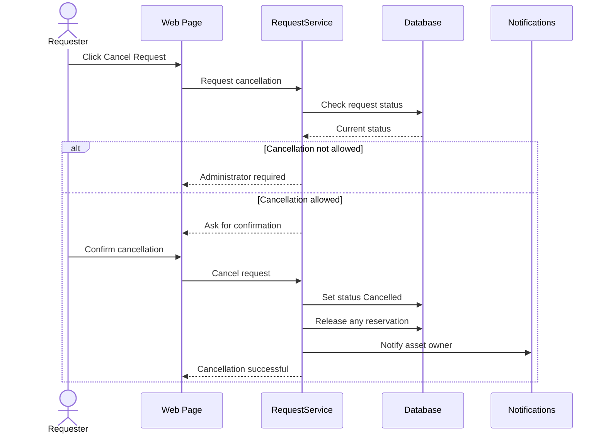

### Explanation

The Requester selects Cancel Request.

The system checks whether the request is still eligible for cancellation.

If a transfer has already been approved, the Requester must contact an Administrator.

Otherwise, the request is cancelled and any active reservation is released.

The asset owner is also notified.

**Related Requirements:** FR-REQ, FR-RSV, BR-04, BR-14.

---

## 1.10 UC-10 Save Asset to Watchlist

This use case allows a Requester to save an asset or search to their watchlist.

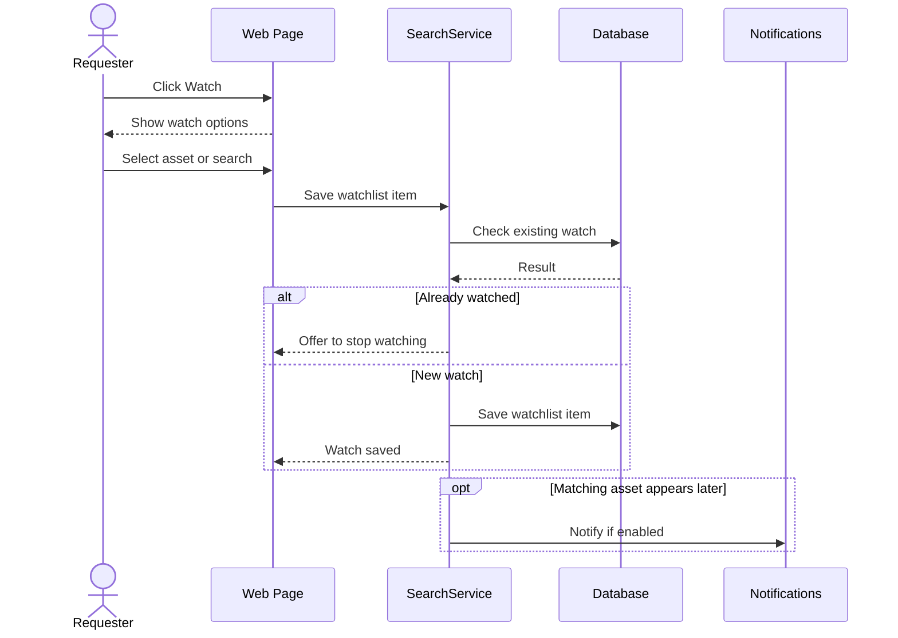

### Explanation

The Requester selects Watch on an asset or saved search.

The system checks whether it is already in the watchlist.

If it is not already saved, a new watchlist entry is created.

The system may notify the Requester when a matching asset becomes available, depending on notification settings.

**Related Requirements:** FR-SRC, FR-NTF.

---

## 1.11 Automatic Reservation Expiry

The system checks reservations automatically and releases those that have expired.

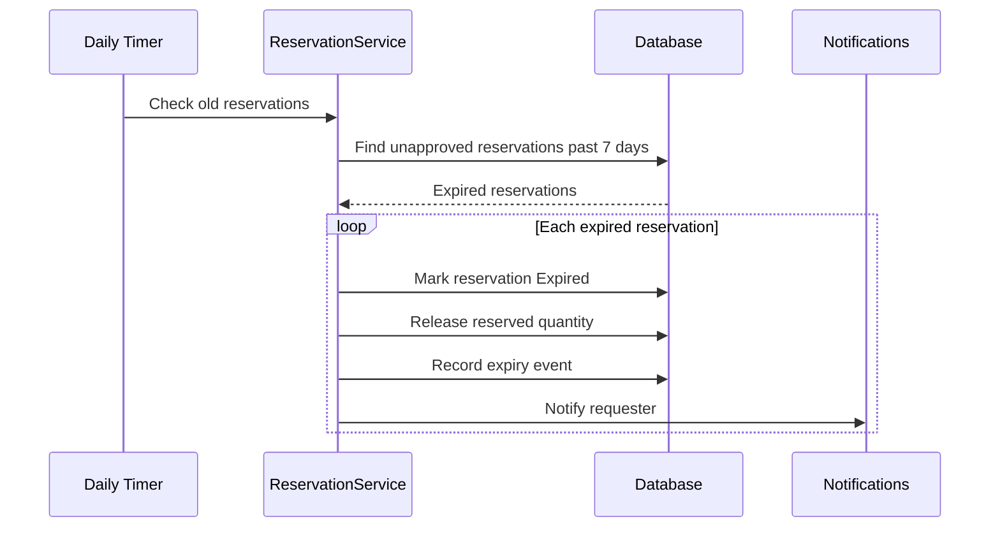

### Explanation

A daily timer starts the reservation expiry check.

The system identifies active reservations that have exceeded seven days without the required approval.

It marks them as Expired and releases the reserved quantity.

The Requester is notified about the expiry.

**Related Requirements:** FR-RSV-05, BR-04.

---

# 2. Class Diagram

The class diagram shows the main classes used in the asset, marketplace, and request modules.

Entity classes store information, while service classes handle system operations.

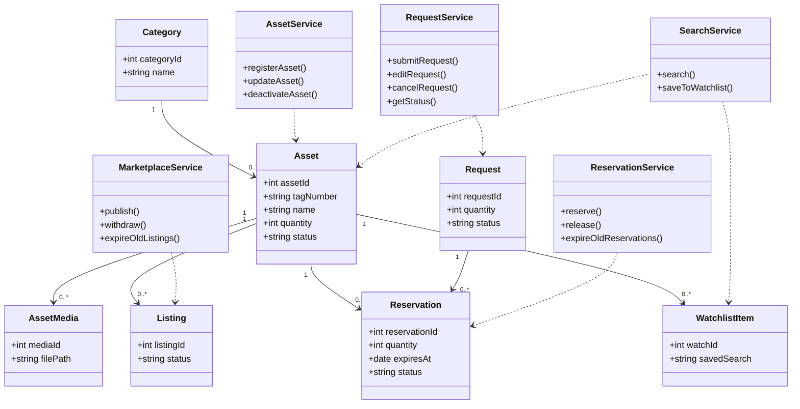

## 2.1 Main Classes

| Class | Purpose |
|---|---|
| Category | Stores asset categories |
| Asset | Stores the main asset information |
| AssetMedia | Stores references to photographs and documents |
| Listing | Represents an asset published on the marketplace |
| Request | Represents a resource request |
| Reservation | Stores reservation details and expiry |
| WatchlistItem | Represents a watched asset or saved search |

## 2.2 Service Classes

| Class | Responsibility | Related Requirements |
|---|---|---|
| AssetService | Register, edit, and deactivate assets | FR-AST-01 to 10 |
| MarketplaceService | Publish, withdraw, and expire listings | FR-MKT-01 to 04 |
| RequestService | Submit, edit, cancel, and track requests | FR-REQ-01 to 09 |
| SearchService | Search, filter, sort, and manage watchlists | FR-SRC-01 to 07 |
| ReservationService | Create, release, and expire reservations | FR-RSV-01 to 05 |

The class diagram is simplified to show the main classes and relationships.

The complete database structure is described in the shared ER diagram.

---

# 3. User Interface Mockups

The wireframes below show the main screens in the asset, marketplace, and request modules.

They are simple layouts showing the information and buttons needed by users.

## 3.1 Register Asset – UC-01

```text
+----------------------------------------------------------------------+
| Circular Campus          [Marketplace] [My Assets] [Requests]        |
+----------------------------------------------------------------------+
| Register New Asset                                                   |
|                                                                      |
| Name *           [__________________________]                        |
| Tag number *     [______________]                                    |
| Description      [____________________________________]              |
| Category *       [Select category v]                                 |
|                                                                      |
| AI suggestion: Laboratory chairs                                     |
| Confidence: 82%                       [Accept] [Change]              |
|                                                                      |
| Quantity *       [1]                                                 |
| Estimated value  [0.00] AED                                          |
| Department *     [Computer Science v]                                |
| Location *       [__________________________]                        |
| Purchase date    [yyyy-mm-dd]                                        |
|                                                                      |
| Condition *      ( ) Good  ( ) Fair  ( ) Needs repair                |
| Availability *   ( ) In use  ( ) Surplus                             |
|                                                                      |
| Photos           [Choose files]                                      |
| Documents        [Choose files]                                      |
|                                                                      |
| * Required               [Save as Draft] [Register]                  |
+----------------------------------------------------------------------+
```

### Screen Description

The Register Asset screen allows Asset Custodians and Department Representatives to create asset records.

The form includes the asset's name, tag number, category, quantity, department, location, condition, purchase date, estimated value, and attachments.

The system validates the information before saving.

An optional AI category suggestion may be accepted or changed by the user.

---

## 3.2 Marketplace and Search – UC-03, UC-04, UC-06, UC-07, UC-10

```text
+----------------------------------------------------------------------+
| Marketplace                                                          |
+----------------------------------------------------------------------+
| Search: [laboratory seating________________] [Search]                |
|                                                                      |
| Filters                 Sort by: [Publication Date v]                |
|                                                                      |
| Category    [v]          -------------------------------------       |
| Condition   [v]          Lab Bench Stool - Quantity: 20             |
| Department  [v]          Computer Science - Good                    |
| Location    [v]          AED 150 each                                |
| Quantity    [_]-[_]      [View] [Reserve] [Watch]                    |
|                                                                      |
| Value AED   [_]-[_]      -------------------------------------       |
| Age         [_]-[_]      Office Chair - Quantity: 6                 |
| Status      [v]          Business - Fair                             |
|                          AED 90 each                                 |
| [Apply Filters]          [View] [Reserve] [Watch]                    |
| [Save Search]                                                        |
|                                                                      |
|                         Page 1 of 3 [Previous] [Next]               |
+----------------------------------------------------------------------+
| No results: "No matching resources found"                            |
+----------------------------------------------------------------------+
```

### Screen Description

The marketplace screen allows authorized users to search published assets.

Users can filter results by category, condition, department, location, quantity, value, age, and status.

Requesters can view asset details, reserve available assets, watch assets, and save searches.

Authorized asset owners can publish or withdraw listings through the asset and listing details pages.

---

## 3.3 Create Request – UC-05

```text
+----------------------------------------------------------------------+
| New Resource Request                                                 |
+----------------------------------------------------------------------+
|                                                                      |
| Category *          [Furniture v]                                    |
| Purpose *           [____________________________]                   |
| Specifications      [____________________________]                   |
| Quantity *          [10]                                             |
| Preferred condition [Good v]                                         |
|                                                                      |
| Urgency *           ( ) Low  ( ) Medium  ( ) High                    |
| Location *          [____________________]                           |
| Required date *     [yyyy-mm-dd]                                     |
|                                                                      |
| [Cancel]                                  [Submit Request]            |
+----------------------------------------------------------------------+
| Request R-0042 created                                               |
|                                                                      |
| Suggested assets:                                                    |
| 1. Lab Bench Stool - Match 91%                 [View]                |
+----------------------------------------------------------------------+
```

### Screen Description

The Create Request screen allows Requesters to submit information about the resources they need.

The system validates the form and creates a new request.

After submission, matching assets may be suggested by the AI module.

---

## 3.4 My Requests and Reservations – UC-08, UC-09

```text
+----------------------------------------------------------------------+
| My Requests                                                          |
+----------------------------------------------------------------------+
|                                                                      |
| ID      Asset / Need       Status                 Reserved Until     |
| -------------------------------------------------------------------- |
| R-0042  Lab Seating x10    Matched / Reserved     2026-11-05         |
| R-0039  Projector x1       Approved               -                  |
| R-0031  Monitors x20       Submitted              -                  |
|                                                                      |
| [View Details]     [Edit]     [Cancel Request]                        |
|                                                                      |
| Cancellation blocked after transfer approval:                        |
| "Ask an administrator to cancel this request."                       |
+----------------------------------------------------------------------+
```

### Screen Description

The My Requests screen allows Requesters to check the progress of their requests.

It displays request status, reservation expiry date, and available actions.

The user can edit or cancel a request only when permitted by the workflow.

---

# 4. Traceability

The traceability table connects the Phase 4 and 5 design elements to the Phase 3 use cases and functional requirements.

| Design Element | Use Case | Related Requirements |
|---|---|---|
| Sequence 1.1, AssetService | UC-01 Register Asset | FR-AST-01 to 08, FR-AI |
| Sequence 1.2, AssetService | UC-02 Edit Asset | FR-AST-09, FR-HST, FR-AUD |
| Sequence 1.3, MarketplaceService | UC-03 Publish Surplus Asset | FR-MKT-01, FR-MKT-02 |
| Sequence 1.4, MarketplaceService | UC-04 Withdraw Listing | FR-MKT-03, FR-NTF |
| Sequence 1.5, RequestService | UC-05 Submit Request | FR-REQ-01 to 06 |
| Sequence 1.6, SearchService | UC-06 Search and Filter Assets | FR-SRC-01 to 05 |
| Sequence 1.7, ReservationService | UC-07 Reserve Asset | FR-RSV-01 to 05, BR-04 |
| Sequence 1.8, RequestService | UC-08 Track Request | FR-REQ-09 |
| Sequence 1.9, RequestService | UC-09 Cancel Request | FR-REQ-08, FR-RSV |
| Sequence 1.10, SearchService | UC-10 Save Asset to Watchlist | FR-SRC-06, FR-SRC-07 |
| Sequence 1.11, ReservationService | Automatic Reservation Expiry | FR-RSV-05, BR-04 |
| AssetService | Asset Deactivation | FR-AST-10 |
| RequestService | Request Editing | FR-REQ-07 |
| MarketplaceService | Automatic Listing Expiry | FR-MKT-04 |

## 4.1 Design Consistency

The sequence diagrams show the interactions between users, services, databases, and supporting modules.

The class diagram identifies the main entities and services used in the system.

The UI mockups show how users access these functions.

The DFDs are handled separately by another team member and should be checked against these designs when the full group document is assembled.
