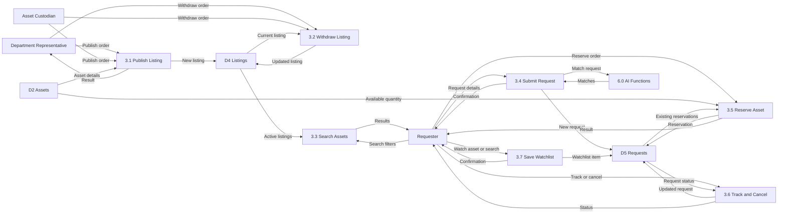
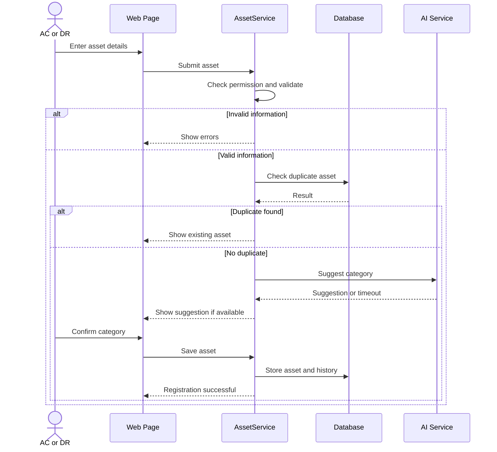
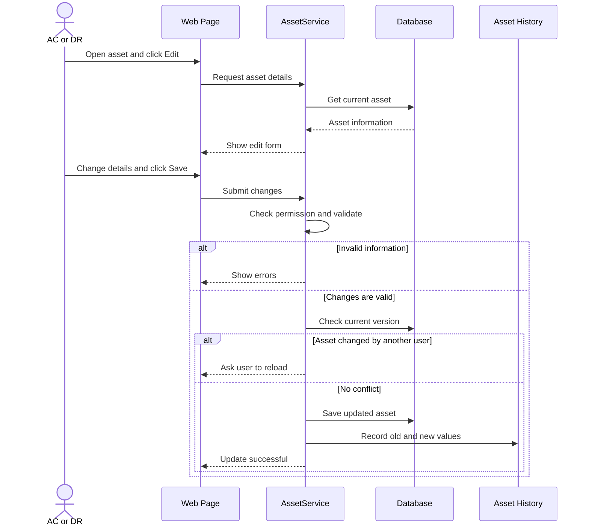
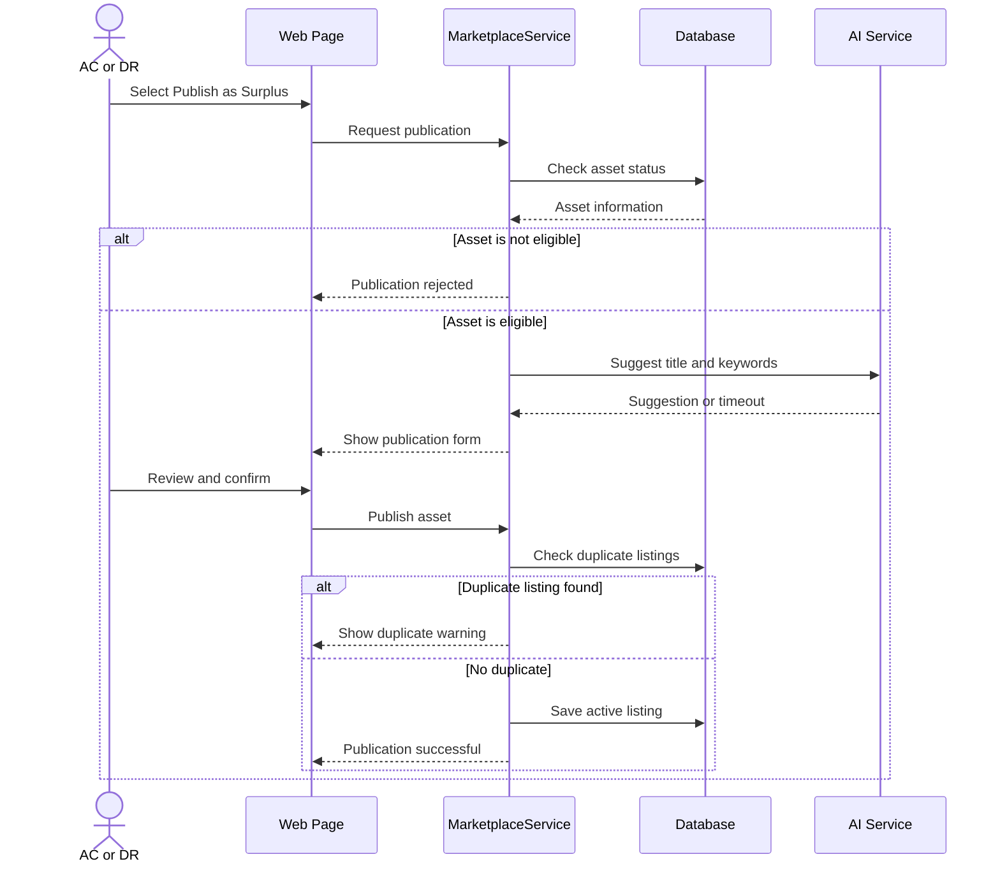
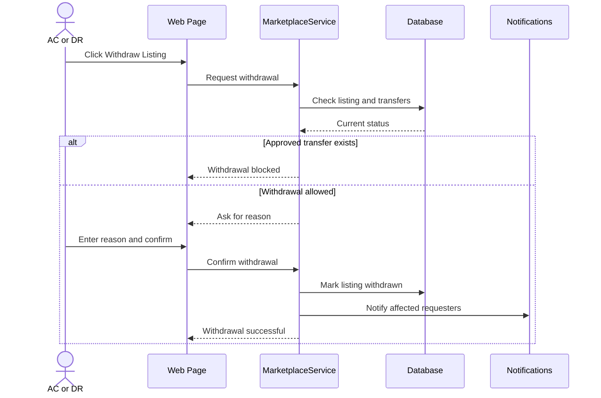
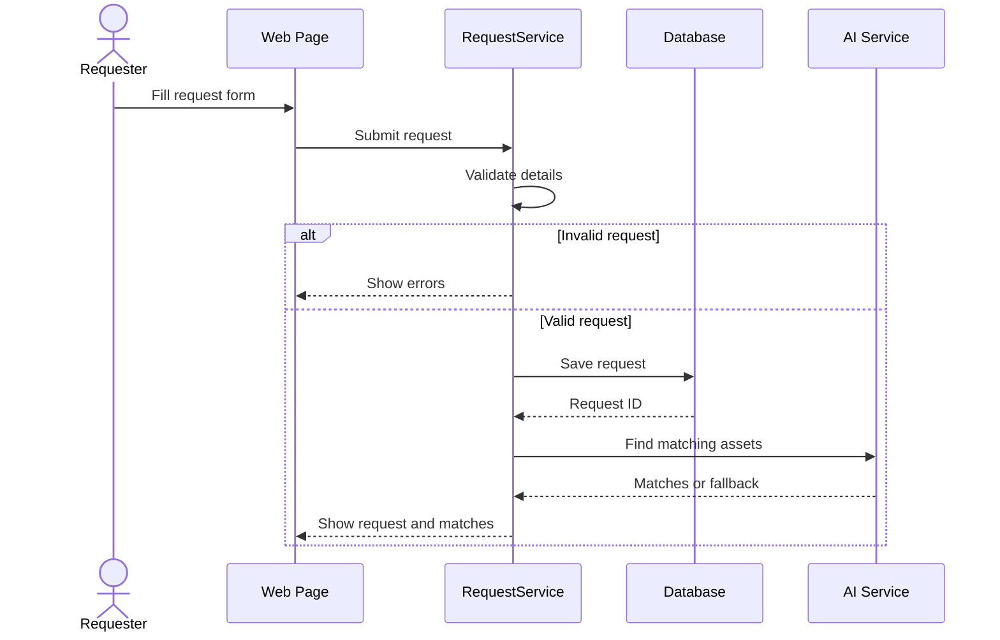
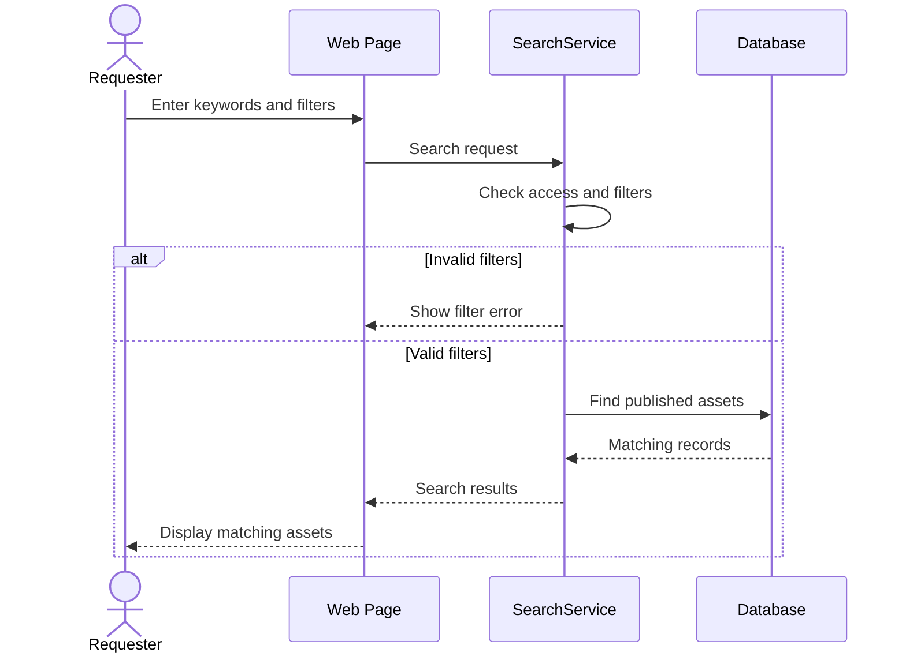
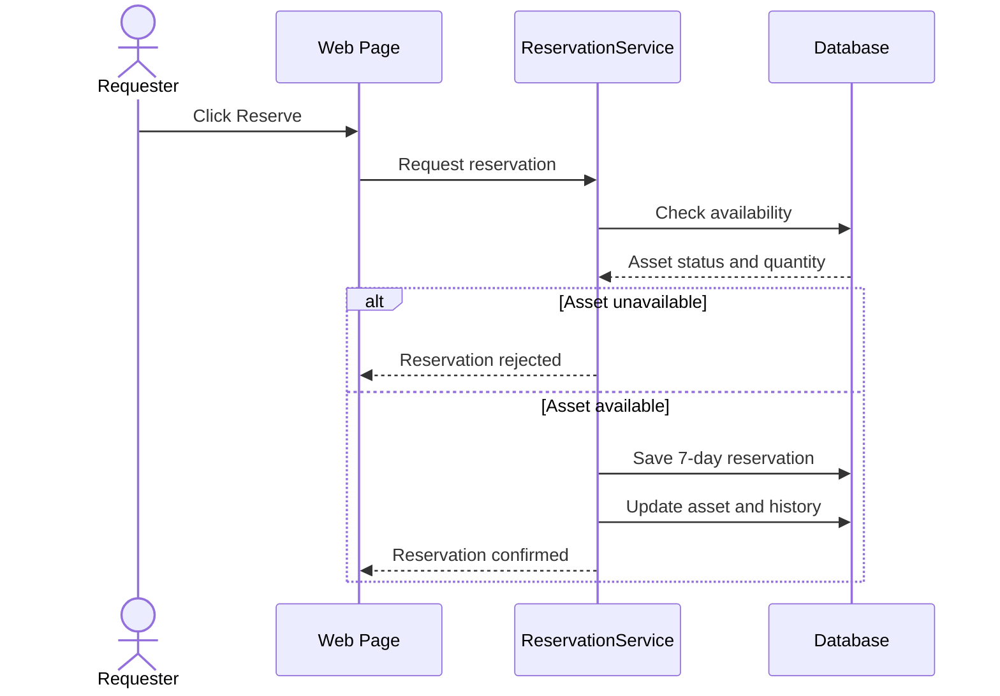
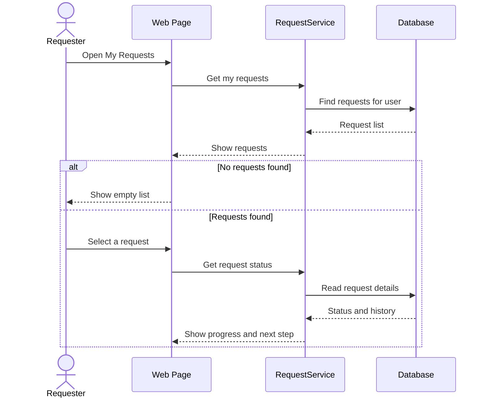

# Phase 4 & 5 – Part 1: Assets, Marketplace and Requests

**Use Cases:** UC-01 to UC-10

**Requirement Groups:** FR-AST, FR-MKT, FR-REQ, FR-SRC, FR-RSV

**Data Stores:** D2 Assets, D3 Asset History, D4 Listings, D5 Requests and Reservations

**Tables:** CATEGORY, ASSET, ASSET_MEDIA, LISTING, REQUEST, RESERVATION, WATCHLIST_ITEM

The shared architecture, context diagram, Level 0 DFD, ER diagram, and data rules are described in `00_architecture_and_shared_design.md`.

---

# 1. Data Flow Diagrams – Level 1

The Level 1 DFDs show how the main processes are divided into smaller processes.

This section covers asset management and marketplace/request management.

## 1.1 Process 2.0 – Manage Assets

This process handles asset registration, editing, and deactivation.

Asset Custodians and Department Representatives provide asset information. The system checks the information and saves it in D2 Assets. Important changes are recorded in D3 Asset History.

```mermaid
flowchart LR
    AC["Asset Custodian"]
    DR["Department Representative"]

    P21["2.1 Register Asset"]
    P22["2.2 Update Asset"]
    P23["2.3 Deactivate Asset"]

    D2["D2 Assets"]
    D3["D3 Asset History"]
    AI["6.0 AI Functions"]
    P4["4.0 Approvals and Transfers"]

    AC -->|Asset details| P21
    DR -->|Asset details| P21
    D2 -->|Existing tag numbers| P21
    P21 -->|New asset| D2
    P21 -->|History event| D3
    P21 -->|Classification request| AI
    AI -->|Suggestion| P21
    P21 -->|Registration result| AC

    AC -->|Edit details| P22
    DR -->|Edit details| P22
    D2 -->|Current record| P22
    P4 -->|Ownership change| P22
    P22 -->|Updated asset| D2
    P22 -->|Change history| D3
    P22 -->|Update result| AC

    AC -->|Deactivate request| P23
    D2 -->|Asset status| P23
    P23 -->|Inactive record| D2
    P23 -->|History event| D3
    P23 -->|Deactivation result| AC
```

### Process Description

| Process | Description | Requirements |
|---|---|---|
| 2.1 Register Asset | Validates asset information, checks duplicate tag numbers, obtains an optional AI category suggestion, and saves the asset | FR-AST-01 to 08, FR-AI |
| 2.2 Update Asset | Updates asset information and records the previous values | FR-AST-09, BR-13 |
| 2.3 Deactivate Asset | Marks an asset as inactive | FR-AST-10 |

### Data Stores

- **D2 Assets:** Stores current asset information.
- **D3 Asset History:** Records asset changes and important events.

The AI service may suggest an asset category during registration, but the user confirms the final category.

---

## 1.2 Process 3.0 – Handle Marketplace and Requests

This process handles marketplace publication, withdrawal, search, request submission, reservation, request tracking, cancellation, and watchlists.

### Process Description

| Process | Description | Requirements |
|---|---|---|
| 3.1 Publish Listing | Publishes an eligible asset on the marketplace | FR-MKT-01, FR-MKT-02 |
| 3.2 Withdraw Listing | Withdraws an active listing | FR-MKT-03 |
| 3.3 Search Assets | Searches and filters published assets | FR-SRC-01 to 05 |
| 3.4 Submit Request | Creates a resource request and obtains possible AI matches | FR-REQ-01 to 06 |
| 3.5 Reserve Asset | Reserves an available asset after checking quantity and conflicts | FR-RSV-01 to 05 |
| 3.6 Track and Cancel | Displays request status and processes cancellation | FR-REQ-07 to 09 |
| 3.7 Save Watchlist | Saves an asset or search to a personal watchlist | FR-SRC-06, FR-SRC-07 |

### Data Stores

- **D2 Assets:** Contains asset information.
- **D4 Listings:** Contains marketplace listings.
- **D5 Requests and Reservations:** Contains requests, reservations, and watchlist information.

---

# 2. Sequence Diagrams

Sequence diagrams show how the user, website, services, and database communicate during each use case.

The diagrams use simple interactions and include important alternative conditions.

## 2.1 UC-01 Register Asset

An Asset Custodian or Department Representative registers a new asset.

The system validates the information, checks for duplicates, and may suggest a category using AI.

### Explanation

The user fills in the asset registration form.

The AssetService validates the information and checks whether the asset already exists.

AI may suggest a category, but the user confirms it.

If AI does not respond within 15 seconds, the user can select a category manually.

After confirmation, the system saves the asset and records its registration in history.

**Related Requirements:** FR-AST, FR-AI, BR-11, BR-13.

---

## 2.2 UC-02 Edit Asset

An Asset Custodian or Department Representative updates an existing asset record.

The system validates the changes and records the previous values.

### Explanation

The user opens an asset and selects Edit.

The system displays the existing information and allows the user to make changes.

If the information is invalid, the system displays an error.

If another user changed the asset first, the system asks the user to reload.

Otherwise, the new information is saved and the previous values remain in history.

**Related Requirements:** FR-AST, FR-HST, FR-AUD, BR-13, BR-14.

---

## 2.3 UC-03 Publish Surplus Asset

An Asset Custodian or Department Representative publishes an unused asset so other departments can find and request it.

### Explanation

The user selects an eligible asset and chooses Publish as Surplus.

The system checks whether the asset can be published.

AI may suggest a better title or keywords, but the user reviews them before publication.

The system checks for duplicate listings and saves the new listing.

If AI is unavailable, the user can enter the information manually.

**Related Requirements:** FR-MKT, FR-AI, FR-NTF, BR-11, BR-13, BR-14.

---

## 2.4 UC-04 Withdraw Listing

An authorized Asset Custodian or Department Representative removes an active listing from the marketplace.

### Explanation

The user selects an active listing and requests withdrawal.

The system checks whether an approved transfer is already in progress.

If a transfer has already been approved, withdrawal is blocked.

Otherwise, the user enters a reason and confirms the withdrawal.

The system removes the listing and notifies affected requesters.

**Related Requirements:** FR-MKT, FR-NTF, BR-06, BR-14.

---

## 2.5 UC-05 Submit Request

A Requester submits a resource request containing the required details.

The system validates the information, saves the request, and looks for matching assets.

### Explanation

The Requester enters the category, purpose, quantity, urgency, location, and required date.

The system validates the information and creates the request.

AI may suggest suitable assets based on the request details.

If AI is unavailable, the system uses normal search as a fallback.

**Related Requirements:** FR-REQ, FR-AI, NFR-04.

---

## 2.6 UC-06 Search and Filter Assets

A Requester searches for published assets using keywords and filters.

### Explanation

The user enters search keywords and selects filters such as category, department, condition, or location.

The system validates the filters and searches published assets.

Only authorized information is displayed.

If no assets match the criteria, the system displays "No matching resources found".

**Related Requirements:** FR-SRC, FR-MKT, NFR-02.

---

## 2.7 UC-07 Reserve Asset

A Requester reserves an available asset.

The system checks availability before saving the reservation.

### Explanation

The Requester selects Reserve on an available asset.

The system checks whether the requested quantity is available and whether a conflicting reservation exists.

If the asset is unavailable, the reservation is rejected.

Otherwise, the reservation is saved with a seven-day expiry.

**Related Requirements:** FR-RSV, BR-04.

---

## 2.8 UC-08 Track Request

A Requester checks the current status of a submitted request.

### Explanation

The Requester opens My Requests and selects a request.

The system displays the current status and progress.

If the request was rejected, the system shows the rejection reason.

If the user has no requests, an empty-list message is displayed.

**Related Requirements:** FR-REQ, FR-HST.

---
