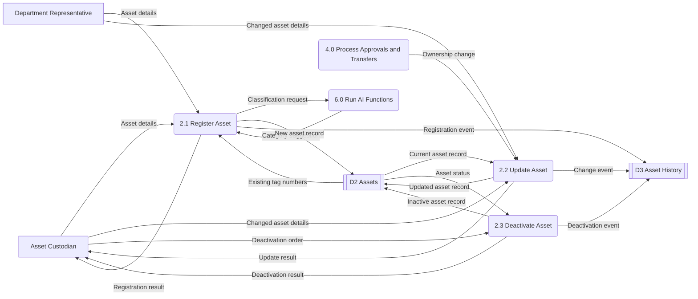
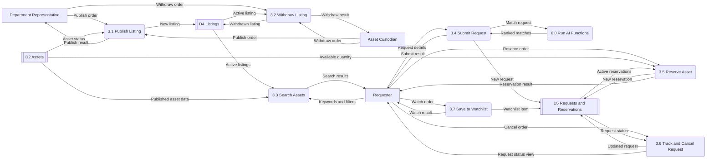
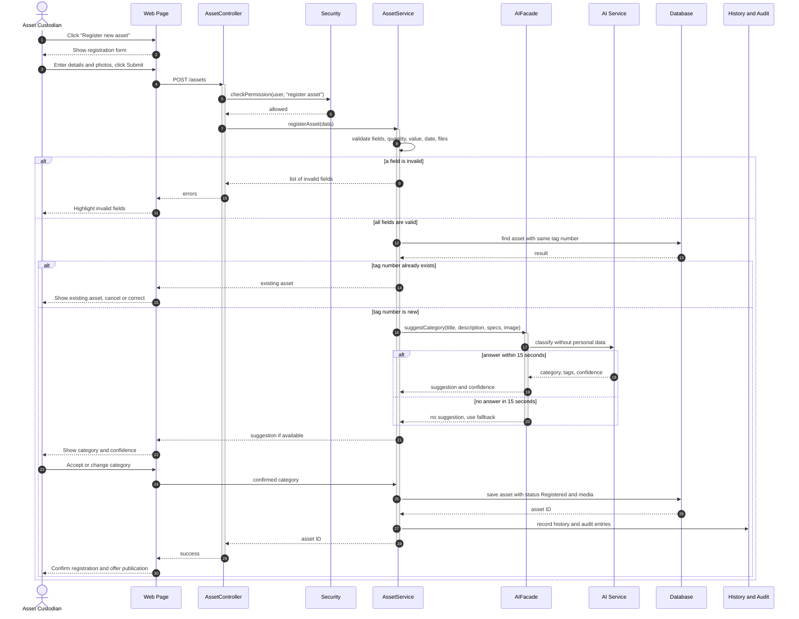
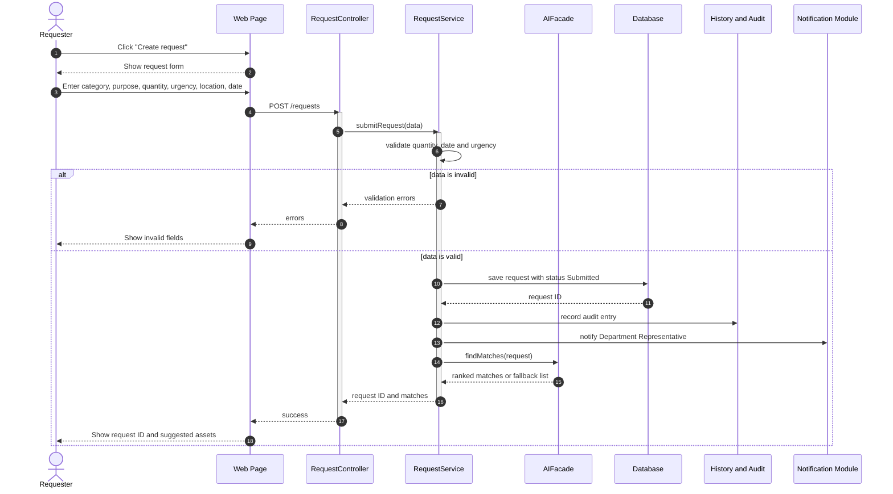

# Phase 4 & 5 – Part 1: Assets, Marketplace and Requests

**Owner:** Mohammed Al Ali

**Use Cases:** UC-01 to UC-10

**Requirement Groups:** FR-AST, FR-MKT, FR-REQ, FR-SRC, FR-RSV

**Data Stores:** D2 Assets, D4 Listings, D5 Requests and Reservations. Watchlist items are included in D5. D3 Asset History is written to but belongs to Part 2.

**Tables:** CATEGORY, ASSET, ASSET_MEDIA, LISTING, REQUEST, RESERVATION, WATCHLIST_ITEM

Shared architecture, context diagram, Level 0 DFD, ER diagram, and data rules are defined in `00_architecture_and_shared_design.md`.

---

# 1. Data Flow Diagrams – Level 1

Level 1 Data Flow Diagrams show how the major system processes are divided into smaller processes.

They identify the actors, data stores, inputs, and outputs involved in asset management, the marketplace, and resource requests.

## 1.1 Process 2.0 – Manage Assets

Process 2.0 handles asset registration, editing, and deactivation.

Asset Custodians and Department Representatives provide asset details. The system validates this information and stores asset records in D2 Assets.

Important changes are also recorded in D3 Asset History.

### Process Description

| Process | Description | Related Requirements |
|---|---|---|
| 2.1 Register Asset | Validates asset fields, checks the unique tag number, requests an optional AI category suggestion, and saves the asset | FR-AST-01 to 08, FR-AI-01 to 15 |
| 2.2 Update Asset | Allows authorized users to change asset information while recording the previous values | FR-AST-09, BR-13 |
| 2.3 Deactivate Asset | Marks an asset as inactive | FR-AST-10 |

The asset registration process uses AI for optional classification suggestions. However, users remain responsible for confirming the final category.

---

## 1.2 Process 3.0 – Handle Marketplace and Requests

Process 3.0 manages marketplace publication, withdrawal, asset searching, request submission, reservations, request tracking, cancellation, and watchlists.

### Process Description

| Process | Description | Related Requirements |
|---|---|---|
| 3.1 Publish Listing | Checks whether an asset can be published and creates an active marketplace listing | FR-MKT-01, FR-MKT-02 |
| 3.2 Withdraw Listing | Removes a published listing from the active marketplace results | FR-MKT-03 |
| 3.3 Search Assets | Searches published assets using keywords, filters, and sorting | FR-SRC-01 to 05, NFR-02 |
| 3.4 Submit Request | Validates a resource request, stores it, and asks for matching suggestions | FR-REQ-01 to 06 |
| 3.5 Reserve Asset | Checks availability and creates a reservation if the quantity is available | FR-RSV-01 to 05, BR-04 |
| 3.6 Track and Cancel Request | Displays request status and allows cancellation when permitted | FR-REQ-07 to 09 |
| 3.7 Save to Watchlist | Saves an asset or search to the Requester's watchlist | FR-SRC-06, FR-SRC-07 |

D2 contains asset records, D4 contains marketplace listings, and D5 contains requests, reservations, and watchlist information.

---

# 2. Sequence Diagrams

Sequence diagrams describe the interaction between actors and software components during important use cases.

The diagrams use the following notation:

- Solid arrows represent messages or requests.
- Dashed arrows represent responses.
- `alt` blocks represent alternative conditions.
- Activation bars indicate when a component is processing an action.

## 2.1 UC-01 Register Asset

This sequence shows how an Asset Custodian registers an asset.

The system validates the submitted information, checks for duplicate tag numbers, obtains an optional AI classification suggestion, and creates the asset record.

The category suggested by AI is not automatically accepted. The user must review and confirm it.

If the AI service is unavailable, the system continues using manual classification.

---

## 2.2 UC-05 Submit Request

This sequence shows how a Requester creates a resource request.

The request is validated, stored, and passed to the AI matching service to obtain suggested resources.

The validation process checks that the requested quantity is at least one, the date is valid, and urgency is Low, Medium, or High.

---
