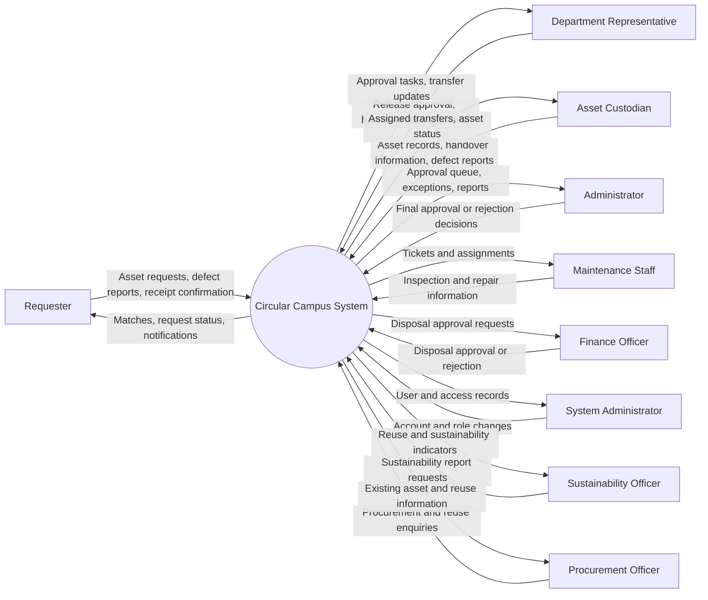
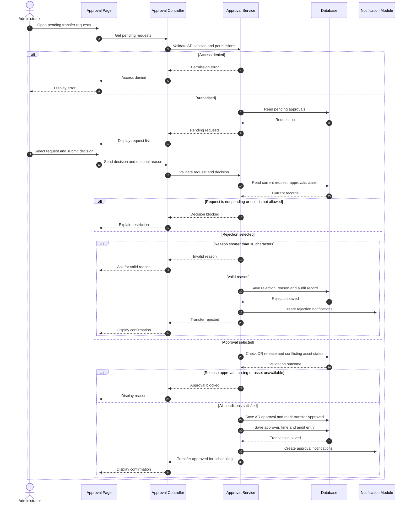
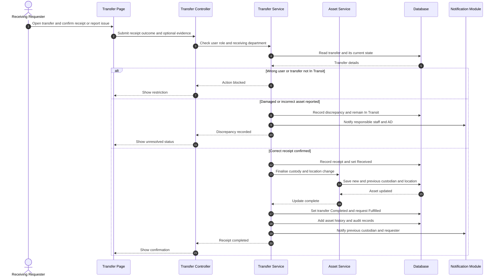
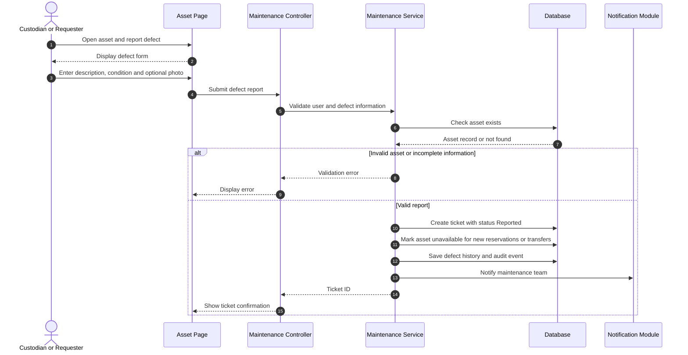
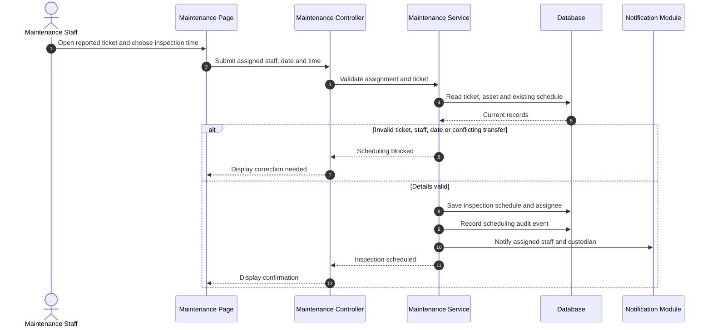
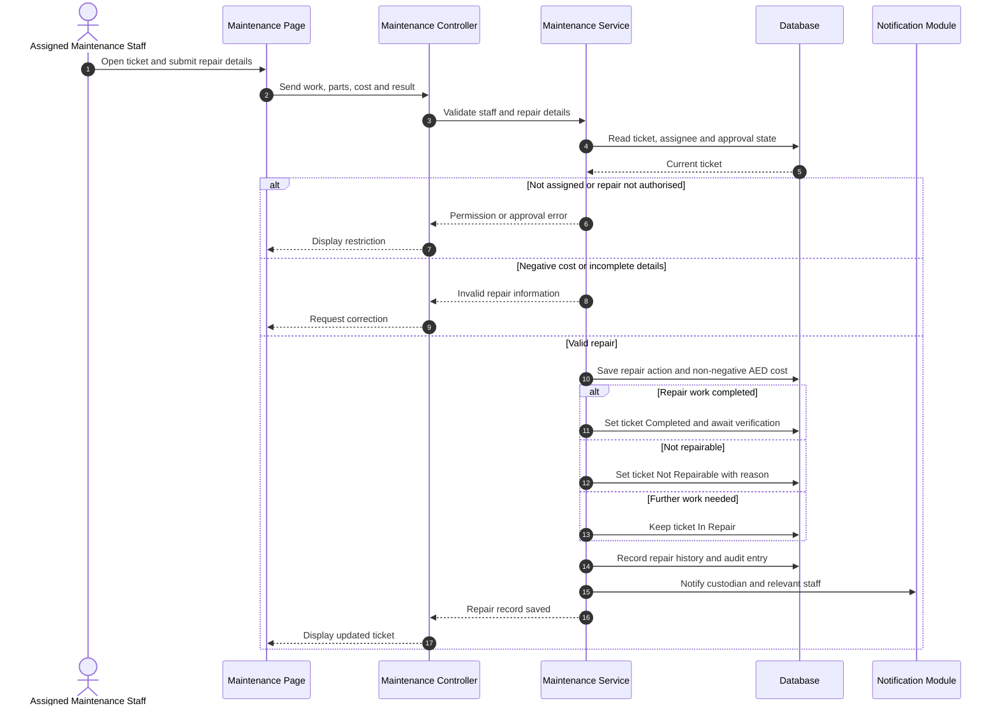
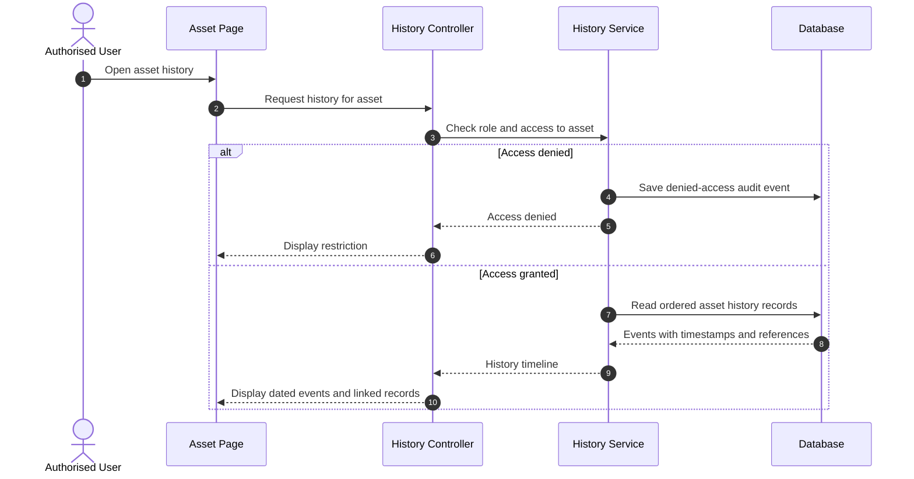
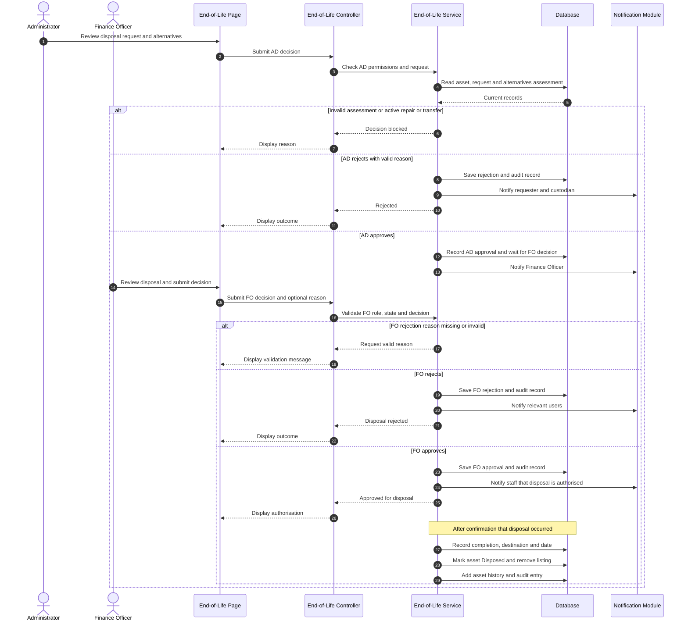
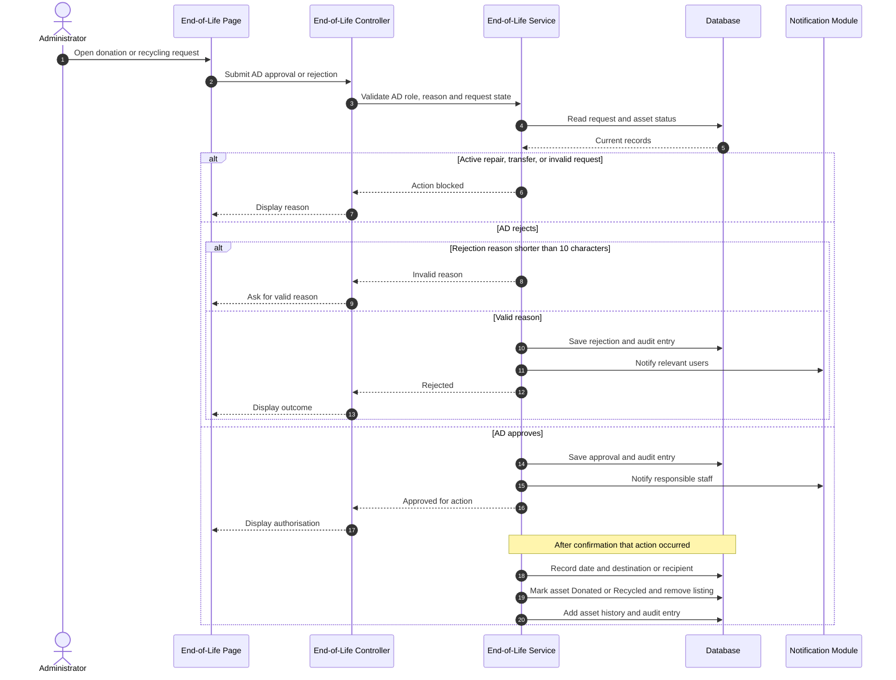
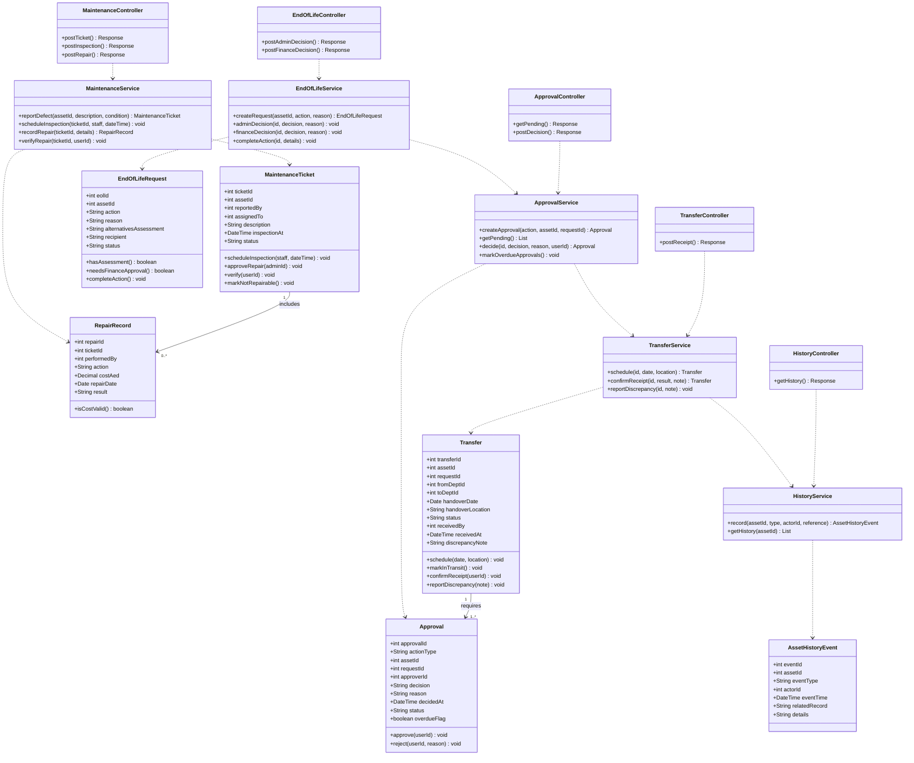

# Phase 4 & 5 — Part 2: Approvals, Transfers, Maintenance and End-of-Life

**Project:** Intelligent, AI-Powered Circular Campus Resource Exchange and Asset Life Cycle Management System  
**Course:** COSC336 — Introduction to Software Engineering  
**Group:** 5  
**Contributor:** Mubarak Saif Mubarak Jarash Alkhyeli  

## 1. Scope and Design Basis

This section covers eight use cases: **UC-11** Approve or Reject Transfer, **UC-12** Confirm Receipt, **UC-13** Report Defect, **UC-14** Record Repair, **UC-15** View Asset History, **UC-16** Approve Disposal, **UC-24** Schedule Inspection, and **UC-25** Approve Donation or Recycling.

The designs trace to **FR-APR, FR-TRF, FR-MNT, FR-HST, FR-DSP, FR-USR, FR-NTF,** and **FR-AUD** in Phase 3.

Relevant database tables are `APPROVAL`, `TRANSFER`, `MAINTENANCE_TICKET`, `REPAIR_RECORD`, `END_OF_LIFE_REQUEST`, and `ASSET_HISTORY`.

The shared data stores are D3 Asset History, D6 Approvals, D7 Transfers, D8 Maintenance Records, and D9 End-of-Life Requests.

The transfer and maintenance state models are in Phase 3 Sections 6.2.1 and 6.2.2, respectively.

The team's consolidated architecture and entity-relationship model belong in `00_architecture_and_shared_design.md`.

### 1.1 Key Design Rules

- The owning Department Representative (DR) must approve asset release before the Administrator (AD) can give final transfer approval.
- A rejection requires a reason containing at least 10 characters.
- Each completed approval stage stores the approver, decision, timestamp, and reason when applicable.
- A transfer must receive the required approvals before scheduling and handover.
- The receiving Requester (RQ) confirms receipt before custody and location are updated.
- Assets under repair or involved in conflicting active transfers cannot be transferred.
- Repair work requires Administrator authorisation, and a separate authorised user verifies completed repairs.
- Disposal requires Administrator and Finance Officer approval. Donation and recycling require Administrator approval.
- All important decisions are recorded in the system's history and audit records.

## 2. Context Diagram

The context diagram shows the interactions between the Circular Campus System and its external users. The system is represented as a single process, while each actor exchanges relevant information with it.



The context diagram focuses on the system boundary and its external interactions. Internal components such as controllers, services, databases, and the notification module are not shown.

## 3. Sequence Diagrams

The following sequence diagrams describe how the main components of the system interact to complete each use case.

### 3.1 UC-11 — Approve or Reject Transfer

The Administrator reviews a pending transfer request and chooses to approve or reject it. Approval requires the owning department's release permission and a valid asset status.



A pending approval older than 48 hours is flagged as overdue, and the Administrator receives a notification according to FR-APR-06.

### 3.2 UC-12 — Confirm Receipt

The receiving Requester confirms that the asset has arrived. The system updates ownership and location only after successful confirmation.



### 3.3 UC-13 — Report Defect

An Asset Custodian or Requester reports a problem with an existing asset. The system creates a maintenance ticket and notifies the maintenance team.



### 3.4 UC-24 — Schedule Inspection

Maintenance Staff schedules an inspection for an existing defect ticket. The system checks the ticket and asset status before saving the schedule.



### 3.5 UC-14 — Record Repair

The assigned Maintenance Staff records the repair details, including the work performed, cost, and repair result.



A completed repair must be verified by another authorised Maintenance Staff member or Asset Custodian before the asset becomes available again.

### 3.6 UC-15 — View Asset History

An authorised user opens an asset's history to review previous activities, including transfers, inspections, and repairs.



Asset history records are read-only. Corrections are stored as new entries referring to the original event.

### 3.7 UC-16 — Approve Disposal

The Administrator reviews a disposal request and its alternatives assessment. Both Administrator and Finance Officer approval are required before disposal can proceed.



### 3.8 UC-25 — Approve Donation or Recycling

The Administrator reviews a donation or recycling request. Unlike disposal, these actions require Administrator approval without a separate Finance Officer decision.



## 4. Class Diagram

The class diagram represents the main entities and services responsible for approval workflows, asset transfers, maintenance, and end-of-life management.



### 4.1 Class Responsibilities

| Class | Main Responsibility | Related Requirements |
|---|---|---|
| ApprovalService | Handles final decisions, release checks, overdue approvals and approval records | FR-APR-01–07 |
| TransferService | Manages scheduling, receipt confirmation, discrepancies and transfer completion | FR-TRF-01–05 |
| MaintenanceService | Manages defect tickets, inspections, repair records and verification | FR-MNT-01–05 |
| EndOfLifeService | Handles donation, recycling and disposal approval and completion | FR-DSP-01–05 |
| HistoryService | Records and retrieves asset history without modifying previous events | FR-HST-01–03 |

## 5. User Interface Mockups

The following interface mockups show the main pages used for approvals, transfers, maintenance, and asset history.

### 5.1 Approval Queue (UC-11, UC-16, UC-25)

```text
+------------------------------------------------------------------+
| Approvals                                        Administrator    |
| Filter: [Pending v]      Type: [All v]                            |
+------------------------------------------------------------------+
| ID      Type        Asset              From -> To       Waiting   |
| A-101   Transfer    Lab bench stool    CS -> Business   6 h       |
| A-099   Disposal    Old projector      Engineering      52 h      |
| A-097   Recycling   Old monitors       IT               20 h      |
|                                        [Open selected]            |
+------------------------------------------------------------------+
| Selected: A-101    Request: R-0042                                |
| Owner department release approval: APPROVED                      |
| Asset condition: Good      Active conflict: None                 |
| Rejection reason (minimum 10 characters): [_________________]    |
|                                  [Reject]  [Approve]             |
+------------------------------------------------------------------+
```

The Administrator can view pending requests, review approval details, and submit a final decision.

### 5.2 Receipt Confirmation (UC-12)

```text
+------------------------------------------------------------------+
| Transfer T-0031                        Status: In Transit         |
| Asset: Lab bench stool x20                                       |
| From: Computer Science          To: Business School             |
| Handover: 2026-11-04           Location: Library                 |
+------------------------------------------------------------------+
| Receiving Requester: [signed-in user]                            |
| Condition: ( ) As expected   ( ) Damaged or incorrect            |
| Discrepancy note: [__________________________________________]   |
| Optional photo: [Choose file]                                    |
|                     [Report problem]  [Confirm receipt]          |
+------------------------------------------------------------------+
```

The receiving Requester confirms receipt or reports a discrepancy. A damaged or incorrect asset does not automatically complete the transfer.

### 5.3 Defect Report (UC-13)

```text
+------------------------------------------------------------------+
| Report a defect                                                  |
| Asset ID *        [A-2045]  Projector                            |
| Description *     [__________________________________________]   |
| Reported condition: ( ) Good ( ) Fair ( ) Needs Repair           |
| Photo (optional): [Choose file]                                  |
| Date: Automatically recorded                                     |
|                                        [Cancel]  [Submit report]  |
+------------------------------------------------------------------+
```

The user enters the asset information and describes the problem. The system creates a maintenance ticket when the information is valid.

### 5.4 Inspection and Repair (UC-24, UC-14)

```text
+------------------------------------------------------------------+
| Maintenance ticket M-0210        Status: Repair Approved         |
| Asset: A-2045 Projector                                         |
| Inspection: [2026-11-05 10:00]  Assigned staff: [MS-02]          |
|                                             [Schedule inspection]|
+------------------------------------------------------------------+
| Repair history                                                   |
| Date         Work performed                Cost (AED)             |
| 2026-11-06   Lamp unit replaced            180.00                 |
+------------------------------------------------------------------+
| New repair record                                                |
| Work done *: [_______________________________________________]   |
| Cost (AED) *: [0.00]                                             |
| Result: ( ) Completed ( ) Further work ( ) Not repairable        |
|                                                   [Save repair]  |
+------------------------------------------------------------------+
| Verification: Different authorised staff member or custodian    |
| Verified condition: ( ) Good ( ) Fair ( ) Needs Repair           |
|                                                   [Verify]       |
+------------------------------------------------------------------+
```

Maintenance Staff can schedule inspections, record repair work and costs, and verify the repair result.

### 5.5 End-of-Life Decision (UC-16, UC-25)

```text
+------------------------------------------------------------------+
| End-of-life request E-0014                                      |
| Asset: Old projector             Action: Dispose                 |
| Reason: Cannot be repaired                                     |
| Alternatives assessed: Reuse / Transfer / Repair / Donation      |
|                        / Recycling                              |
+------------------------------------------------------------------+
| Administrator decision: Pending                                 |
| Finance Officer decision: Required for disposal                 |
| Reason for rejection (minimum 10 characters): [______________]  |
|                                        [Reject]  [Approve]        |
| Note: Final asset status changes only after action completion.  |
+------------------------------------------------------------------+
```

The Administrator reviews the request and the alternatives assessment. Disposal additionally requires Finance Officer approval.

### 5.6 Asset History (UC-15)

```text
+------------------------------------------------------------------+
| Asset history: A-2045 Projector                                 |
| Date        Event         Actor           Related record         |
| 2026-09-02  Registered    Custodian       -                      |
| 2026-09-10  Published     Custodian       L-0044                 |
| 2026-09-20  Transferred   Administrator   T-0031                 |
| 2026-10-21  Defect        Requester       M-0210                 |
| 2026-10-24  Repaired      Maint. staff    R-0090                 |
+------------------------------------------------------------------+
| Entries are read-only. Corrections create linked new entries.   |
+------------------------------------------------------------------+
```

The asset history displays previous activities in chronological order, including the date, event, responsible user, and related record.

## 6. Traceability

The following table connects the diagrams and interface mockups to their related use cases and functional requirements.

| Diagram / Mockup | Use Case | Related Requirements |
|---|---|---|
| Sequence 3.1, UI 5.1 | UC-11 Approve or Reject Transfer | FR-APR-01, 02, 03, 05, 06, 07; FR-TRF-01 |
| Sequence 3.2, UI 5.2 | UC-12 Confirm Receipt | FR-TRF-03, 04, 05; FR-HST-01 |
| Sequence 3.3, UI 5.3 | UC-13 Report Defect | FR-MNT-01; FR-HST-01 |
| Sequence 3.4, UI 5.4 | UC-24 Schedule Inspection | FR-MNT-02; FR-NTF-01 |
| Sequence 3.5, UI 5.4 | UC-14 Record Repair | FR-MNT-03, 04, 05; FR-HST-01 |
| Sequence 3.6, UI 5.6 | UC-15 View Asset History | FR-HST-01, 02, 03; FR-USR-06 |
| Sequence 3.7, UI 5.1/5.5 | UC-16 Approve Disposal | FR-DSP-01–05; FR-APR-03, 04, 05, 07 |
| Sequence 3.8, UI 5.1/5.5 | UC-25 Approve Donation or Recycling | FR-DSP-01, 03, 04, 05; FR-APR-03, 05, 07 |
| Context Diagram Section 2 | System Boundary and External Actors | FR-APR, FR-TRF, FR-MNT, FR-DSP, FR-USR |
| Class Diagram Section 4 | Workflow and Application Services | FR-APR, FR-TRF, FR-MNT, FR-HST, FR-DSP |

## 7. Design Consistency and Notes

### 7.1 Transfer Approval

The Department Representative must approve releasing the asset before the Administrator gives final transfer approval. A rejected request cannot proceed to scheduling or handover.

### 7.2 Transfer Completion

Administrator approval changes the transfer status to Approved, but does not immediately change ownership, custody, or location.

These details are updated only after the receiving Requester confirms receipt.

### 7.3 Maintenance Verification

A repair marked Completed must still be verified by an authorised staff member or Asset Custodian before the asset can return to service.

### 7.4 Disposal Approval

Disposal requires both Administrator and Finance Officer approval under the Phase 3 requirements. Donation and recycling require Administrator approval.

An approved end-of-life request does not immediately mark an asset as Donated, Recycled, or Disposed. The status changes only after the authorised action is confirmed complete.

### 7.5 Notifications and Audit Records

The system records important approval decisions, transfer updates, maintenance activities, and end-of-life actions.

Relevant users receive notifications when a workflow changes. Audit records contain the responsible actor, action, timestamp, and outcome.

### 7.6 Shared Design Documents

The context diagram provides a high-level representation of external system interactions.

The sequence diagrams describe the order of interactions between components, while the class diagram represents the main entities and services.

The shared architecture and entity-relationship diagram are maintained separately in `00_architecture_and_shared_design.md`.

This separation keeps the individual design document focused on approvals, transfers, maintenance, and end-of-life management.
