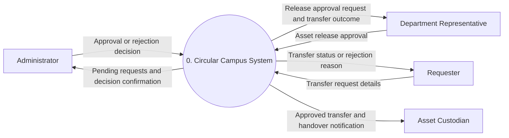

# UC-11 – Approve or Reject Transfer

**Use Case ID:** UC-11  
**Use Case Name:** Approve or Reject Transfer  
**Primary Actor:** Administrator (AD)  
**Supporting Actors:** Department Representative (DR), Requester (RQ), Asset Custodian (AC)  
**Related Requirements:** FR-APR-01, FR-APR-02, FR-APR-03, FR-APR-05, FR-APR-07, FR-TRF-01, FR-USR-06, FR-NTF-01, FR-NTF-02, FR-AUD-01  
**Priority:** Essential

### 1. Description

This use case describes how an Administrator reviews and approves or rejects an asset transfer request between university departments.

Before approving the transfer, the system checks whether the asset is available and whether the department currently responsible for it has approved its release.

The Administrator can approve the transfer or reject it with a reason. The system records the decision, updates the request status, and notifies the relevant users.

### 2. Preconditions

- The Administrator is logged into the system.
- A transfer request has been submitted.
- The request is awaiting final approval.
- The transfer request is linked to an existing asset.

**Trigger:** The Administrator selects a pending transfer request for review.

### 3. Main Flow

1. The Administrator opens the pending transfer requests.
2. The system retrieves and displays the pending requests.
3. The Administrator selects a request to review.
4. The system displays the asset information, requesting department, and previous approval details.
5. The Administrator chooses to approve or reject the transfer.
6. The system validates the Administrator's permissions and checks the request status.
7. If approved, the system checks the asset's availability and the owning department's release approval.
8. If rejected, the system validates the rejection reason.
9. The system records the decision, updates the transfer status, and saves the audit information.
10. The relevant users receive notifications, and the Administrator receives a confirmation message.

### 4. Context Diagram

The following context diagram shows how the Circular Campus System interacts with the external actors involved in the transfer approval process.

The Administrator reviews transfer requests and submits the final decision. The Department Representative provides the asset release approval, while the Requester and Asset Custodian receive information about the transfer outcome.

The diagram represents the system as one process and focuses on its interactions with external actors. Internal components such as the database and notification service are not included because they operate within the system boundary.

### 5. Alternative Flows

**A1 – Transfer Rejected**

If the Administrator rejects the transfer, a reason containing at least 10 characters must be provided. The system records the reason, changes the status to Rejected, and notifies the requester.

**A2 – Missing Department Approval**

If the department responsible for the asset has not approved its release, the system prevents the Administrator from completing the approval. The request remains pending until the required approval is recorded.

**A3 – Asset Unavailable**

If the asset is currently being repaired or is involved in another conflicting active transfer, the system blocks the approval and displays an explanation.

**A4 – Unauthorised User**

If a user without Administrator permissions attempts to approve or reject a transfer, the system denies the action and records the unauthorised attempt.

**A5 – Request Already Processed**

If the transfer has already been approved, rejected, or cancelled, the system prevents another decision and displays the current request status.

**A6 – Invalid Rejection Reason**

If the rejection reason contains fewer than 10 characters, the system requests a valid reason before allowing the rejection.

### 6. Postconditions

**If approved:**
- The transfer status changes to Approved.
- The approval decision and Administrator details are saved.
- The decision timestamp and audit information are recorded.
- The relevant users are notified.
- The transfer can proceed to scheduling and handover.

**If rejected:**
- The transfer status changes to Rejected.
- The rejection reason is recorded.
- The Administrator's decision is saved.
- The requester receives a notification.
- The rejected transfer cannot proceed.

**If validation fails:**
- The transfer status remains unchanged.
- The system displays the reason for the failed action.
- Unauthorised attempts are recorded.

### 7. Design Notes

The Administrator is responsible for making the final decision, while the Department Representative must approve releasing the asset before the transfer can proceed.

The system validates permissions, checks the asset's availability, updates the transfer status, and records the approval decision.

The database stores the transfer request details, approval decisions, timestamps, and audit records. The Notification Service informs the relevant users when the transfer status changes.

The context diagram provides a high-level view of the interactions between the Circular Campus System and its external actors without showing internal processing details.

An approved transfer does not immediately change the asset's custodian or location. These details are updated only after the receiving department confirms receipt.

This ensures that asset transfers are authorised, properly recorded, and traceable throughout the approval process.
