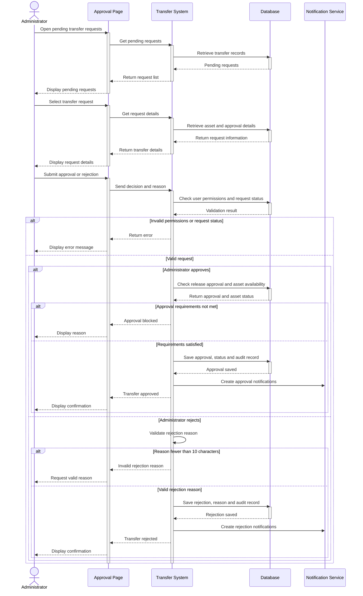
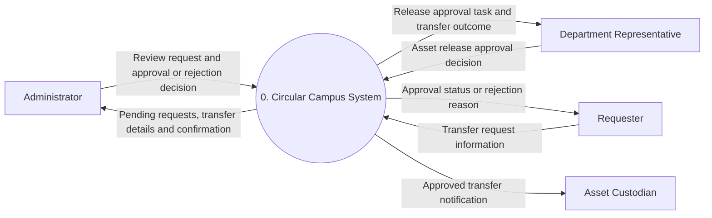

# UC-11 – Approve or Reject Transfer

**Use Case ID:** UC-11  
**Use Case Name:** Approve or Reject Transfer  
**Primary Actor:** Administrator (AD)  
**Supporting Actors:** Department Representative (DR), Requester (RQ), Asset Custodian (AC)  
**Related Requirements:** FR-APR-01, FR-APR-02, FR-APR-03, FR-APR-05, FR-APR-07, FR-TRF-01, FR-USR-06, FR-NTF-01, FR-NTF-02, FR-AUD-01, FR-AUD-02  
**Priority:** Essential

### 1. Description

This use case describes how an Administrator reviews and approves or rejects an asset transfer request between university departments.

Before approving the transfer, the system checks whether the owning department has approved releasing the asset and whether the asset is eligible for transfer.

The Administrator can approve the request or reject it with a valid reason. The system records the decision, updates the transfer status, and informs the relevant users.

An approved transfer can proceed to scheduling and handover, but the asset's custodian and location are not updated until the receiving department confirms receipt.

### 2. Preconditions

- The Administrator is logged into the system with an active account.
- A transfer request has been submitted.
- The request is in Pending Approval status.
- The request is linked to an existing asset and requesting department.

**Trigger:** The Administrator opens a pending transfer request to make a final decision.

### 3. Main Flow

1. The Administrator opens the pending transfer requests page.
2. The system retrieves and displays the pending requests.
3. The Administrator selects a request to review.
4. The system displays the asset information, requesting department, and previous approval details.
5. The Administrator chooses to approve or reject the transfer.
6. The system validates the Administrator's permissions and checks that the request is still pending.
7. If approved, the system verifies the owning department's release approval and the asset's eligibility for transfer.
8. The system records the decision, Administrator ID, timestamp, and audit information, then updates the transfer status.
9. The system creates notifications for the relevant users.
10. The Administrator receives a confirmation message.

### 4. Sequence Diagram

The following sequence diagram shows the interaction between the Administrator, Approval Page, Transfer System, Database, and Notification Service when processing a transfer request.

### 5. Context Diagram

The context diagram shows how the Circular Campus System interacts with the external actors involved in the transfer approval process.

The system is represented as one process. The diagram focuses on the information exchanged between the Administrator, Department Representative, Requester, Asset Custodian, and the system.

This diagram represents the external interactions relevant to UC-11 rather than the entire Circular Campus project. Internal components such as the database, approval page, and notification service are not shown because they are part of the system itself.

### 6. Alternative Flows

**A1 – Transfer Rejected**

If the Administrator rejects the transfer, a rejection reason containing at least 10 characters must be provided. The system records the reason, changes the transfer status to Rejected, saves the audit record, and notifies the requester.

**A2 – Missing Department Approval**

If the owning Department Representative has not approved releasing the asset, the system prevents the Administrator from completing the approval. The request remains pending until the required approval is recorded.

**A3 – Asset Unavailable**

If the asset is currently under repair or involved in another conflicting active transfer, the system blocks the approval and displays an explanation. A reservation belonging to the same transfer request is not considered a conflict.

**A4 – Unauthorised User**

If a user without Administrator permissions attempts to approve or reject a transfer, the system denies the action and records the unauthorised attempt.

**A5 – Request Already Processed**

If the transfer request has already been approved, rejected, or cancelled, the system prevents another decision and displays the current status.

**A6 – Invalid Rejection Reason**

If the Administrator enters a rejection reason containing fewer than 10 characters, the system asks for a valid reason before allowing the rejection.

**A7 – Notification Failure**

If an optional email notification fails, the approval or rejection decision remains saved. The in-app notification remains available to the relevant user.

### 7. Postconditions

**If approved:**
- The transfer status changes to Approved.
- The approval decision, Administrator ID, and timestamp are recorded.
- An audit record is created.
- The relevant users receive notifications.
- The transfer can proceed to scheduling and handover.
- The asset's custodian and location remain unchanged until receipt is confirmed.

**If rejected:**
- The transfer status changes to Rejected.
- The rejection reason is recorded.
- The Administrator's decision and timestamp are saved.
- An audit record is created.
- The requester receives a notification.
- The rejected transfer cannot proceed.

**If validation fails:**
- The transfer status remains unchanged.
- The system displays the reason for the failed action.
- Unauthorised attempts are recorded where required.

### 8. Design Notes

The Administrator is responsible for making the final decision, while the Department Representative is responsible for approving the release of the asset before the transfer can be authorised.

The Transfer System handles permission checks, approval validation, status updates, and notification requests. The database stores transfer information, approval decisions, and audit records.

The Notification Service creates notifications for the relevant users when the transfer status changes. Optional email delivery does not affect the saved approval decision.

The context diagram provides a high-level view of the system's interactions with external actors, while the sequence diagram explains the order of interactions between the internal components.

An approved transfer does not immediately change the asset's custodian or location. These details are updated only after the receiving requester confirms receipt.

This design ensures that asset transfers are authorised, correctly recorded, and traceable throughout the approval and handover process.
