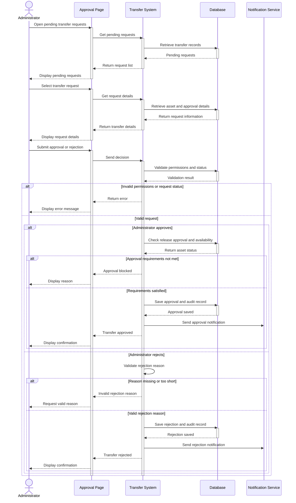

## UC-11 – Approve or Reject Transfer

**Use Case ID:** UC-11  
**Use Case Name:** Approve or Reject Transfer  
**Primary Actor:** Administrator (AD)  
**Related Requirements:** FR-APR-01, FR-APR-02, FR-APR-03, FR-APR-05, FR-APR-07, FR-TRF-01  
**Priority:** Essential

### 1. Description

This use case describes how an Administrator reviews and approves or rejects an asset transfer request between university departments.

Before approving the transfer, the system checks whether the asset is available and whether the department currently responsible for it has approved its release.

The Administrator can then approve the request or reject it with a reason. The system saves the decision and informs the relevant users.

### 2. Preconditions

- The Administrator is logged into the system.
- A transfer request has been submitted.
- The request is awaiting final approval.
- The owning department's representative has approved releasing the asset.

### 3. Main Flow

1. The Administrator opens the pending transfer requests.
2. The system retrieves and displays the pending requests.
3. The Administrator selects a request to review.
4. The system displays the asset information and approval details.
5. The Administrator chooses to approve or reject the transfer.
6. The system validates the Administrator's permissions and the request status.
7. If approved, the system checks the asset's availability and previous approval.
8. The system records the decision and updates the transfer status.
9. The relevant users receive a notification.
10. The Administrator receives a confirmation message.

### 4. Sequence Diagram

The following sequence diagram shows the interaction between the Administrator, Approval Page, Transfer System, Database, and Notification Service.

### 5. Alternative Flows

**A1 – Transfer Rejected**

If the Administrator rejects the transfer, a reason containing at least 10 characters must be provided. The system records the reason, changes the status to Rejected, and notifies the requester.

**A2 – Missing Department Approval**

If the department responsible for the asset has not approved its release, the system prevents the Administrator from completing the approval.

**A3 – Asset Unavailable**

If the asset is currently being repaired or is involved in another active transfer, the system blocks the approval.

**A4 – Unauthorised User**

If a user without Administrator permissions attempts to approve or reject a transfer, the system denies the action.

### 6. Postconditions

**If approved:**
- The transfer status changes to Approved.
- The approval decision and Administrator details are saved.
- The relevant users are notified.
- The transfer can proceed to scheduling and handover.

**If rejected:**
- The transfer status changes to Rejected.
- The rejection reason is recorded.
- The requester receives a notification.
- The transfer cannot proceed.

### 7. Design Notes

The Administrator is responsible for making the final decision, while the system handles validation, record updates, and notifications.

The database stores the request details, approval decisions, and audit records. The Notification Service informs users when the request status changes.

An approved transfer does not immediately change the asset's custodian or location. These details are updated only after the receiving department confirms receipt.

This ensures that asset transfers are authorised, properly recorded, and traceable.
