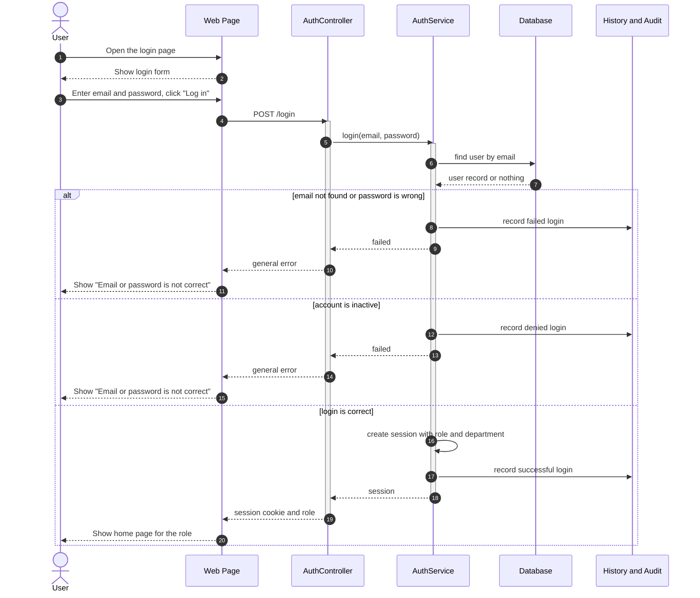
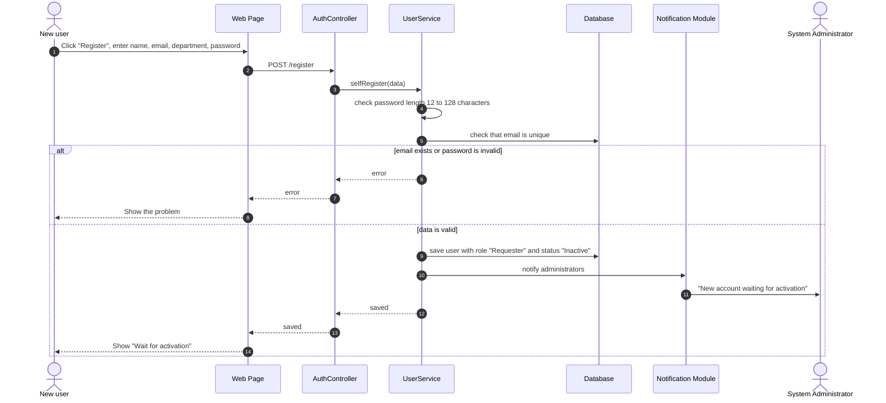
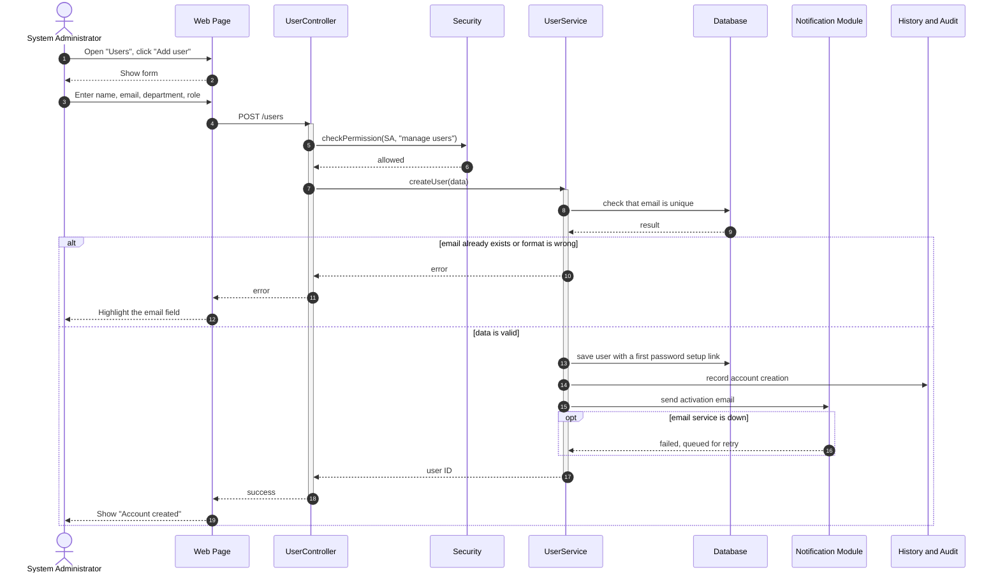
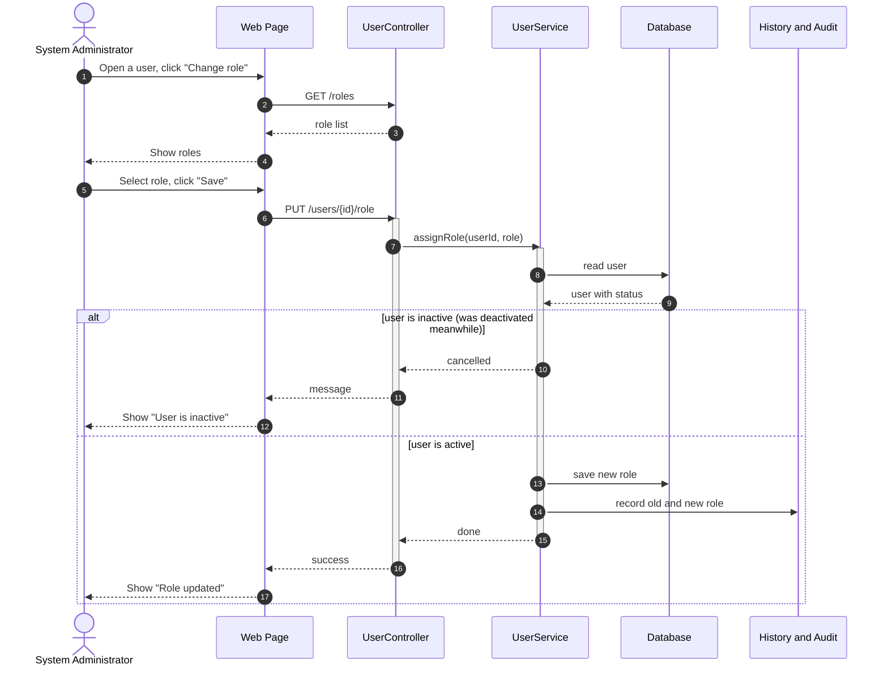
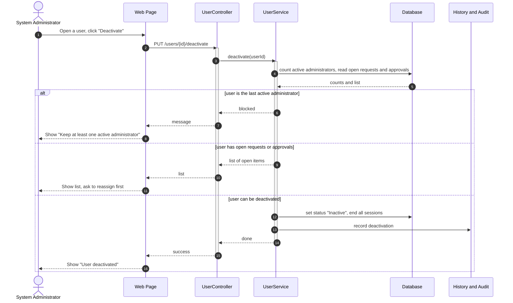
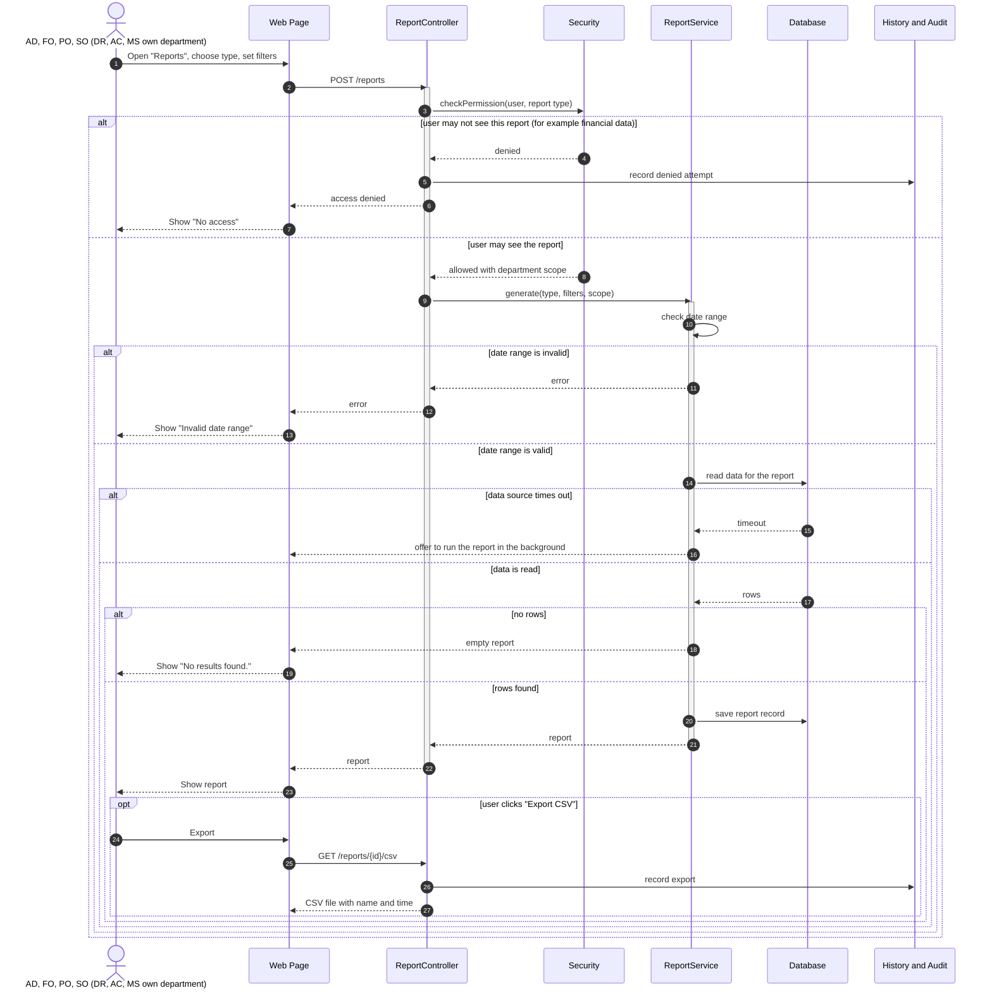
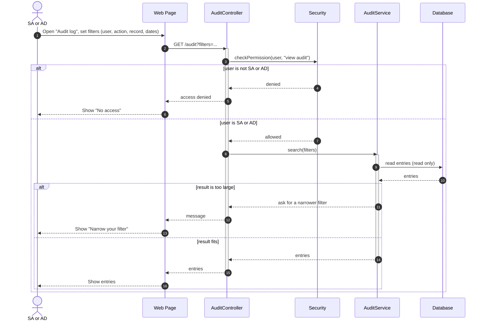
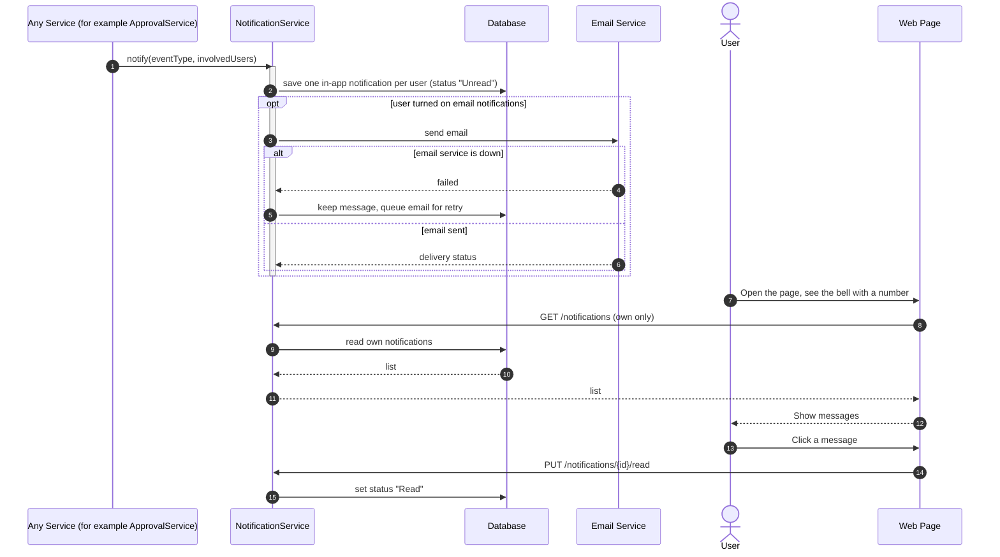
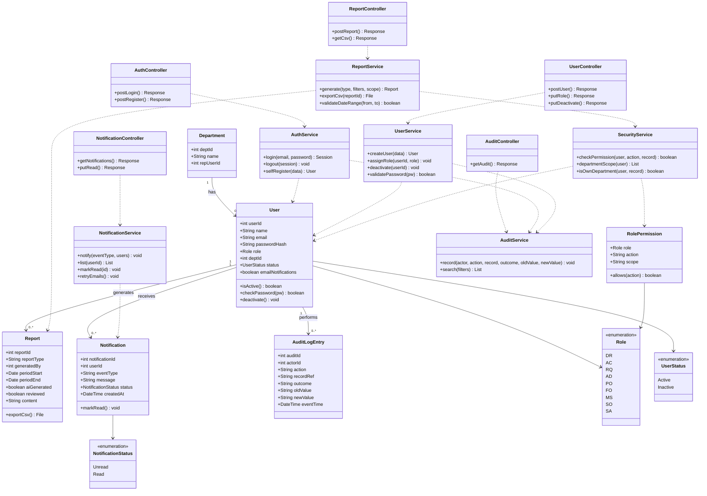

# Phase 4 & 5 – Part 3: Users, Access, Reports, Notifications and Audit

**Owner:** Mohammed Alketbi
**Use cases:** UC-17 Create user, UC-18 Assign role, UC-19 Deactivate user, UC-20 Log in, UC-21 Generate report, UC-22 View audit log, UC-23 Receive notification
**Requirement groups:** FR-USR, FR-RPT, FR-NTF, FR-AUD (and the security rules BR-07, BR-14, BR-16, NFR-08 to 11)
**Data stores:** D1 Users, D12 Reports, D13 Notifications, D14 Audit Log
**Tables:** DEPARTMENT, USER, ROLE_PERMISSION, REPORT, NOTIFICATION, AUDIT_LOG

Shared diagrams (architecture, the one Level 0 DFD, ER diagram) are in `00_architecture_and_shared_design.md`.

---

# 1. Sequence Diagrams

## 1.1 UC-20 Log In



Both wrong-password and inactive-account give the same message, so nobody can find out which emails exist (FR-USR error rules).

## 1.2 Self-Registration (FR-USR-02)



## 1.3 UC-17 Create User



## 1.4 UC-18 Assign Role



## 1.5 UC-19 Deactivate User



## 1.6 UC-21 Generate Report



## 1.7 UC-22 View Audit Log



## 1.8 UC-23 Receive Notification



---

# 2. Class Diagram



| Class | Role | Rule it enforces |
|---|---|---|
| AuthService | Login, logout, self-registration | FR-USR-02 to 04, NFR-08 |
| SecurityService | One place that checks role, department and active status before every action | FR-USR-06, BR-07, BR-16 |
| UserService | Create, change role, deactivate | FR-USR-01, FR-USR-05, last administrator rule |
| ReportService | Build, filter and export reports | FR-RPT-01 to 04 |
| NotificationService | Create, deliver and list notifications | FR-NTF-01 to 04 |
| AuditService | Writes entries (never edits or deletes) and searches them | FR-AUD-01 to 04, BR-14 |
| RolePermission | Stores the permission matrix of Phase 3 (Section 2.4) as data | BR-16 |

---

# 3. User Interface Mockups

## 3.1 Login and Register (UC-20, FR-USR-02)

```text
+----------------------------------------------+
|        Circular Campus Resource Exchange     |
|                                              |
|   Email      [______________________]        |
|   Password   [______________________]        |
|                                              |
|              [        Log in        ]        |
|   No account?  Register as a requester       |
|                                              |
|   Wrong details show one general message:    |
|   "Email or password is not correct"         |
+----------------------------------------------+
```

## 3.2 User Management (UC-17, UC-18, UC-19)

```text
+----------------------------------------------------------------------+
|  Users                                         (System Administrator)|
|  Search [__________]  Role [ All v ]  Status [ All v ] [ + Add user ]|
|                                                                      |
|  Name            Email            Dept       Role   Status           |
|  A. Hassan       a.h@univ.ae      CS         DR     Active           |
|  K. Saeed        k.s@univ.ae      Business   RQ     Inactive         |
|  M. Rashid       m.r@univ.ae      IT         SA     Active           |
|                                                                      |
|  [Change role]  [Deactivate]  [Activate]                             |
+----------------------------------------------------------------------+
|  Add user                                                            |
|  Name *  [__________]   Email * [______________]                     |
|  Department * [ v ]     Role * [ v ]                                 |
|                                    [ Cancel ]  [ Create account ]    |
+----------------------------------------------------------------------+
```

## 3.3 Reports (UC-21)

```text
+----------------------------------------------------------------------+
|  Reports                                                             |
|  Report  [ Completed transfers v ]                                   |
|  From [ yyyy-mm-dd ]  To [ yyyy-mm-dd ]  Department [ All v ]        |
|  Category [ All v ]   Status [ All v ]              [ Generate ]     |
|                                                                      |
|  Completed transfers, 2026-09-01 to 2026-09-30     Made 2026-10-01   |
|  Asset            From      To          Date         Value (AED)*    |
|  Lab bench stool  CS        Business    2026-09-20   3,000           |
|  Projector        IT        Eng.        2026-09-25   1,800           |
|                                                                      |
|  * Value column only for FO, AD and allowed roles                    |
|                                                  [ Export CSV ]      |
|  Empty result: "No results found."                                   |
+----------------------------------------------------------------------+
```

## 3.4 Audit Log (UC-22)

```text
+----------------------------------------------------------------------+
|  Audit log                                      (SA or Administrator)|
|  User [____]  Action [ All v ]  Record [____]  From [ ]  To [ ]      |
|                                                    [ Search ]        |
|                                                                      |
|  Time              User   Action          Record  Outcome            |
|  2026-10-21 09:12  AD01   Approve         A-101   Success            |
|  2026-10-21 09:20  RQ07   Approve         A-101   Denied             |
|  2026-10-21 10:02  SA01   Change role     U-33    Success            |
|  Details: old value DR -> new value AC                               |
|                                                                      |
|  Read only. Entries cannot be edited or deleted.                     |
+----------------------------------------------------------------------+
```

## 3.5 Notifications (UC-23)

```text
+----------------------------------------------------------------------+
|  Circular Campus                                [ Bell (3) ]  (RQ) v |
+----------------------------------------------------------------------+
|  Notifications                                                       |
|  * Your request R-0042 was approved                       5 min ago  |
|  * Transfer T-0031 is ready for pickup                    2 h ago    |
|    Reservation of Lab bench stool expires in 1 day        1 day ago  |
|                                                                      |
|  (* = unread)                       [ Mark all as read ]             |
|  Settings: [x] Also send me emails                                   |
+----------------------------------------------------------------------+
```

---

# 4. Traceability

| Diagram | Use case | Requirements |
|---|---|---|
| Sequence 1.3 | UC-17 Create user | FR-USR-01, FR-USR-02, FR-AUD-01 |
| Sequence 1.4 | UC-18 Assign role | FR-USR-05, BR-16 |
| Sequence 1.5 | UC-19 Deactivate user | FR-USR-05 |
| Sequence 1.1, 1.2 | UC-20 Log in | FR-USR-02 to 04, FR-USR-06 |
| Sequence 1.6 | UC-21 Generate report | FR-RPT-01 to 04 |
| Sequence 1.7 | UC-22 View audit log | FR-AUD-01 to 04 |
| Sequence 1.8 | UC-23 Receive notification | FR-NTF-01 to 04 |

