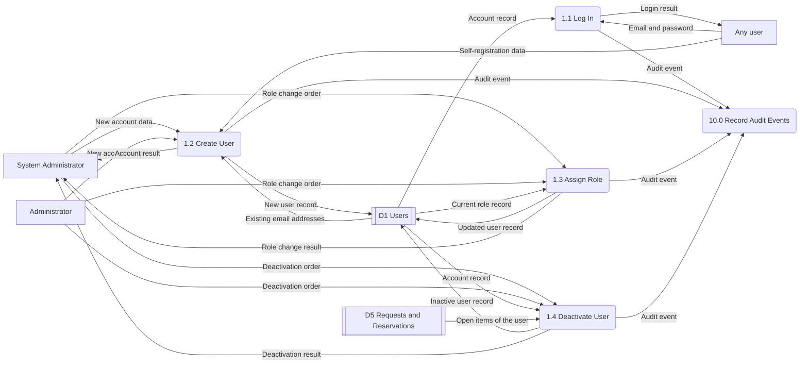
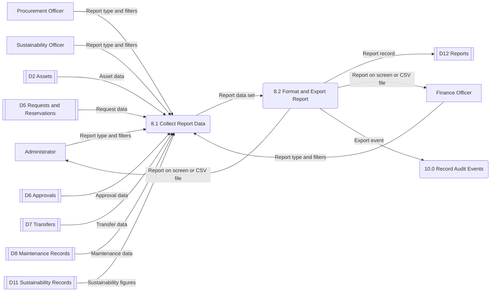
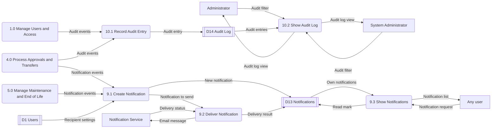

# Phase 4 & 5 – Part 3: Users, Access, Reports, Notifications and Audit

**Owner:** Mohammed Alketbi
**Use cases:** UC-17 Create user, UC-18 Assign role, UC-19 Deactivate user, UC-20 Log in, UC-21 Generate report, UC-22 View audit log, UC-23 Receive notification
**Requirement groups:** FR-USR, FR-RPT, FR-NTF, FR-AUD (and the security rules BR-07, BR-14, BR-16, NFR-08 to 11)
**Data stores:** D1 Users, D12 Reports, D13 Notifications, D14 Audit Log
**Tables:** DEPARTMENT, USER, ROLE_PERMISSION, REPORT, NOTIFICATION, AUDIT_LOG

Shared diagrams (architecture, context, Level 0 DFD, ER diagram) are in `00_architecture_and_shared_design.md`.

---

# 1. Data Flow Diagrams, Level 1

## 1.1 Process 1.0 – Manage Users and Access

| Process | Does what | Requirements |
|---|---|---|
| 1.1 Log In | Checks email, password and active status. Shows one general error if the login is wrong | FR-USR-03, NFR-08 |
| 1.2 Create User | Creates an account with a unique email. Self-registration makes an inactive Requester account | FR-USR-01, FR-USR-02 |
| 1.3 Assign Role | Changes the role. Never changes it for an inactive account | FR-USR-05, BR-16 |
| 1.4 Deactivate User | Blocks login. Open requests and approvals must be moved first. The last active administrator cannot deactivate itself | FR-USR-05 and its error rules |

## 1.2 Process 8.0 – Generate Reports

| Process | Does what | Requirements |
|---|---|---|
| 8.1 Collect Report Data | Reads the data the user may see, applies the filters (date range, department, category, status). Financial data only for FO, AD and other allowed roles | FR-RPT-01, FR-RPT-02, FR-RPT-04 |
| 8.2 Format and Export Report | Shows the report or makes a CSV with report name and time. Shows "No results found." when empty | FR-RPT-03, NFR-02 |

## 1.3 Processes 9.0 and 10.0 – Notifications and Audit

| Process | Does what | Requirements |
|---|---|---|
| 9.1 Create Notification | Finds the users involved in an event and creates in-app messages | FR-NTF-01, FR-NTF-02, FR-NTF-04 |
| 9.2 Deliver Notification | Sends an email to users who turned it on. If the email fails, the workflow continues and the in-app message stays | FR-NTF-03 and its error rules |
| 9.3 Show Notifications | Shows only the user's own messages. The user marks them as read | FR-NTF-04 |
| 10.1 Record Audit Entry | Writes audit ID, actor, action, record, time, outcome and old and new values. Passwords are never stored | FR-AUD-01, FR-AUD-02, BR-14 |
| 10.2 Show Audit Log | Shows and filters entries by user, action, record and date. Only AD and SA | FR-AUD-04, FR-AUD-03 |

> 
---

