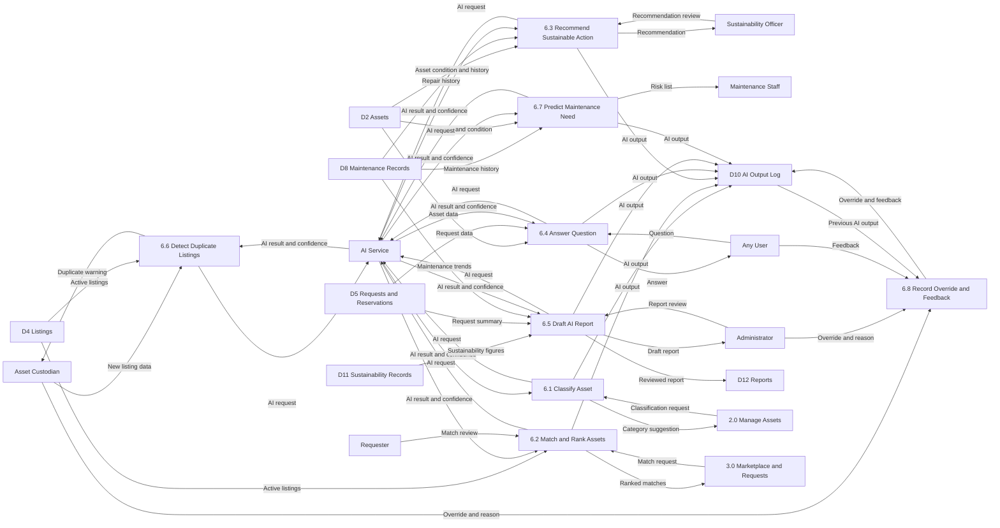

# Phase 4 & 5 – Part 4: AI Layer and Sustainability

**Owner:** Abdulla

**Use cases:** UC-26 to UC-35

**Requirement groups:** FR-AI-01 to FR-AI-70, FR-AI-X-01 to FR-AI-X-17, FR-SUS-01 to FR-SUS-31

**Data stores:** D10 AI Output Log, D11 Sustainability Records

**Tables:** AI_OUTPUT, AI_OVERRIDE, AI_FEEDBACK, REUSE_EVENT, EMISSION_FACTOR

Shared architecture and common AI integration path:

**Service → AI Facade → Privacy Filter → AI Adapter → AI Service → Answer Checker → AI Output Log**

All AI use cases follow this common path unless a fallback or alternative flow is triggered.

# 1. Data Flow Diagrams, Level 1
## 1.1 Process 6.0 – Run AI Functions

