# Phase 4 & 5 - Part 4: AI Layer and Sustainability

**Owner:** Abdulla

**Use cases:** UC-26 Classify asset, UC-27 Review AI match, UC-28 Review sustainability recommendation, UC-29 Ask the assistant, UC-30 Generate AI report, UC-31 View sustainability dashboard, UC-32 Override an AI output, UC-33 Detect duplicate listings, UC-34 Predict maintenance need, UC-35 Submit AI feedback

**Requirement groups:** FR-AI-01 to FR-AI-70, FR-AI-X-01 to FR-AI-X-17, FR-SUS-01 to FR-SUS-31

**Data stores:** D10 AI Output Log, D11 Sustainability Records (reads D2, D4, D5, D8)

**Tables:** AI_OUTPUT, AI_OVERRIDE, AI_FEEDBACK, REUSE_EVENT, EMISSION_FACTOR

Shared diagrams (architecture, AI integration design, the one Level 0 DFD, ER diagram) are in `00_architecture_and_shared_design.md`. Read Section 2.4 there first. Every AI use case below uses the same path: service, AI Facade, privacy filter, AI Adapter, AI Service, answer checker, AI Output Log.


# 1. Sequence Diagrams

## 1.1 UC-26 Classify Asset

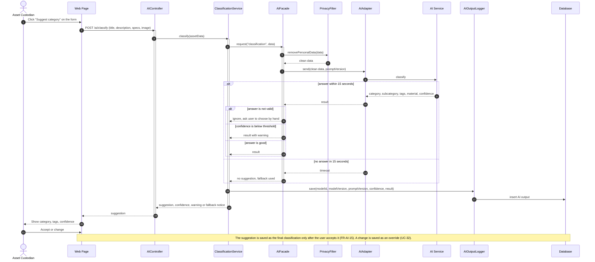


## 1.2 UC-27 Review AI Match

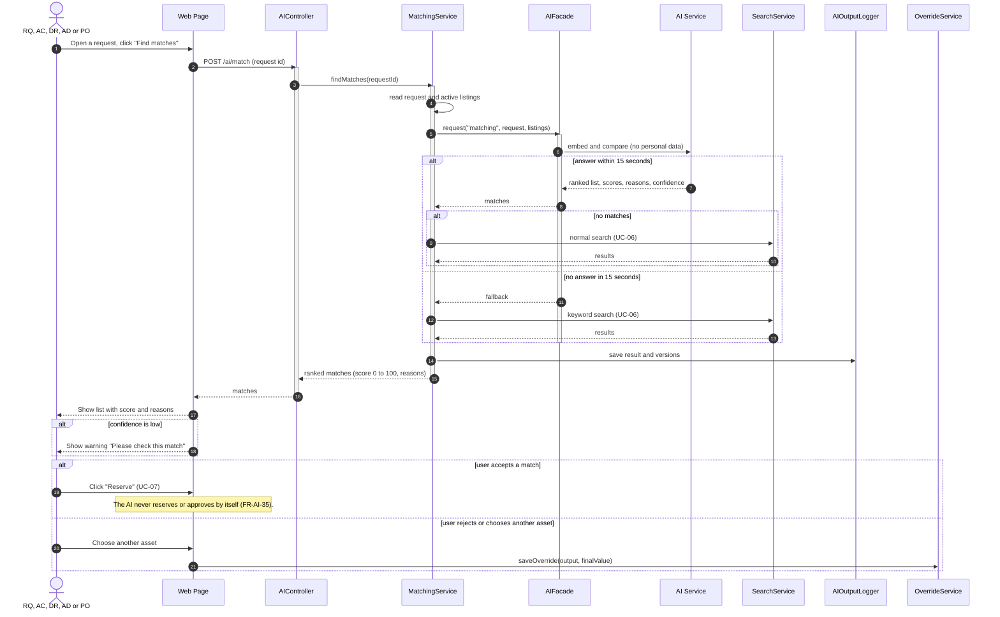


## 1.3 UC-28 Review Sustainability Recommendation

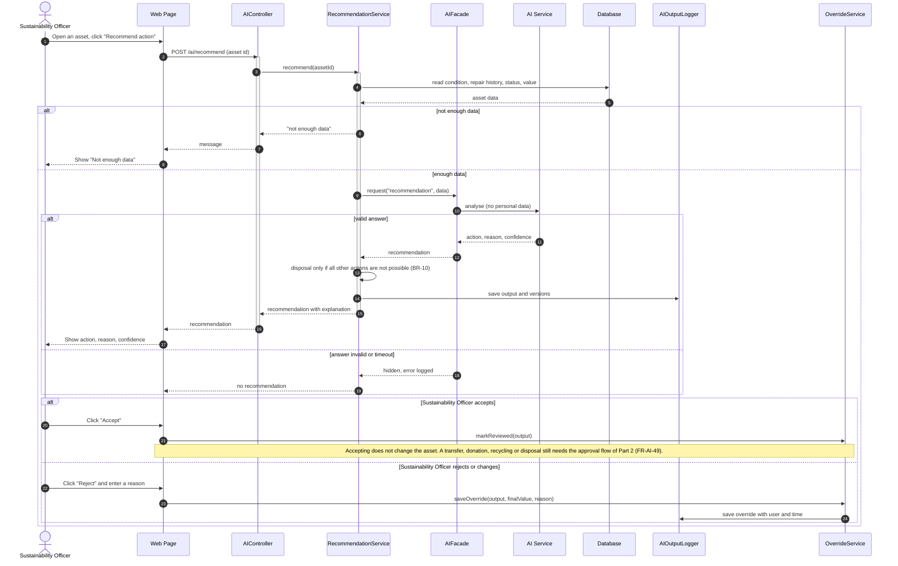


## 1.4 UC-29 Ask the Assistant

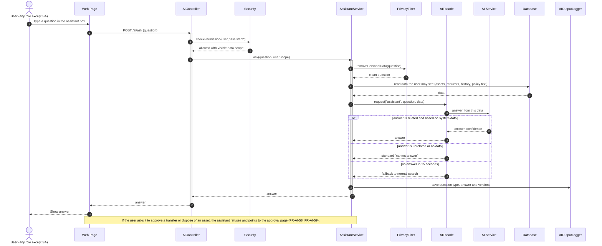


## 1.5 UC-30 Generate AI Report

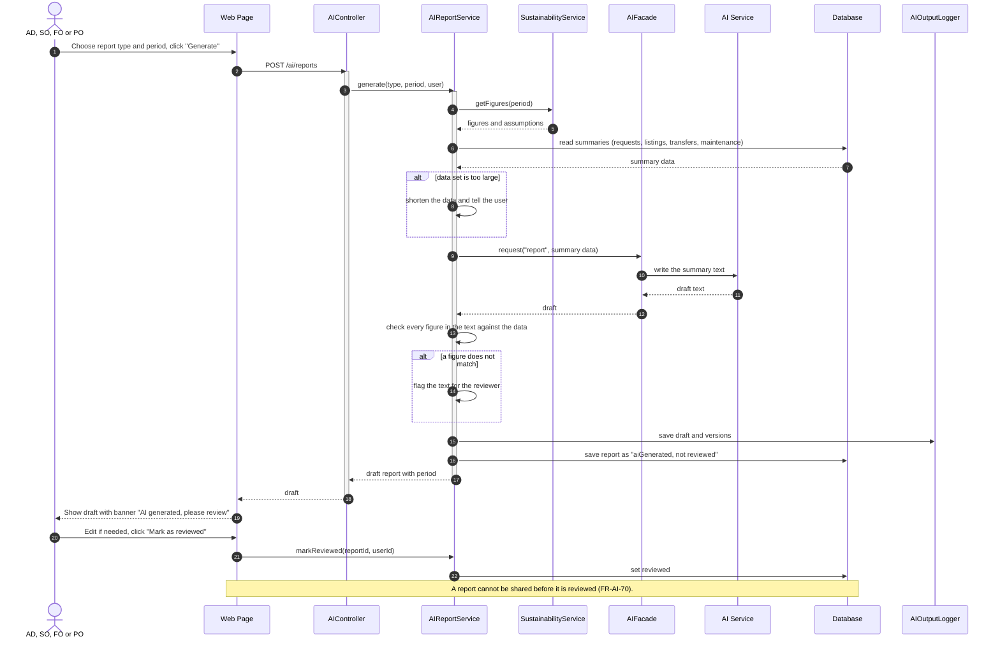


## 1.6 UC-31 View Sustainability Dashboard

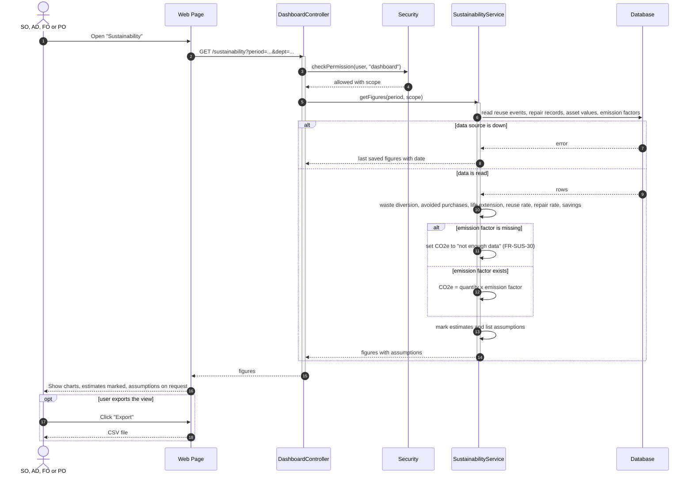


## 1.7 UC-32 Override an AI Output

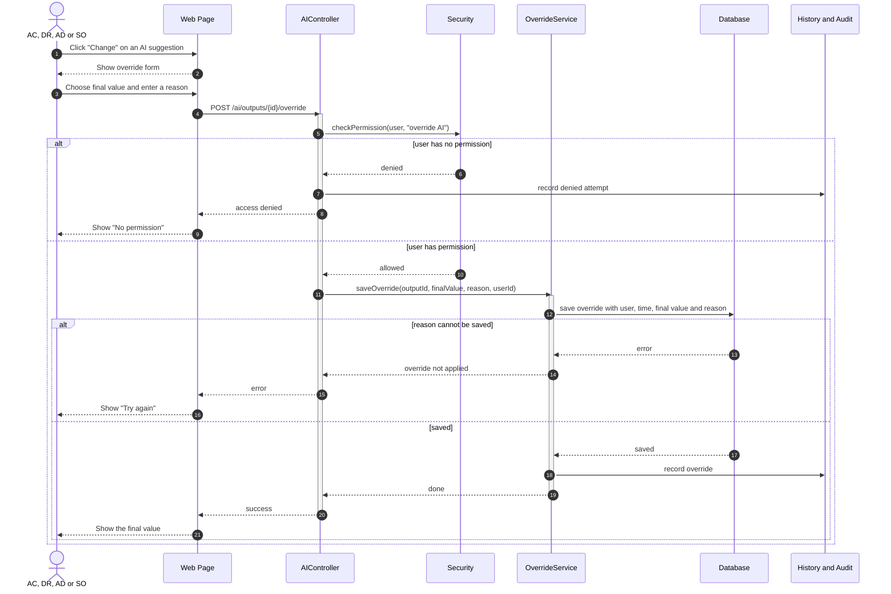


## 1.8 UC-33 Detect Duplicate Listings

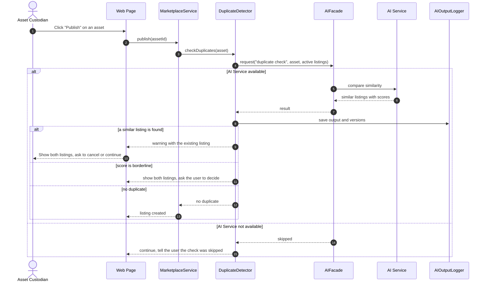


## 1.9 UC-34 Predict Maintenance Need

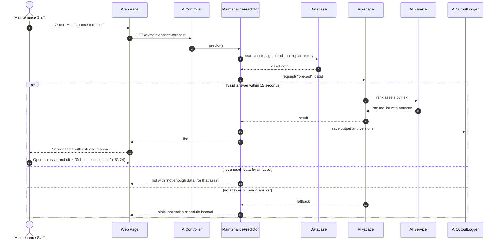


## 1.10 UC-35 Submit AI Feedback

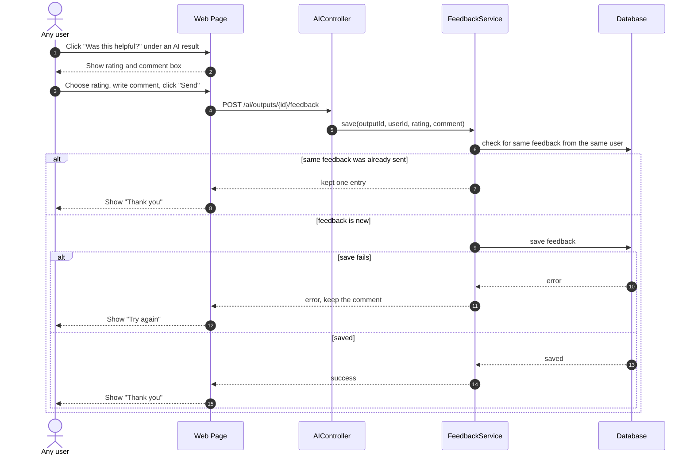


# 2. Class Diagram

## 2.1 AI Module (design pattern: Facade + Adapter)

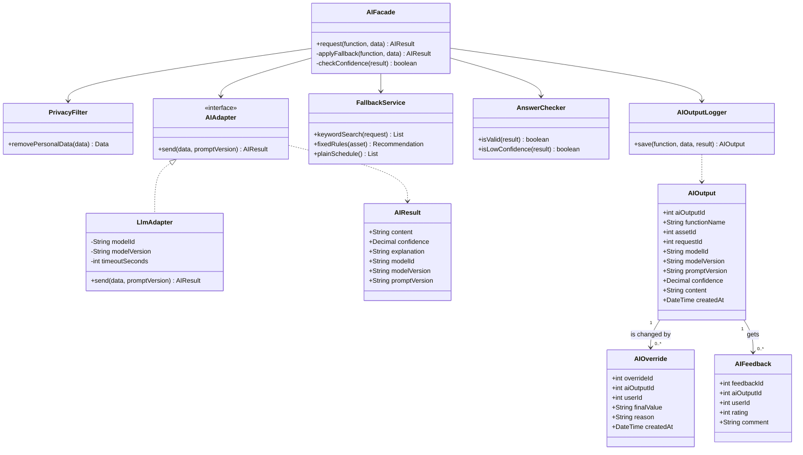


## 2.2 AI Functions and Sustainability

```mermaid
classDiagram
    class ClassificationService {
        +classify(assetData) Suggestion
    }

    class MatchingService {
        +findMatches(requestId) List
        -score(request, listing) int
    }

    class RecommendationService {
        +recommend(assetId) Recommendation
        -disposalOnlyLast(options) Recommendation
    }

    class AssistantService {
        +ask(question, userScope) Answer
        -refuseAction(question) boolean
    }

    class AIReportService {
        +generate(type, period, user) Report
        +markReviewed(reportId, userId) void
        -checkFigures(text, data) boolean
    }

    class DuplicateDetector {
        +checkDuplicates(asset) List
    }

    class MaintenancePredictor {
        +predict() List
    }

    class OverrideService {
        +saveOverride(outputId, finalValue, reason, userId) AIOverride
        +markReviewed(outputId) void
    }

    class FeedbackService {
        +save(outputId, userId, rating, comment) AIFeedback
    }

    class SustainabilityService {
        +recordReuseEvent(assetId, requestId) ReuseEvent
        +getFigures(period, scope) Figures
        +wasteDiversion(period) Decimal
        +avoidedPurchases(period) int
        +lifeExtension(assetId) int
        +reuseRate(period) Decimal
        +repairRate(period) Decimal
        +financialSavings(period) Decimal
        +carbonReduction(period) Decimal
    }

    class ReuseEvent {
        +int reuseId
        +int assetId
        +int requestId
        +String eventType
        +Decimal avoidedValueAed
        +DateTime eventTime
    }

    class EmissionFactor {
        +int factorId
        +int categoryId
        +Decimal kgCo2ePerUnit
        +String source
    }

    class Figures {
        +Decimal value
        +boolean isEstimate
        +String assumptions
        +String numerator
        +String denominator
    }

    class AIController {
        +postClassify() Response
        +postMatch() Response
        +postRecommend() Response
        +postAsk() Response
        +postReport() Response
        +postOverride() Response
        +postFeedback() Response
        +getForecast() Response
    }

    class DashboardController {
        +getFigures() Response
    }

    AIController ..> ClassificationService
    AIController ..> MatchingService
    AIController ..> RecommendationService
    AIController ..> AssistantService
    AIController ..> AIReportService
    AIController ..> OverrideService
    AIController ..> FeedbackService
    AIController ..> MaintenancePredictor
    DashboardController ..> SustainabilityService
    AIReportService ..> SustainabilityService
    SustainabilityService ..> ReuseEvent
    SustainabilityService ..> EmissionFactor
    SustainabilityService ..> Figures
    ClassificationService ..> AIFacade
    MatchingService ..> AIFacade
    RecommendationService ..> AIFacade
    AssistantService ..> AIFacade
    AIReportService ..> AIFacade
    DuplicateDetector ..> AIFacade
    MaintenancePredictor ..> AIFacade
```

| Class | Role | Rule it enforces |
|---|---|---|
| AIFacade | Single door to the AI layer. Applies the privacy filter, adapter, checker, fallback and logger in the same order every time | BR-11, NFR-04, NFR-14 |
| PrivacyFilter | Removes names, emails and IDs of people | NFR-14 |
| AIAdapter / LlmAdapter | One interface. A new provider only needs a new adapter class | Design goal "easy to change" |
| FallbackService | Keyword search, fixed rules, plain schedule | FR-AI-X-08 to 10 |
| AIOutputLogger | Saves model, version, prompt version, confidence and result | FR-AI-X-05 to 07, FR-AI-X-11 to 13 |
| OverrideService | Saves override, final value and reason | FR-AI-X-03, FR-AI-X-04, BR-12 |
| SustainabilityService | The formulas and the "estimate" marks | FR-SUS-01 to 31 |


## 2.3 Sustainability Formulas

From Phase 3, Section 4.21:

**Reuse rate (%)** = (assets reused or transferred / assets considered for reuse) x 100

**Repair rate (%)** = (assets repaired / assets needing a disposition decision) x 100

**Estimated carbon reduction (kg CO2e)** = activity quantity x emission factor, with the emission factor and its source shown on screen


# 3. User Interface Mockups

## 3.1 AI Match Review (UC-27)

```text
+----------------------------------------------------------------------+
|  Matches for request R-0042: "laboratory seating x10"                |
|                                                                      |
|  Rank  Asset                 Score  Why                              |
|  1     Lab bench stool x20   91     Same purpose, stock is enough,   |
|                                     Good condition, same campus      |
|  2     Office chair x6       64     Not enough quantity, Fair        |
|                                                                      |
|  Confidence: High            AI suggestions need your decision.      |
|  [ Reserve #1 ]  [ Choose another asset ]  [ Was this helpful? ]     |
+----------------------------------------------------------------------+
|  Low confidence example:                                             |
|  ! The AI is not sure about this match. Please check it.             |
+----------------------------------------------------------------------+
```


## 3.2 Sustainability Recommendation (UC-28, UC-32)

```text
+----------------------------------------------------------------------+
|  Recommended action for A-2045 Projector                             |
|                                                                      |
|  Suggested: REPAIR              Confidence: 74 %                     |
|  Why: Repair cost is low and the asset is 3 years old.               |
|  Other options: Transfer, Refurbish, Recycle                         |
|  Disposal is the last option.                                        |
|                                                                      |
|  [ Accept ]   [ Change ]   [ Reject ]                                |
|                                                                      |
|  Change or reject:                                                   |
|  Final value [ Transfer v ]   Reason * [____________________]        |
|                                                [ Save override ]     |
|                                                                      |
|  Accepting does not change the asset. Approvals are still needed.    |
+----------------------------------------------------------------------+
```


## 3.3 Assistant (UC-29)

```text
+----------------------------------------------------------------------+
|  Assistant                                                           |
|                                                                      |
|  You:        Which projectors are available in Engineering?          |
|  Assistant:  2 projectors are published by Engineering:              |
|              A-2045 (Good) and A-2051 (Fair).  [Open A-2045]         |
|                                                                      |
|  You:        Approve the transfer of A-2045 for me.                  |
|  Assistant:  I cannot approve transfers. An administrator must       |
|              approve it on the Approvals page.                       |
|                                                                      |
|  [ Type your question here ______________________ ] [ Send ]          |
|  [ Was this helpful? ]                                               |
+----------------------------------------------------------------------+
```


## 3.4 AI Report Review (UC-30)

```text
+----------------------------------------------------------------------+
|  AI report: Monthly summary, September 2026                          |
|  ! AI generated. Please review before sharing.                       |
|                                                                      |
|  Period: 2026-09-01 to 2026-09-30                                   |
|  Summary: 14 assets were reused. 6 purchases were avoided with an    |
|  estimated value of AED 21,000 (estimate).                           |
|  Flagged: "AED 25,000" does not match the data (AED 21,000).         |
|                                                                      |
|  [ Edit text ]   [ Regenerate ]   [ Mark as reviewed ]               |
|  Status: Not reviewed             [ Export ] (disabled until reviewed)|
+----------------------------------------------------------------------+
```


## 3.5 Sustainability Dashboard (UC-31)

```text
+----------------------------------------------------------------------+
|  Sustainability                  Period [ Sep 2026 v ] Dept [ All v ]|
|                                                                      |
|  Assets reused    Avoided purchases   Savings (est.)   CO2e (est.)   |
|  14               6                   AED 21,000       380 kg        |
|                                                                      |
|  Reuse rate  70 %  (14 of 20)         Repair rate 50 % (5 of 10)     |
|  Waste diverted  38 items             Life extension 26 months (est.)|
|                                                                      |
|  [bar chart: reuse by month]          [pie: actions taken]           |
|                                                                      |
|  Values marked "est." are estimates. [Show assumptions] [Export]     |
|  Missing emission factor: "Not enough data"                          |
+----------------------------------------------------------------------+
```


## 3.6 Duplicate Warning (UC-33) and Maintenance Forecast (UC-34)

```text
+----------------------------------------------+   +--------------------------------------+
|  Possible duplicate listing                  |   |  Maintenance forecast                |
|                                              |   |                                      |
|  New: Lab bench stool x20 (CS)               |   |  Asset      Risk     Reason          |
|  Existing: Lab bench stool x20 (CS) L-0044   |   |  A-2045     High     5 repairs, 6 y  |
|  Similarity: 93 %                            |   |  A-2102     Medium   Age 4 y         |
|  [ Cancel ]   [ Publish anyway ]             |   |  A-2201     -        Not enough data |
+----------------------------------------------+   |  [Schedule inspection]               |
                                                   +--------------------------------------+
```


# 4. Traceability

| Diagram | Use case | Requirements |
|---|---|---|
| Sequence 1.1 | UC-26 Classify asset | FR-AI-01 to 15, FR-AI-X-01, FR-AI-X-02 |
| Sequence 1.2 | UC-27 Review AI match | FR-AI-16 to 35 |
| Sequence 1.3 | UC-28 Review sustainability recommendation | FR-AI-36 to 49, FR-SUS-27 to 31 |
| Sequence 1.4 | UC-29 Ask the assistant | FR-AI-50 to 59 |
| Sequence 1.5 | UC-30 Generate AI report | FR-AI-60 to 70 |
| Sequence 1.6 | UC-31 View sustainability dashboard | FR-SUS-01 to 31 |
| Sequence 1.7 | UC-32 Override an AI output | FR-AI-X-03, FR-AI-X-04, BR-12 |
| Sequence 1.8 | UC-33 Detect duplicate listings | No functional requirement in Phase 3 yet |
| Sequence 1.9 | UC-34 Predict maintenance need | No functional requirement in Phase 3 yet |
| Sequence 1.10 | UC-35 Submit AI feedback | No functional requirement in Phase 3 yet |
| AI module class diagram | All AI use cases | FR-AI-X-05 to 17, NFR-04, NFR-14 |
