# Phase 4 & 5 - Part 1: Assets, Marketplace and Requests

Owner: Mohammed Al Ali Use cases: UC-01 to UC-10 (Register asset, Edit asset, Publish surplus asset, Withdraw listing, Submit request, Search and filter assets, Reserve asset, Track request, Cancel request, Save asset to watchlist) Requirement groups: FR-AST, FR-MKT, FR-REQ, FR-SRC, FR-RSV Data stores: D2 Assets, D4 Listings, D5 Requests and Reservations (watchlist items are kept in D5). D3 Asset History is written to, but it belongs to Part 2. Tables: CATEGORY, ASSET, ASSET_MEDIA, LISTING, REQUEST, RESERVATION, WATCHLIST_ITEM

Shared diagrams (architecture, the one Level 0 DFD, ER diagram) are in 00_architecture_and_shared_design.md.

---

## 1. Sequence Diagrams


### 1.1 UC-01 Register Asset

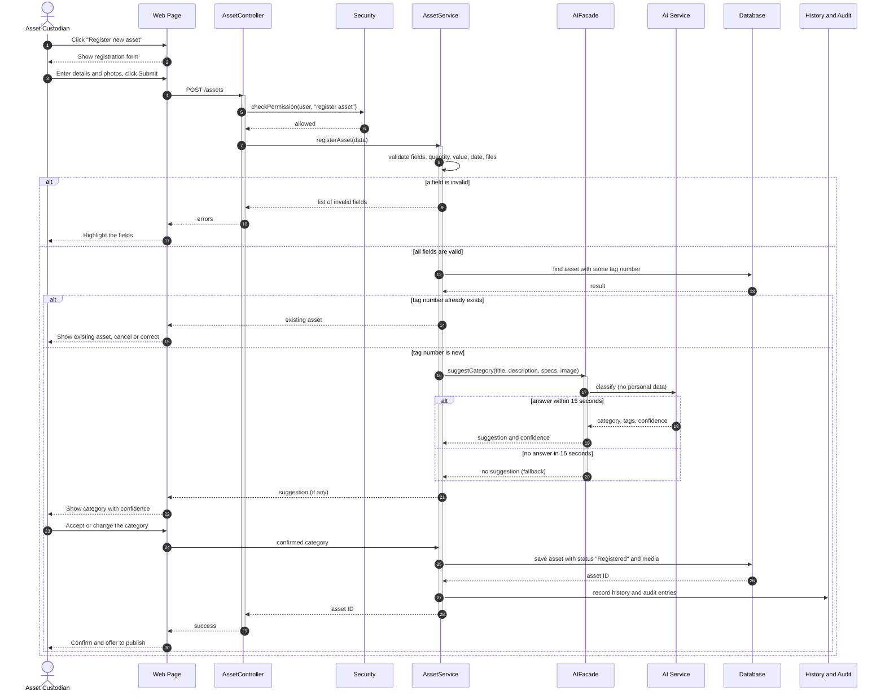

### 1.2 UC-02 Edit Asset

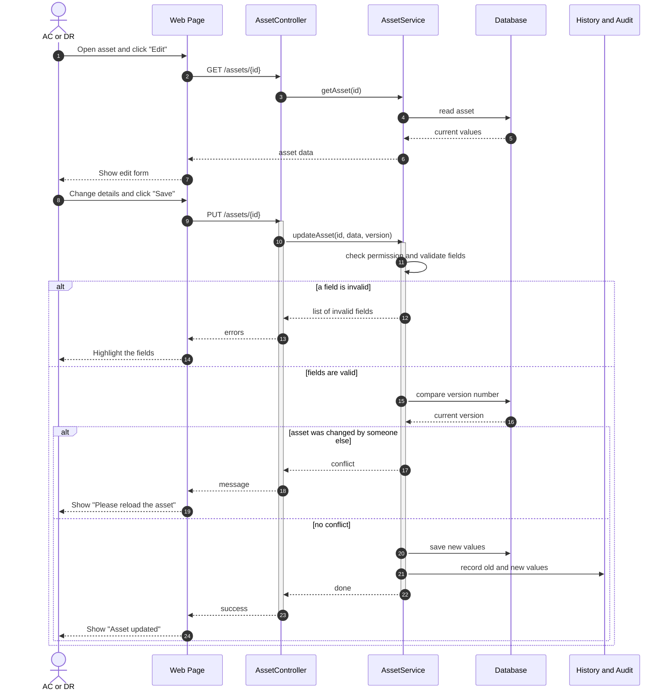

### 1.3 UC-03 Publish Surplus Asset

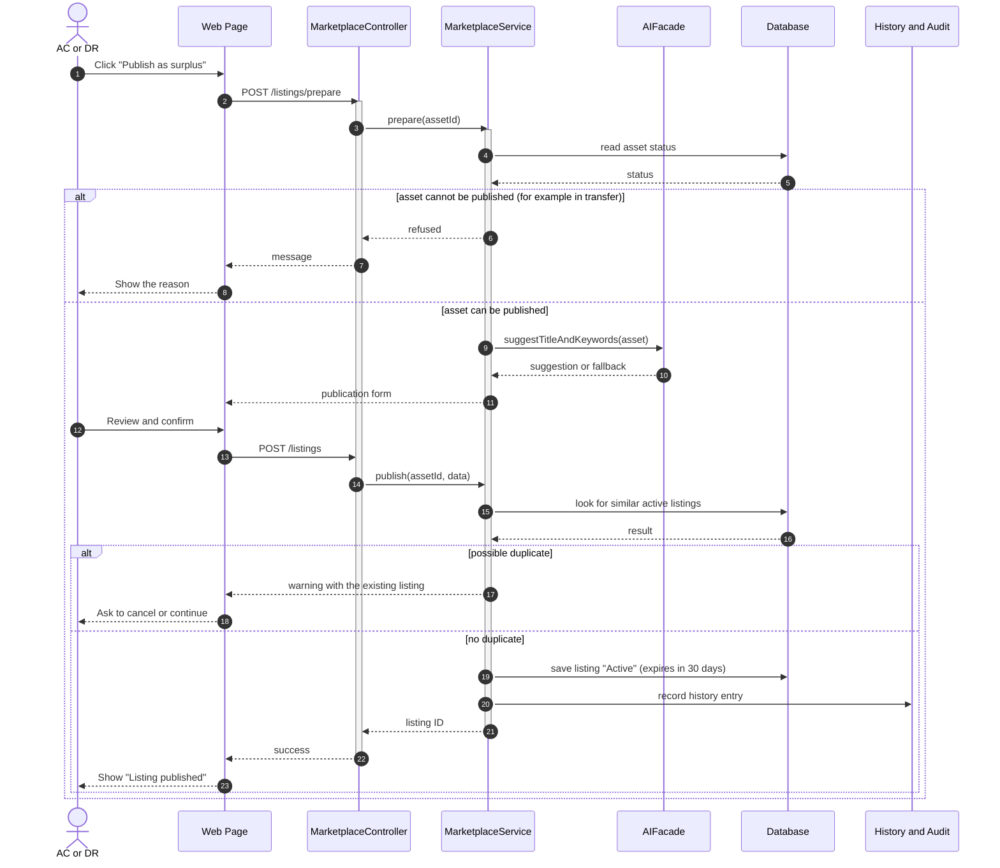

### 1.4 UC-04 Withdraw Listing

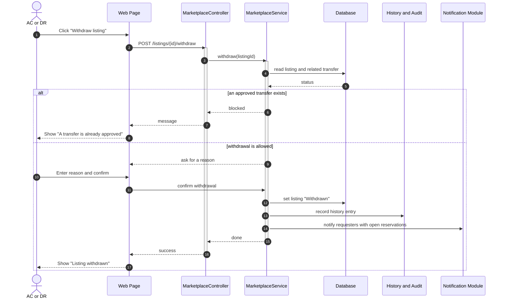

### 1.5 UC-05 Submit Request

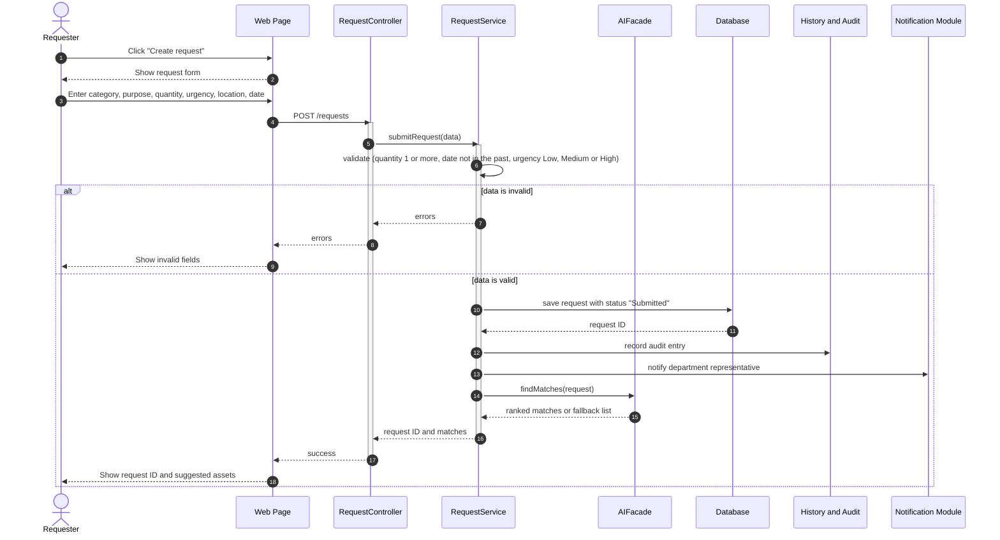

### 1.6 UC-06 Search and Filter Assets

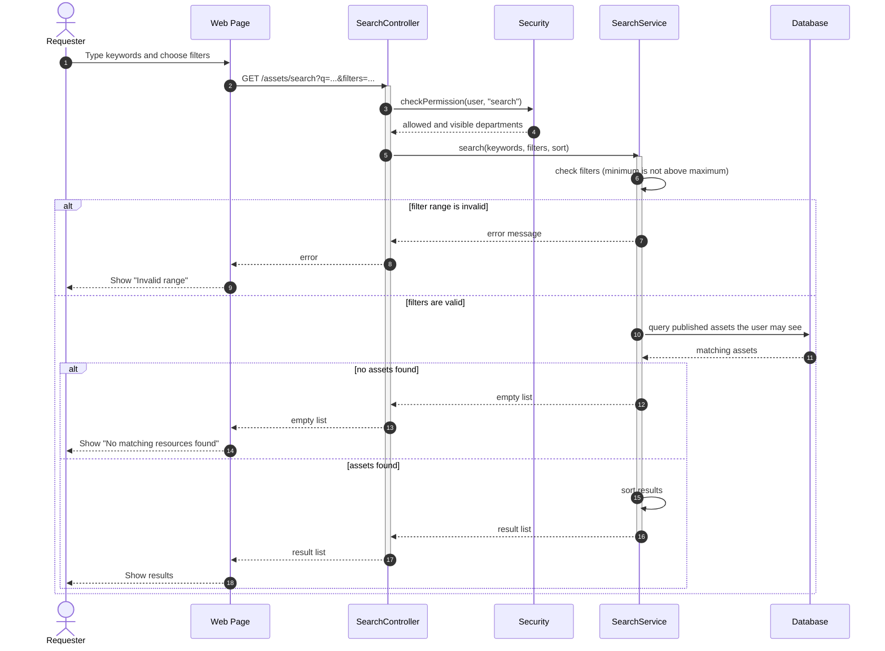

### 1.7 UC-07 Reserve Asset

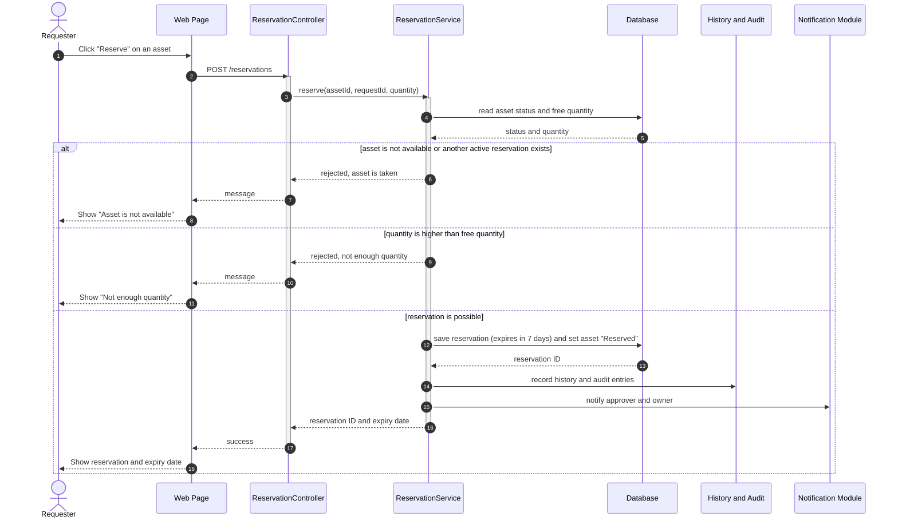

### 1.8 UC-08 Track Request

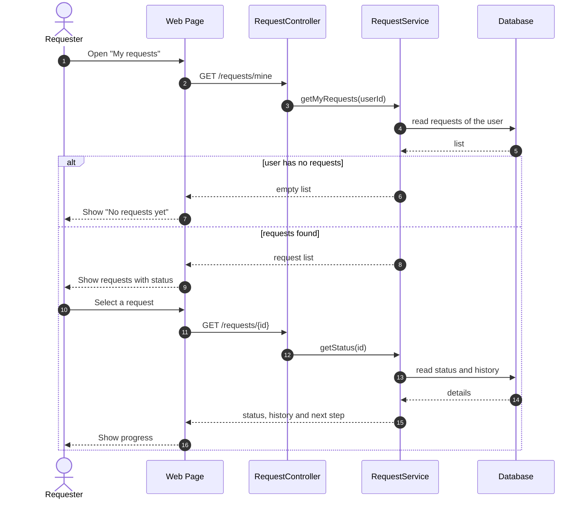

### 1.9 UC-09 Cancel Request

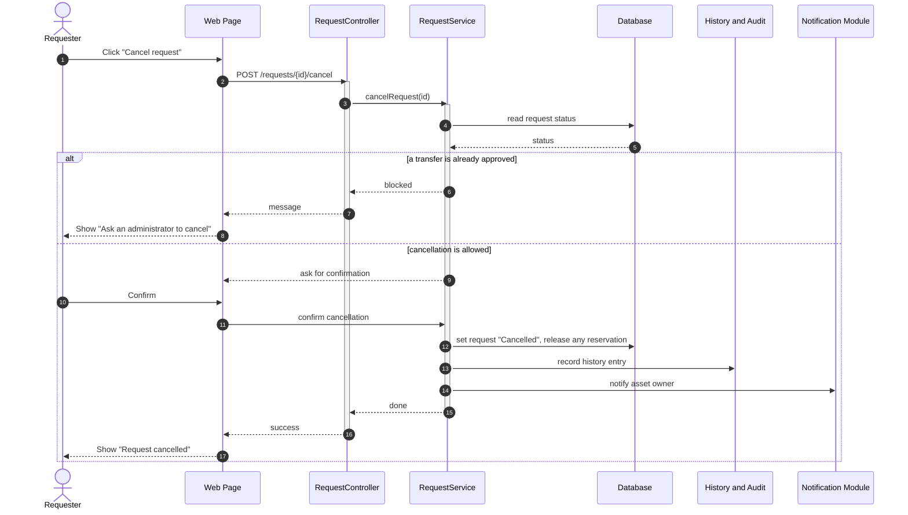

### 1.10 UC-10 Save Asset to Watchlist

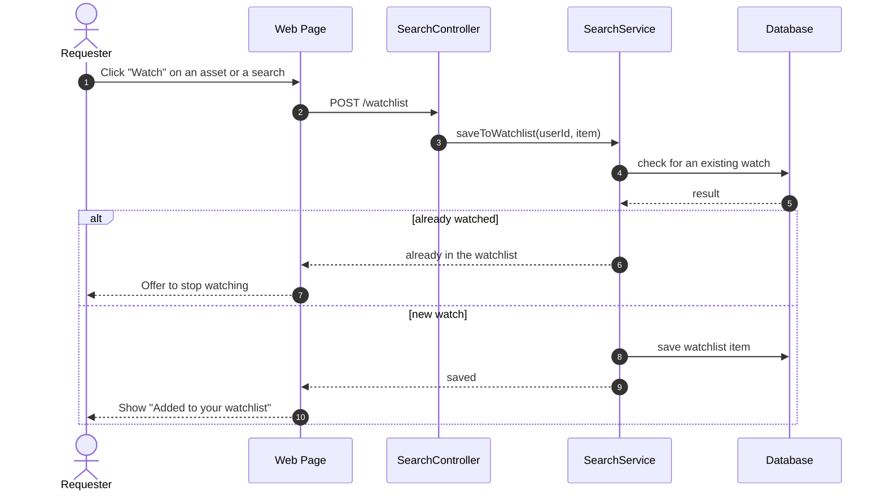

### 1.11 Reservation Expiry (runs every day)

This is the system action behind FR-RSV-05 and BR-04.

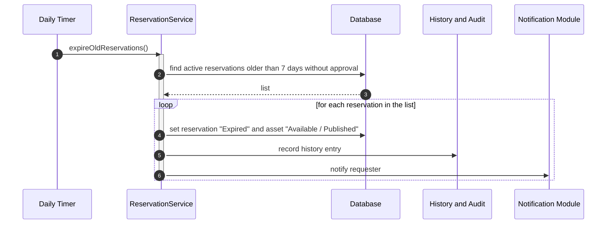

---

---

## 2. Class Diagram

Entity classes match the ER tables. Service classes hold the rules (BR and FR). Controller classes only receive requests and call one service.

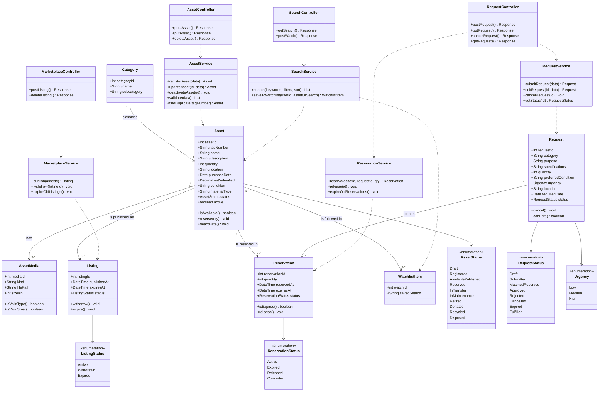

| Class | Role | Rule it enforces |
| --- | --- | --- |
| AssetService | Register, edit, deactivate assets | FR-AST-01 to 10, BR-01, BR-02, BR-13 |
| MarketplaceService | Publish, withdraw, expire listings | FR-MKT-01 to 04, BR-05 |
| RequestService | Submit, edit, cancel, track requests | FR-REQ-01 to 09 |
| ReservationService | Reserve and expire reservations | FR-RSV-01 to 05, BR-04 |
| SearchService | Search, filter, sort, watchlist | FR-SRC-01 to 07, NFR-02, BR-16 |

---

## 3. User Interface Mockups

These are simple wireframes. Real screens will use the same fields and buttons.

### 3.1 Register Asset (UC-01)

```text
+----------------------------------------------------------------------+
|  Circular Campus        [Marketplace] [My assets] [Requests]  (AC) v |
+----------------------------------------------------------------------+
|  Register new asset                                                  |
| Class diagram |
|  Name *            [__________________________]                      |
|  Tag number *      [______________]    (must be new)                 |
|  Description       [__________________________________________]      |
|  Category *        [ Select v ]   AI suggestion: [Laboratory chairs]  |
|                                   Confidence: 82 %  [Accept][Change] |
|  Quantity *        [ 1 ]    Estimated value (AED) [ 0.00 ]           |
|  Owner / Dept *    [ Computer Science v ]                            |
|  Location *        [______________]  Purchase date [ yyyy-mm-dd ]    |
|  Condition *       ( ) Good  ( ) Fair  ( ) Needs repair              |
|  Availability *    ( ) In use  ( ) Surplus                           |
|  Photos            [Choose files]  JPG, JPEG, PNG, max 5 MB          |
|  Documents         [Choose files]  PDF, DOCX, max 10 MB              |
| Class diagram |
|  * required                       [ Save as draft ]  [ Register ]    |
+----------------------------------------------------------------------+
```

### 3.2 Marketplace and Search (UC-06, UC-10)

```text
+----------------------------------------------------------------------+
|  Marketplace                                                         |
|  Search: [ laboratory seating ____________ ] [Search]                |
| Class diagram |
|  Filters            |  Sort by: [ Publication date v ]               |
|  Category   [ v ]   |  ------------------------------------------   |
|  Condition  [ v ]   |  [img] Lab bench stool        Qty 20          |
|  Department [ v ]   |        Computer Science, Good, AED 150 each    |
|  Location   [ v ]   |        [View] [Reserve] [Watch]                |
|  Quantity   [ ]-[ ] |  ------------------------------------------   |
|  Value AED  [ ]-[ ] |  [img] Office chair           Qty 6           |
|  Age (years)[ ]-[ ] |        Business, Fair, AED 90 each             |
|  Status     [ v ]   |        [View] [Reserve] [Watch]                |
|  [Apply filters]    |  ------------------------------------------   |
|  [Save this search] |  Page 1 of 3          [Prev] [Next]            |
+----------------------------------------------------------------------+
|  When nothing matches: "No matching resources found"                 |
+----------------------------------------------------------------------+
```

### 3.3 Create Request (UC-05)

```text
+----------------------------------------------------------------------+
|  New resource request                                                |
| Class diagram |
|  Category *        [ Furniture v ]                                   |
|  Purpose *         [______________________________________]          |
|  Specifications    [______________________________________]          |
|  Quantity *        [ 10 ]                                            |
|  Preferred cond.   [ Good v ]                                        |
|  Urgency *         ( ) Low   ( ) Medium   ( ) High                   |
|  Location *        [______________]  Required date * [ yyyy-mm-dd ]  |
| Class diagram |
|  [ Cancel ]                                [ Submit request ]        |
+----------------------------------------------------------------------+
|  After submit: "Request R-0042 created. Suggested assets:"           |
|   1. Lab bench stool (match 91 %)  [View]                            |
+----------------------------------------------------------------------+
```

### 3.4 My Requests and Reservations (UC-08, UC-09)

```text
+----------------------------------------------------------------------+
|  My requests                                                         |
| Class diagram |
|  ID      Asset / Need        Status               Reserved until     |
|  R-0042  Lab seating x10     Matched / Reserved   2026-11-05         |
|  R-0039  Projector x1        Approved             -                  |
|  R-0031  Monitors x20        Submitted            -                  |
| Class diagram |
|  [View details]  [Edit]  [Cancel request]                            |
| Class diagram |
|  Cancel is blocked once a transfer is approved:                      |
|  "Ask an administrator to cancel this request."                      |
+----------------------------------------------------------------------+
```

---

## 4. Traceability

| Diagram | Use case | Requirements |
| --- | --- | --- |
| Sequence 1.1 | UC-01 Register asset | FR-AST-01 to 08, FR-AI-01 to 15, NFR-04 |
| Sequence 1.2 | UC-02 Edit asset | FR-AST-09, BR-13 |
| Sequence 1.3 | UC-03 Publish surplus asset | FR-MKT-01, FR-MKT-02, FR-MKT-04 |
| Sequence 1.4 | UC-04 Withdraw listing | FR-MKT-03 |
| Sequence 1.5 | UC-05 Submit request | FR-REQ-01 to 06 |
| Sequence 1.6 | UC-06 Search and filter assets | FR-SRC-01 to 05 |
| Sequence 1.7, 1.11 | UC-07 Reserve asset | FR-RSV-01 to 05 |
| Sequence 1.8 | UC-08 Track request | FR-REQ-09 |
| Sequence 1.9 | UC-09 Cancel request | FR-REQ-07, FR-REQ-08 |
| Sequence 1.10 | UC-10 Save asset to watchlist | FR-SRC-06, FR-SRC-07 |
| Class diagram (AssetService) | Deactivate asset (part of UC-02) | FR-AST-10 |


# Phase 4 & 5 — Part 2: Approvals, Transfers, Maintenance and End-of-Life

**Project:** Intelligent, AI-Powered Circular Campus Resource Exchange and Asset Life Cycle Management System  
**Course:** COSC336 — Introduction to Software Engineering  
**Group:** 5  
**Contributor:** Mubarak Saif Mubarak Jarash Alkhyeli  

## 1. Scope and Design Basis

This section covers eight use cases: **UC-11** Approve or Reject Transfer, **UC-12** Confirm Receipt, **UC-13** Report Defect, **UC-14** Record Repair, **UC-15** View Asset History, **UC-16** Approve Disposal, **UC-24** Schedule Inspection, and **UC-25** Approve Donation or Recycling.

The designs trace to **FR-APR, FR-TRF, FR-MNT, FR-HST, FR-DSP, FR-USR, FR-NTF,** and **FR-AUD** in Phase 3.

Relevant database tables are `APPROVAL`, `TRANSFER`, `MAINTENANCE_TICKET`, `REPAIR_RECORD`, `END_OF_LIFE_REQUEST`, and `ASSET_HISTORY`.

The shared data stores are D3 Asset History, D6 Approvals, D7 Transfers, D8 Maintenance Records, and D9 End-of-Life Requests.

The transfer and maintenance state models are in Phase 3 Sections 6.2.1 and 6.2.2, respectively.

The team's consolidated architecture and entity-relationship model belong in `00_architecture_and_shared_design.md`.

### 1.1 Key Design Rules

- The owning Department Representative (DR) must approve asset release before the Administrator (AD) can give final transfer approval.
- A rejection requires a reason containing at least 10 characters.
- Each completed approval stage stores the approver, decision, timestamp, and reason when applicable.
- A transfer must receive the required approvals before scheduling and handover.
- The receiving Requester (RQ) confirms receipt before custody and location are updated.
- Assets under repair or involved in conflicting active transfers cannot be transferred.
- Repair work requires Administrator authorisation, and a separate authorised user verifies completed repairs.
- Disposal requires Administrator and Finance Officer approval. Donation and recycling require Administrator approval.
- All important decisions are recorded in the system's history and audit records.

## 2. Context Diagram

The context diagram shows the interactions between the Circular Campus System and its external users. The system is represented as a single process, while each actor exchanges relevant information with it.

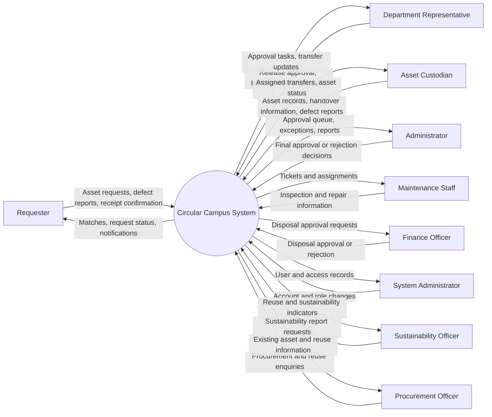

The context diagram focuses on the system boundary and its external interactions. Internal components such as controllers, services, databases, and the notification module are not shown.

## 3. Sequence Diagrams

The following sequence diagrams describe how the main components of the system interact to complete each use case.

### 3.1 UC-11 — Approve or Reject Transfer

The Administrator reviews a pending transfer request and chooses to approve or reject it. Approval requires the owning department's release permission and a valid asset status.

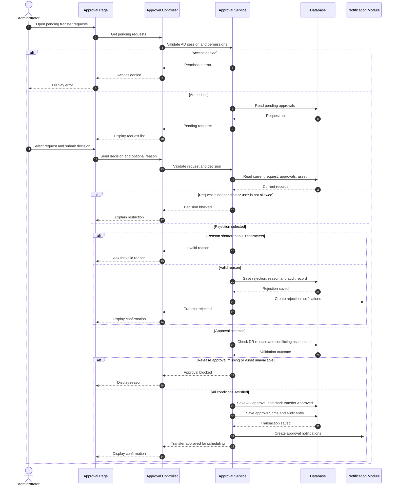

A pending approval older than 48 hours is flagged as overdue, and the Administrator receives a notification according to FR-APR-06.

### 3.2 UC-12 — Confirm Receipt

The receiving Requester confirms that the asset has arrived. The system updates ownership and location only after successful confirmation.

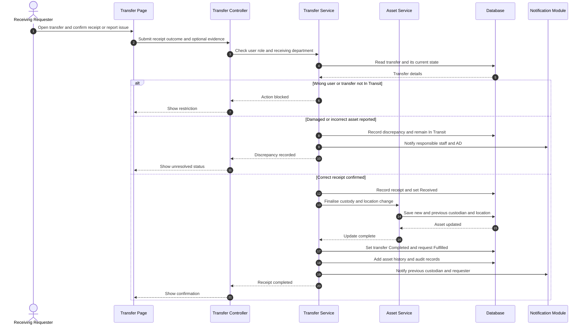

### 3.3 UC-13 — Report Defect

An Asset Custodian or Requester reports a problem with an existing asset. The system creates a maintenance ticket and notifies the maintenance team.

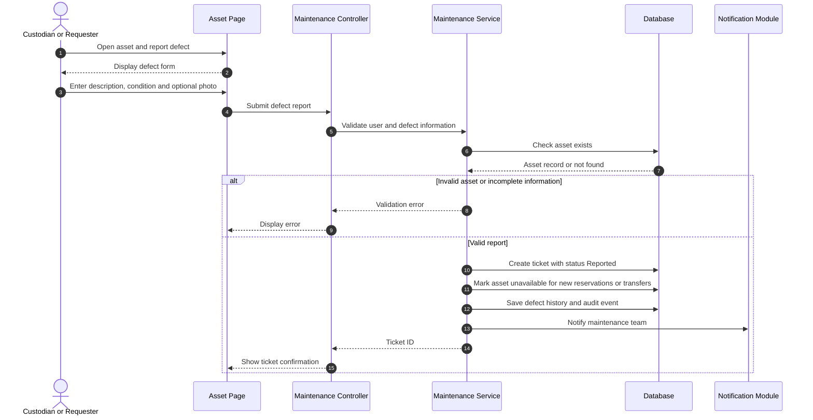

### 3.4 UC-24 — Schedule Inspection

Maintenance Staff schedules an inspection for an existing defect ticket. The system checks the ticket and asset status before saving the schedule.

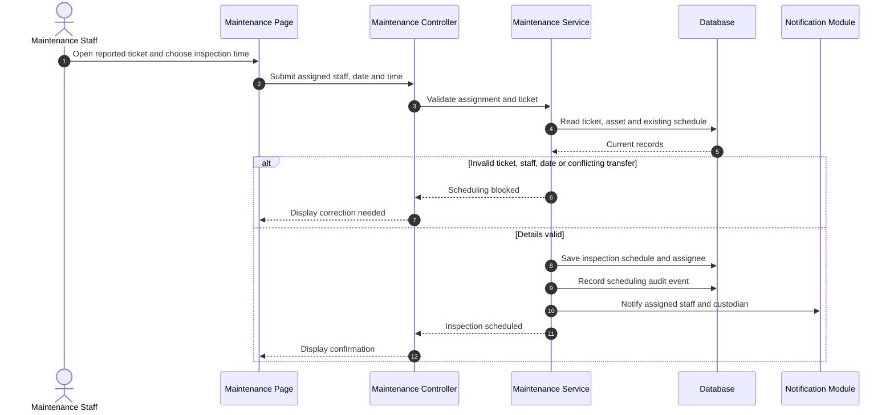

### 3.5 UC-14 — Record Repair

The assigned Maintenance Staff records the repair details, including the work performed, cost, and repair result.

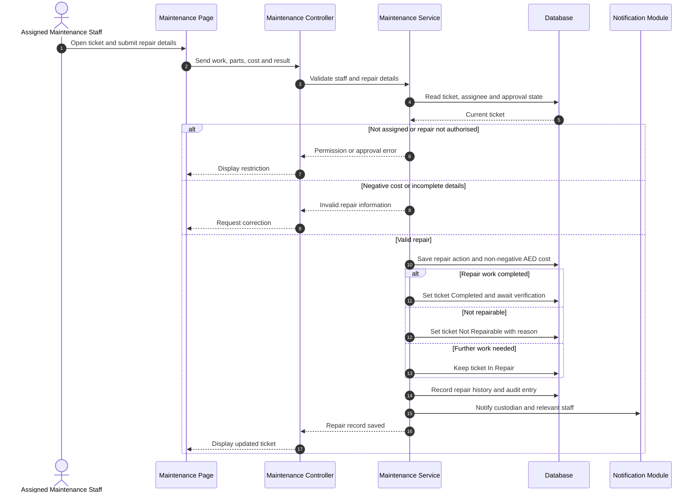

A completed repair must be verified by another authorised Maintenance Staff member or Asset Custodian before the asset becomes available again.

### 3.6 UC-15 — View Asset History

An authorised user opens an asset's history to review previous activities, including transfers, inspections, and repairs.

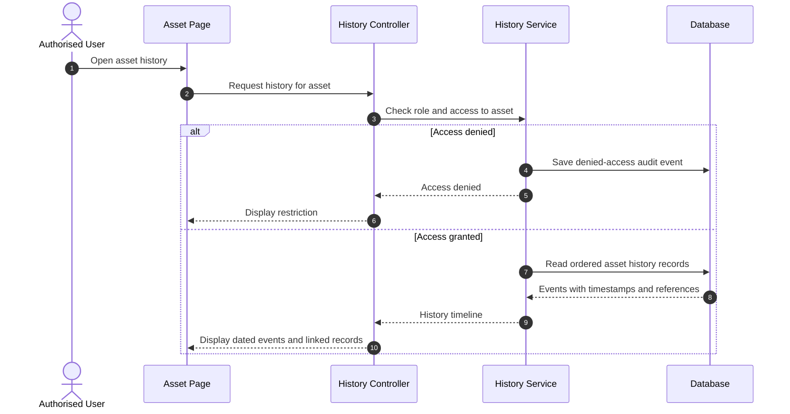

Asset history records are read-only. Corrections are stored as new entries referring to the original event.

### 3.7 UC-16 — Approve Disposal

The Administrator reviews a disposal request and its alternatives assessment. Both Administrator and Finance Officer approval are required before disposal can proceed.

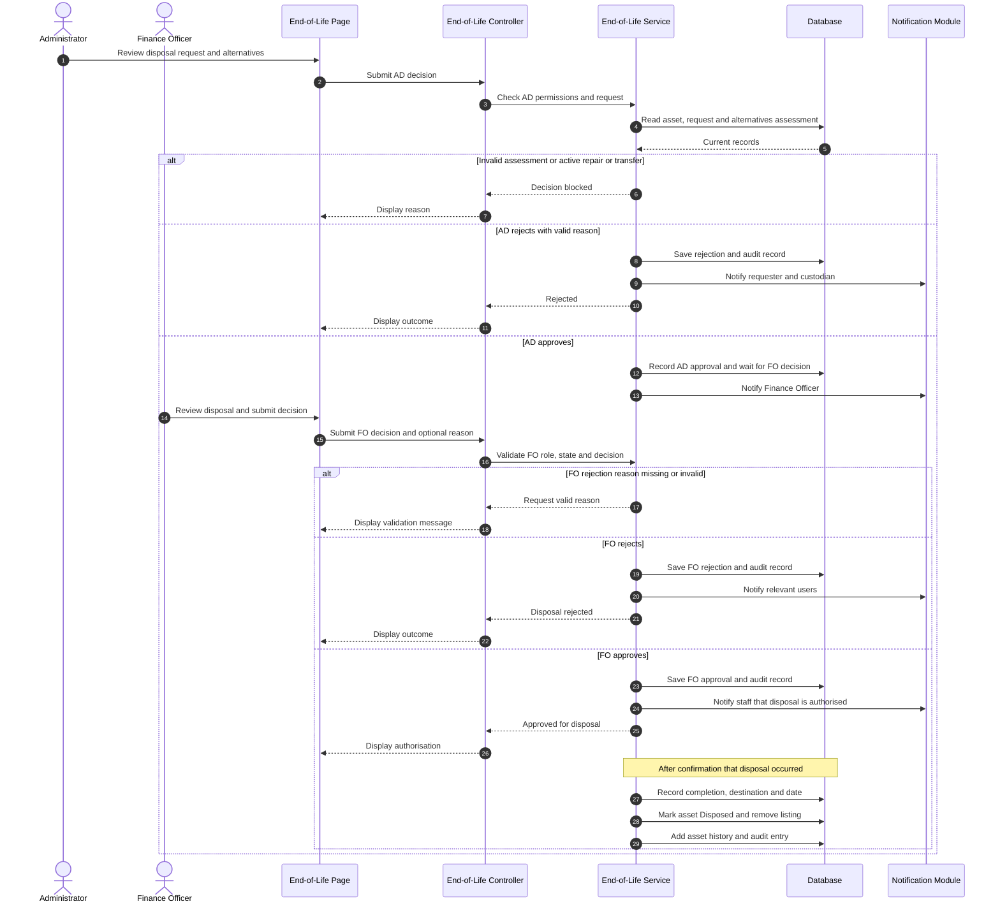

### 3.8 UC-25 — Approve Donation or Recycling

The Administrator reviews a donation or recycling request. Unlike disposal, these actions require Administrator approval without a separate Finance Officer decision.

```mermaid
sequenceDiagram
    autonumber
    actor AD as Administrator
    participant UI as End-of-Life Page
    participant C as End-of-Life Controller
    participant S as End-of-Life Service
    participant DB as Database
    participant N as Notification Module

    AD->>UI: Open donation or recycling request
    UI->>C: Submit AD approval or rejection
    C->>S: Validate AD role, reason and request state
    S->>DB: Read request and asset status
    DB-->>S: Current records

    alt Active repair, transfer, or invalid request
        S-->>C: Action blocked
        C-->>UI: Display reason

    else AD rejects
        alt Rejection reason shorter than 10 characters
            S-->>C: Invalid reason
            C-->>UI: Ask for valid reason
        else Valid reason
            S->>DB: Save rejection and audit entry
            S->>N: Notify relevant users
            S-->>C: Rejected
            C-->>UI: Display outcome
        end

    else AD approves
        S->>DB: Save approval and audit entry
        S->>N: Notify responsible staff
        S-->>C: Approved for action
        C-->>UI: Display authorisation

        Note over S,DB: After confirmation that action occurred

        S->>DB: Record date and destination or recipient
        S->>DB: Mark asset Donated or Recycled and remove listing
        S->>DB: Add asset history and audit entry
    end
```

## 4. Class Diagram

The class diagram represents the main entities and services responsible for approval workflows, asset transfers, maintenance, and end-of-life management.

```mermaid
classDiagram
    class Approval {
        +int approvalId
        +String actionType
        +int assetId
        +int requestId
        +int approverId
        +String decision
        +String reason
        +DateTime decidedAt
        +String status
        +boolean overdueFlag
        +approve(userId) void
        +reject(userId, reason) void
    }

    class Transfer {
        +int transferId
        +int assetId
        +int requestId
        +int fromDeptId
        +int toDeptId
        +Date handoverDate
        +String handoverLocation
        +String status
        +int receivedBy
        +DateTime receivedAt
        +String discrepancyNote
        +schedule(date, location) void
        +markInTransit() void
        +confirmReceipt(userId) void
        +reportDiscrepancy(note) void
    }

    class MaintenanceTicket {
        +int ticketId
        +int assetId
        +int reportedBy
        +int assignedTo
        +String description
        +DateTime inspectionAt
        +String status
        +scheduleInspection(staff, dateTime) void
        +approveRepair(adminId) void
        +verify(userId) void
        +markNotRepairable() void
    }

    class RepairRecord {
        +int repairId
        +int ticketId
        +int performedBy
        +String action
        +Decimal costAed
        +Date repairDate
        +String result
        +isCostValid() boolean
    }

    class EndOfLifeRequest {
        +int eolId
        +int assetId
        +String action
        +String reason
        +String alternativesAssessment
        +String recipient
        +String status
        +hasAssessment() boolean
        +needsFinanceApproval() boolean
        +completeAction() void
    }

    class AssetHistoryEvent {
        +int eventId
        +int assetId
        +String eventType
        +int actorId
        +DateTime eventTime
        +String relatedRecord
        +String details
    }

    class ApprovalService {
        +createApproval(action, assetId, requestId) Approval
        +getPending() List
        +decide(id, decision, reason, userId) Approval
        +markOverdueApprovals() void
    }

    class TransferService {
        +schedule(id, date, location) Transfer
        +confirmReceipt(id, result, note) Transfer
        +reportDiscrepancy(id, note) void
    }

    class MaintenanceService {
        +reportDefect(assetId, description, condition) MaintenanceTicket
        +scheduleInspection(ticketId, staff, dateTime) void
        +recordRepair(ticketId, details) RepairRecord
        +verifyRepair(ticketId, userId) void
    }

    class EndOfLifeService {
        +createRequest(assetId, action, reason) EndOfLifeRequest
        +adminDecision(id, decision, reason) void
        +financeDecision(id, decision, reason) void
        +completeAction(id, details) void
    }

    class HistoryService {
        +record(assetId, type, actorId, reference) AssetHistoryEvent
        +getHistory(assetId) List
    }

    class ApprovalController {
        +getPending() Response
        +postDecision() Response
    }

    class TransferController {
        +postReceipt() Response
    }

    class MaintenanceController {
        +postTicket() Response
        +postInspection() Response
        +postRepair() Response
    }

    class EndOfLifeController {
        +postAdminDecision() Response
        +postFinanceDecision() Response
    }

    class HistoryController {
        +getHistory() Response
    }

    MaintenanceTicket "1" --> "0..*" RepairRecord : includes
    Transfer "1" --> "1..*" Approval : requires

    ApprovalController ..> ApprovalService
    TransferController ..> TransferService
    MaintenanceController ..> MaintenanceService
    EndOfLifeController ..> EndOfLifeService
    HistoryController ..> HistoryService

    ApprovalService ..> Approval
    ApprovalService ..> TransferService
    TransferService ..> Transfer
    TransferService ..> HistoryService

    MaintenanceService ..> MaintenanceTicket
    MaintenanceService ..> RepairRecord

    EndOfLifeService ..> EndOfLifeRequest
    EndOfLifeService ..> ApprovalService
    HistoryService ..> AssetHistoryEvent
```

### 4.1 Class Responsibilities

| Class | Main Responsibility | Related Requirements |
|---|---|---|
| ApprovalService | Handles final decisions, release checks, overdue approvals and approval records | FR-APR-01–07 |
| TransferService | Manages scheduling, receipt confirmation, discrepancies and transfer completion | FR-TRF-01–05 |
| MaintenanceService | Manages defect tickets, inspections, repair records and verification | FR-MNT-01–05 |
| EndOfLifeService | Handles donation, recycling and disposal approval and completion | FR-DSP-01–05 |
| HistoryService | Records and retrieves asset history without modifying previous events | FR-HST-01–03 |

## 5. User Interface Mockups

The following interface mockups show the main pages used for approvals, transfers, maintenance, and asset history.

### 5.1 Approval Queue (UC-11, UC-16, UC-25)

```text
+------------------------------------------------------------------+
| Approvals                                        Administrator    |
| Filter: [Pending v]      Type: [All v]                            |
+------------------------------------------------------------------+
| ID      Type        Asset              From -> To       Waiting   |
| A-101   Transfer    Lab bench stool    CS -> Business   6 h       |
| A-099   Disposal    Old projector      Engineering      52 h      |
| A-097   Recycling   Old monitors       IT               20 h      |
|                                        [Open selected]            |
+------------------------------------------------------------------+
| Selected: A-101    Request: R-0042                                |
| Owner department release approval: APPROVED                      |
| Asset condition: Good      Active conflict: None                 |
| Rejection reason (minimum 10 characters): [_________________]    |
|                                  [Reject]  [Approve]             |
+------------------------------------------------------------------+
```

The Administrator can view pending requests, review approval details, and submit a final decision.

### 5.2 Receipt Confirmation (UC-12)

```text
+------------------------------------------------------------------+
| Transfer T-0031                        Status: In Transit         |
| Asset: Lab bench stool x20                                       |
| From: Computer Science          To: Business School             |
| Handover: 2026-11-04           Location: Library                 |
+------------------------------------------------------------------+
| Receiving Requester: [signed-in user]                            |
| Condition: ( ) As expected   ( ) Damaged or incorrect            |
| Discrepancy note: [__________________________________________]   |
| Optional photo: [Choose file]                                    |
|                     [Report problem]  [Confirm receipt]          |
+------------------------------------------------------------------+
```

The receiving Requester confirms receipt or reports a discrepancy. A damaged or incorrect asset does not automatically complete the transfer.

### 5.3 Defect Report (UC-13)

```text
+------------------------------------------------------------------+
| Report a defect                                                  |
| Asset ID *        [A-2045]  Projector                            |
| Description *     [__________________________________________]   |
| Reported condition: ( ) Good ( ) Fair ( ) Needs Repair           |
| Photo (optional): [Choose file]                                  |
| Date: Automatically recorded                                     |
|                                        [Cancel]  [Submit report]  |
+------------------------------------------------------------------+
```

The user enters the asset information and describes the problem. The system creates a maintenance ticket when the information is valid.

### 5.4 Inspection and Repair (UC-24, UC-14)

```text
+------------------------------------------------------------------+
| Maintenance ticket M-0210        Status: Repair Approved         |
| Asset: A-2045 Projector                                         |
| Inspection: [2026-11-05 10:00]  Assigned staff: [MS-02]          |
|                                             [Schedule inspection]|
+------------------------------------------------------------------+
| Repair history                                                   |
| Date         Work performed                Cost (AED)             |
| 2026-11-06   Lamp unit replaced            180.00                 |
+------------------------------------------------------------------+
| New repair record                                                |
| Work done *: [_______________________________________________]   |
| Cost (AED) *: [0.00]                                             |
| Result: ( ) Completed ( ) Further work ( ) Not repairable        |
|                                                   [Save repair]  |
+------------------------------------------------------------------+
| Verification: Different authorised staff member or custodian    |
| Verified condition: ( ) Good ( ) Fair ( ) Needs Repair           |
|                                                   [Verify]       |
+------------------------------------------------------------------+
```

Maintenance Staff can schedule inspections, record repair work and costs, and verify the repair result.

### 5.5 End-of-Life Decision (UC-16, UC-25)

```text
+------------------------------------------------------------------+
| End-of-life request E-0014                                      |
| Asset: Old projector             Action: Dispose                 |
| Reason: Cannot be repaired                                     |
| Alternatives assessed: Reuse / Transfer / Repair / Donation      |
|                        / Recycling                              |
+------------------------------------------------------------------+
| Administrator decision: Pending                                 |
| Finance Officer decision: Required for disposal                 |
| Reason for rejection (minimum 10 characters): [______________]  |
|                                        [Reject]  [Approve]        |
| Note: Final asset status changes only after action completion.  |
+------------------------------------------------------------------+
```

The Administrator reviews the request and the alternatives assessment. Disposal additionally requires Finance Officer approval.

### 5.6 Asset History (UC-15)

```text
+------------------------------------------------------------------+
| Asset history: A-2045 Projector                                 |
| Date        Event         Actor           Related record         |
| 2026-09-02  Registered    Custodian       -                      |
| 2026-09-10  Published     Custodian       L-0044                 |
| 2026-09-20  Transferred   Administrator   T-0031                 |
| 2026-10-21  Defect        Requester       M-0210                 |
| 2026-10-24  Repaired      Maint. staff    R-0090                 |
+------------------------------------------------------------------+
| Entries are read-only. Corrections create linked new entries.   |
+------------------------------------------------------------------+
```

The asset history displays previous activities in chronological order, including the date, event, responsible user, and related record.

## 6. Traceability

The following table connects the diagrams and interface mockups to their related use cases and functional requirements.

| Diagram / Mockup | Use Case | Related Requirements |
|---|---|---|
| Sequence 3.1, UI 5.1 | UC-11 Approve or Reject Transfer | FR-APR-01, 02, 03, 05, 06, 07; FR-TRF-01 |
| Sequence 3.2, UI 5.2 | UC-12 Confirm Receipt | FR-TRF-03, 04, 05; FR-HST-01 |
| Sequence 3.3, UI 5.3 | UC-13 Report Defect | FR-MNT-01; FR-HST-01 |
| Sequence 3.4, UI 5.4 | UC-24 Schedule Inspection | FR-MNT-02; FR-NTF-01 |
| Sequence 3.5, UI 5.4 | UC-14 Record Repair | FR-MNT-03, 04, 05; FR-HST-01 |
| Sequence 3.6, UI 5.6 | UC-15 View Asset History | FR-HST-01, 02, 03; FR-USR-06 |
| Sequence 3.7, UI 5.1/5.5 | UC-16 Approve Disposal | FR-DSP-01–05; FR-APR-03, 04, 05, 07 |
| Sequence 3.8, UI 5.1/5.5 | UC-25 Approve Donation or Recycling | FR-DSP-01, 03, 04, 05; FR-APR-03, 05, 07 |
| Context Diagram Section 2 | System Boundary and External Actors | FR-APR, FR-TRF, FR-MNT, FR-DSP, FR-USR |
| Class Diagram Section 4 | Workflow and Application Services | FR-APR, FR-TRF, FR-MNT, FR-HST, FR-DSP |

## 7. Design Consistency and Notes

### 7.1 Transfer Approval

The Department Representative must approve releasing the asset before the Administrator gives final transfer approval. A rejected request cannot proceed to scheduling or handover.

### 7.2 Transfer Completion

Administrator approval changes the transfer status to Approved, but does not immediately change ownership, custody, or location.

These details are updated only after the receiving Requester confirms receipt.

### 7.3 Maintenance Verification

A repair marked Completed must still be verified by an authorised staff member or Asset Custodian before the asset can return to service.

### 7.4 Disposal Approval

Disposal requires both Administrator and Finance Officer approval under the Phase 3 requirements. Donation and recycling require Administrator approval.

An approved end-of-life request does not immediately mark an asset as Donated, Recycled, or Disposed. The status changes only after the authorised action is confirmed complete.

### 7.5 Notifications and Audit Records

The system records important approval decisions, transfer updates, maintenance activities, and end-of-life actions.

Relevant users receive notifications when a workflow changes. Audit records contain the responsible actor, action, timestamp, and outcome.

### 7.6 Shared Design Documents

The context diagram provides a high-level representation of external system interactions.

The sequence diagrams describe the order of interactions between components, while the class diagram represents the main entities and services.

The shared architecture and entity-relationship diagram are maintained separately in `00_architecture_and_shared_design.md`.

This separation keeps the individual design document focused on approvals, transfers, maintenance, and end-of-life management.

# Phase 4 & 5 – Part 3: Users, Access, Reports, Notifications and Audit

**Owner:** Mohammed Alketbi
**Use cases:** UC-17 Create user, UC-18 Assign role, UC-19 Deactivate user, UC-20 Log in, UC-21 Generate report, UC-22 View audit log, UC-23 Receive notification
**Requirement groups:** FR-USR, FR-RPT, FR-NTF, FR-AUD (and the security rules BR-07, BR-14, BR-16, NFR-08 to 11)
**Data stores:** D1 Users, D12 Reports, D13 Notifications, D14 Audit Log
**Tables:** DEPARTMENT, USER, ROLE_PERMISSION, REPORT, NOTIFICATION, AUDIT_LOG

Shared diagrams (architecture, the one Level 0 DFD, ER diagram) are in `00_architecture_and_shared_design.md`.

---

# 1. Sequence Diagrams

## 1.1 UC-20 Log In

```mermaid
sequenceDiagram
    autonumber
    actor U as User
    participant UI as Web Page
    participant AuthController
    participant AuthService
    participant DB as Database
    participant Audit as History and Audit

    U->>UI: Open the login page
    UI-->>U: Show login form
    U->>UI: Enter email and password, click "Log in"
    UI->>AuthController: POST /login
    activate AuthController
    AuthController->>AuthService: login(email, password)
    activate AuthService
    AuthService->>DB: find user by email
    DB-->>AuthService: user record or nothing
    alt email not found or password is wrong
        AuthService->>Audit: record failed login
        AuthService-->>AuthController: failed
        AuthController-->>UI: general error
        UI-->>U: Show "Email or password is not correct"
    else account is inactive
        AuthService->>Audit: record denied login
        AuthService-->>AuthController: failed
        AuthController-->>UI: general error
        UI-->>U: Show "Email or password is not correct"
    else login is correct
        AuthService->>AuthService: create session with role and department
        AuthService->>Audit: record successful login
        AuthService-->>AuthController: session
        deactivate AuthService
        AuthController-->>UI: session cookie and role
        deactivate AuthController
        UI-->>U: Show home page for the role
    end
```

Both wrong-password and inactive-account give the same message, so nobody can find out which emails exist (FR-USR error rules).

## 1.2 Self-Registration (FR-USR-02)

```mermaid
sequenceDiagram
    autonumber
    actor V as New user
    participant UI as Web Page
    participant AuthController
    participant UserService
    participant DB as Database
    participant Noti as Notification Module
    actor SA as System Administrator

    V->>UI: Click "Register", enter name, email, department, password
    UI->>AuthController: POST /register
    AuthController->>UserService: selfRegister(data)
    UserService->>UserService: check password length 12 to 128 characters
    UserService->>DB: check that email is unique
    alt email exists or password is invalid
        UserService-->>AuthController: error
        AuthController-->>UI: error
        UI-->>V: Show the problem
    else data is valid
        UserService->>DB: save user with role "Requester" and status "Inactive"
        UserService->>Noti: notify administrators
        Noti->>SA: "New account waiting for activation"
        UserService-->>AuthController: saved
        AuthController-->>UI: saved
        UI-->>V: Show "Wait for activation"
    end
```

## 1.3 UC-17 Create User

```mermaid
sequenceDiagram
    autonumber
    actor SA as System Administrator
    participant UI as Web Page
    participant UserController
    participant Security
    participant UserService
    participant DB as Database
    participant Noti as Notification Module
    participant Audit as History and Audit

    SA->>UI: Open "Users", click "Add user"
    UI-->>SA: Show form
    SA->>UI: Enter name, email, department, role
    UI->>UserController: POST /users
    activate UserController
    UserController->>Security: checkPermission(SA, "manage users")
    Security-->>UserController: allowed
    UserController->>UserService: createUser(data)
    activate UserService
    UserService->>DB: check that email is unique
    DB-->>UserService: result
    alt email already exists or format is wrong
        UserService-->>UserController: error
        UserController-->>UI: error
        UI-->>SA: Highlight the email field
    else data is valid
        UserService->>DB: save user with a first password setup link
        UserService->>Audit: record account creation
        UserService->>Noti: send activation email
        opt email service is down
            Noti-->>UserService: failed, queued for retry
        end
        UserService-->>UserController: user ID
        deactivate UserService
        UserController-->>UI: success
        deactivate UserController
        UI-->>SA: Show "Account created"
    end
```

## 1.4 UC-18 Assign Role

```mermaid
sequenceDiagram
    autonumber
    actor SA as System Administrator
    participant UI as Web Page
    participant UserController
    participant UserService
    participant DB as Database
    participant Audit as History and Audit

    SA->>UI: Open a user, click "Change role"
    UI->>UserController: GET /roles
    UserController-->>UI: role list
    UI-->>SA: Show roles
    SA->>UI: Select role, click "Save"
    UI->>UserController: PUT /users/{id}/role
    activate UserController
    UserController->>UserService: assignRole(userId, role)
    activate UserService
    UserService->>DB: read user
    DB-->>UserService: user with status
    alt user is inactive (was deactivated meanwhile)
        UserService-->>UserController: cancelled
        UserController-->>UI: message
        UI-->>SA: Show "User is inactive"
    else user is active
        UserService->>DB: save new role
        UserService->>Audit: record old and new role
        UserService-->>UserController: done
        deactivate UserService
        UserController-->>UI: success
        deactivate UserController
        UI-->>SA: Show "Role updated"
    end
```

## 1.5 UC-19 Deactivate User

```mermaid
sequenceDiagram
    autonumber
    actor SA as System Administrator
    participant UI as Web Page
    participant UserController
    participant UserService
    participant DB as Database
    participant Audit as History and Audit

    SA->>UI: Open a user, click "Deactivate"
    UI->>UserController: PUT /users/{id}/deactivate
    activate UserController
    UserController->>UserService: deactivate(userId)
    activate UserService
    UserService->>DB: count active administrators, read open requests and approvals
    DB-->>UserService: counts and list
    alt user is the last active administrator
        UserService-->>UserController: blocked
        UserController-->>UI: message
        UI-->>SA: Show "Keep at least one active administrator"
    else user has open requests or approvals
        UserService-->>UserController: list of open items
        UserController-->>UI: list
        UI-->>SA: Show list, ask to reassign first
    else user can be deactivated
        UserService->>DB: set status "Inactive", end all sessions
        UserService->>Audit: record deactivation
        UserService-->>UserController: done
        deactivate UserService
        UserController-->>UI: success
        deactivate UserController
        UI-->>SA: Show "User deactivated"
    end
```

## 1.6 UC-21 Generate Report

```mermaid
sequenceDiagram
    autonumber
    actor U as AD, FO, PO, SO (DR, AC, MS own department)
    participant UI as Web Page
    participant ReportController
    participant Security
    participant ReportService
    participant DB as Database
    participant Audit as History and Audit

    U->>UI: Open "Reports", choose type, set filters
    UI->>ReportController: POST /reports
    activate ReportController
    ReportController->>Security: checkPermission(user, report type)
    alt user may not see this report (for example financial data)
        Security-->>ReportController: denied
        ReportController->>Audit: record denied attempt
        ReportController-->>UI: access denied
        UI-->>U: Show "No access"
    else user may see the report
        Security-->>ReportController: allowed with department scope
        ReportController->>ReportService: generate(type, filters, scope)
        activate ReportService
        ReportService->>ReportService: check date range
        alt date range is invalid
            ReportService-->>ReportController: error
            ReportController-->>UI: error
            UI-->>U: Show "Invalid date range"
        else date range is valid
            ReportService->>DB: read data for the report
            alt data source times out
                DB-->>ReportService: timeout
                ReportService-->>UI: offer to run the report in the background
            else data is read
                DB-->>ReportService: rows
                alt no rows
                    ReportService-->>UI: empty report
                    UI-->>U: Show "No results found."
                else rows found
                    ReportService->>DB: save report record
                    ReportService-->>ReportController: report
                    deactivate ReportService
                    ReportController-->>UI: report
                    deactivate ReportController
                    UI-->>U: Show report
                    opt user clicks "Export CSV"
                        U->>UI: Export
                        UI->>ReportController: GET /reports/{id}/csv
                        ReportController->>Audit: record export
                        ReportController-->>UI: CSV file with name and time
                    end
                end
            end
        end
    end
```

## 1.7 UC-22 View Audit Log

```mermaid
sequenceDiagram
    autonumber
    actor U as SA or AD
    participant UI as Web Page
    participant AuditController
    participant Security
    participant AuditService
    participant DB as Database

    U->>UI: Open "Audit log", set filters (user, action, record, dates)
    UI->>AuditController: GET /audit?filters=...
    activate AuditController
    AuditController->>Security: checkPermission(user, "view audit")
    alt user is not SA or AD
        Security-->>AuditController: denied
        AuditController-->>UI: access denied
        UI-->>U: Show "No access"
    else user is SA or AD
        Security-->>AuditController: allowed
        AuditController->>AuditService: search(filters)
        activate AuditService
        AuditService->>DB: read entries (read only)
        DB-->>AuditService: entries
        alt result is too large
            AuditService-->>AuditController: ask for a narrower filter
            AuditController-->>UI: message
            UI-->>U: Show "Narrow your filter"
        else result fits
            AuditService-->>AuditController: entries
            deactivate AuditService
            AuditController-->>UI: entries
            deactivate AuditController
            UI-->>U: Show entries
        end
    end
```

## 1.8 UC-23 Receive Notification

```mermaid
sequenceDiagram
    autonumber
    participant Svc as Any Service (for example ApprovalService)
    participant NotificationService
    participant DB as Database
    participant Mail as Email Service
    actor U as User
    participant UI as Web Page

    Svc->>NotificationService: notify(eventType, involvedUsers)
    activate NotificationService
    NotificationService->>DB: save one in-app notification per user (status "Unread")
    opt user turned on email notifications
        NotificationService->>Mail: send email
        alt email service is down
            Mail-->>NotificationService: failed
            NotificationService->>DB: keep message, queue email for retry
        else email sent
            Mail-->>NotificationService: delivery status
        end
    end
    deactivate NotificationService
    U->>UI: Open the page, see the bell with a number
    UI->>NotificationService: GET /notifications (own only)
    NotificationService->>DB: read own notifications
    DB-->>NotificationService: list
    NotificationService-->>UI: list
    UI-->>U: Show messages
    U->>UI: Click a message
    UI->>NotificationService: PUT /notifications/{id}/read
    NotificationService->>DB: set status "Read"
```

---

# 2. Class Diagram

```mermaid
classDiagram
    class Department {
        +int deptId
        +String name
        +int repUserId
    }
    class User {
        +int userId
        +String name
        +String email
        +String passwordHash
        +Role role
        +int deptId
        +UserStatus status
        +boolean emailNotifications
        +isActive() boolean
        +checkPassword(pw) boolean
        +deactivate() void
    }
    class RolePermission {
        +Role role
        +String action
        +String scope
        +allows(action) boolean
    }
    class Report {
        +int reportId
        +String reportType
        +int generatedBy
        +Date periodStart
        +Date periodEnd
        +boolean aiGenerated
        +boolean reviewed
        +String content
        +exportCsv() File
    }
    class Notification {
        +int notificationId
        +int userId
        +String eventType
        +String message
        +NotificationStatus status
        +DateTime createdAt
        +markRead() void
    }
    class AuditLogEntry {
        +int auditId
        +int actorId
        +String action
        +String recordRef
        +String outcome
        +String oldValue
        +String newValue
        +DateTime eventTime
    }
    class Role {
        <<enumeration>>
        DR
        AC
        RQ
        AD
        PO
        FO
        MS
        SO
        SA
    }
    class UserStatus {
        <<enumeration>>
        Active
        Inactive
    }
    class NotificationStatus {
        <<enumeration>>
        Unread
        Read
    }

    class AuthService {
        +login(email, password) Session
        +logout(session) void
        +selfRegister(data) User
    }
    class SecurityService {
        +checkPermission(user, action, record) boolean
        +departmentScope(user) List
        +isOwnDepartment(user, record) boolean
    }
    class UserService {
        +createUser(data) User
        +assignRole(userId, role) void
        +deactivate(userId) void
        +validatePassword(pw) boolean
    }
    class ReportService {
        +generate(type, filters, scope) Report
        +exportCsv(reportId) File
        +validateDateRange(from, to) boolean
    }
    class NotificationService {
        +notify(eventType, users) void
        +list(userId) List
        +markRead(id) void
        +retryEmails() void
    }
    class AuditService {
        +record(actor, action, record, outcome, oldValue, newValue) void
        +search(filters) List
    }
    class AuthController {
        +postLogin() Response
        +postRegister() Response
    }
    class UserController {
        +postUser() Response
        +putRole() Response
        +putDeactivate() Response
    }
    class ReportController {
        +postReport() Response
        +getCsv() Response
    }
    class AuditController {
        +getAudit() Response
    }
    class NotificationController {
        +getNotifications() Response
        +putRead() Response
    }

    Department "1" --> "0..*" User : has
    User --> Role
    User --> UserStatus
    Notification --> NotificationStatus
    User "1" --> "0..*" Notification : receives
    User "1" --> "0..*" AuditLogEntry : performs
    User "1" --> "0..*" Report : generates
    RolePermission --> Role

    AuthController ..> AuthService
    UserController ..> UserService
    ReportController ..> ReportService
    AuditController ..> AuditService
    NotificationController ..> NotificationService
    AuthService ..> User
    AuthService ..> AuditService
    UserService ..> User
    UserService ..> AuditService
    ReportService ..> Report
    ReportService ..> SecurityService
    NotificationService ..> Notification
    SecurityService ..> RolePermission
    SecurityService ..> User
```

| Class | Role | Rule it enforces |
|---|---|---|
| AuthService | Login, logout, self-registration | FR-USR-02 to 04, NFR-08 |
| SecurityService | One place that checks role, department and active status before every action | FR-USR-06, BR-07, BR-16 |
| UserService | Create, change role, deactivate | FR-USR-01, FR-USR-05, last administrator rule |
| ReportService | Build, filter and export reports | FR-RPT-01 to 04 |
| NotificationService | Create, deliver and list notifications | FR-NTF-01 to 04 |
| AuditService | Writes entries (never edits or deletes) and searches them | FR-AUD-01 to 04, BR-14 |
| RolePermission | Stores the permission matrix of Phase 3 (Section 2.4) as data | BR-16 |

---

# 3. User Interface Mockups

## 3.1 Login and Register (UC-20, FR-USR-02)

```text
+----------------------------------------------+
|        Circular Campus Resource Exchange     |
|                                              |
|   Email      [______________________]        |
|   Password   [______________________]        |
|                                              |
|              [        Log in        ]        |
|   No account?  Register as a requester       |
|                                              |
|   Wrong details show one general message:    |
|   "Email or password is not correct"         |
+----------------------------------------------+
```

## 3.2 User Management (UC-17, UC-18, UC-19)

```text
+----------------------------------------------------------------------+
|  Users                                         (System Administrator)|
|  Search [__________]  Role [ All v ]  Status [ All v ] [ + Add user ]|
|                                                                      |
|  Name            Email            Dept       Role   Status           |
|  A. Hassan       a.h@univ.ae      CS         DR     Active           |
|  K. Saeed        k.s@univ.ae      Business   RQ     Inactive         |
|  M. Rashid       m.r@univ.ae      IT         SA     Active           |
|                                                                      |
|  [Change role]  [Deactivate]  [Activate]                             |
+----------------------------------------------------------------------+
|  Add user                                                            |
|  Name *  [__________]   Email * [______________]                     |
|  Department * [ v ]     Role * [ v ]                                 |
|                                    [ Cancel ]  [ Create account ]    |
+----------------------------------------------------------------------+
```

## 3.3 Reports (UC-21)

```text
+----------------------------------------------------------------------+
|  Reports                                                             |
|  Report  [ Completed transfers v ]                                   |
|  From [ yyyy-mm-dd ]  To [ yyyy-mm-dd ]  Department [ All v ]        |
|  Category [ All v ]   Status [ All v ]              [ Generate ]     |
|                                                                      |
|  Completed transfers, 2026-09-01 to 2026-09-30     Made 2026-10-01   |
|  Asset            From      To          Date         Value (AED)*    |
|  Lab bench stool  CS        Business    2026-09-20   3,000           |
|  Projector        IT        Eng.        2026-09-25   1,800           |
|                                                                      |
|  * Value column only for FO, AD and allowed roles                    |
|                                                  [ Export CSV ]      |
|  Empty result: "No results found."                                   |
+----------------------------------------------------------------------+
```

## 3.4 Audit Log (UC-22)

```text
+----------------------------------------------------------------------+
|  Audit log                                      (SA or Administrator)|
|  User [____]  Action [ All v ]  Record [____]  From [ ]  To [ ]      |
|                                                    [ Search ]        |
|                                                                      |
|  Time              User   Action          Record  Outcome            |
|  2026-10-21 09:12  AD01   Approve         A-101   Success            |
|  2026-10-21 09:20  RQ07   Approve         A-101   Denied             |
|  2026-10-21 10:02  SA01   Change role     U-33    Success            |
|  Details: old value DR -> new value AC                               |
|                                                                      |
|  Read only. Entries cannot be edited or deleted.                     |
+----------------------------------------------------------------------+
```

## 3.5 Notifications (UC-23)

```text
+----------------------------------------------------------------------+
|  Circular Campus                                [ Bell (3) ]  (RQ) v |
+----------------------------------------------------------------------+
|  Notifications                                                       |
|  * Your request R-0042 was approved                       5 min ago  |
|  * Transfer T-0031 is ready for pickup                    2 h ago    |
|    Reservation of Lab bench stool expires in 1 day        1 day ago  |
|                                                                      |
|  (* = unread)                       [ Mark all as read ]             |
|  Settings: [x] Also send me emails                                   |
+----------------------------------------------------------------------+
```

---

# 4. Traceability

| Diagram | Use case | Requirements |
|---|---|---|
| Sequence 1.3 | UC-17 Create user | FR-USR-01, FR-USR-02, FR-AUD-01 |
| Sequence 1.4 | UC-18 Assign role | FR-USR-05, BR-16 |
| Sequence 1.5 | UC-19 Deactivate user | FR-USR-05 |
| Sequence 1.1, 1.2 | UC-20 Log in | FR-USR-02 to 04, FR-USR-06 |
| Sequence 1.6 | UC-21 Generate report | FR-RPT-01 to 04 |
| Sequence 1.7 | UC-22 View audit log | FR-AUD-01 to 04 |
| Sequence 1.8 | UC-23 Receive notification | FR-NTF-01 to 04 |

# Phase 4 & 5 - Part 4: AI Layer and Sustainability

**Owner:** Abdulla

**Use cases:** UC-26 Classify asset, UC-27 Review AI match, UC-28 Review sustainability recommendation, UC-29 Ask the assistant, UC-30 Generate AI report, UC-31 View sustainability dashboard, UC-32 Override an AI output, UC-33 Detect duplicate listings, UC-34 Predict maintenance need, UC-35 Submit AI feedback

**Requirement groups:** FR-AI-01 to FR-AI-70, FR-AI-X-01 to FR-AI-X-17, FR-SUS-01 to FR-SUS-31

**Data stores:** D10 AI Output Log, D11 Sustainability Records (reads D2, D4, D5, D8)

**Tables:** AI_OUTPUT, AI_OVERRIDE, AI_FEEDBACK, REUSE_EVENT, EMISSION_FACTOR

Shared diagrams (architecture, AI integration design, the one Level 0 DFD, ER diagram) are in `00_architecture_and_shared_design.md`. Read Section 2.4 there first. Every AI use case below uses the same path: service, AI Facade, privacy filter, AI Adapter, AI Service, answer checker, AI Output Log.


# 1. Sequence Diagrams

## 1.1 UC-26 Classify Asset

```mermaid
sequenceDiagram
    autonumber
    actor AC as Asset Custodian
    participant UI as Web Page
    participant AIController
    participant ClassificationService
    participant AIFacade
    participant Privacy as PrivacyFilter
    participant Adapter as AIAdapter
    participant AIService as AI Service
    participant Log as AIOutputLogger
    participant DB as Database

    AC->>UI: Click "Suggest category" on the form
    UI->>AIController: POST /ai/classify (title, description, specs, image)
    activate AIController
    AIController->>ClassificationService: classify(assetData)
    activate ClassificationService
    ClassificationService->>AIFacade: request("classification", data)
    activate AIFacade
    AIFacade->>Privacy: removePersonalData(data)
    Privacy-->>AIFacade: clean data
    AIFacade->>Adapter: send(clean data, promptVersion)
    Adapter->>AIService: classify

    alt answer within 15 seconds
        AIService-->>Adapter: category, subcategory, tags, material, confidence
        Adapter-->>AIFacade: result

        alt answer is not valid
            AIFacade-->>ClassificationService: ignore, ask user to choose by hand
        else confidence is below threshold
            AIFacade-->>ClassificationService: result with warning
        else answer is good
            AIFacade-->>ClassificationService: result
        end

    else no answer in 15 seconds
        Adapter-->>AIFacade: timeout
        AIFacade-->>ClassificationService: no suggestion, fallback used
    end

    deactivate AIFacade
    ClassificationService->>Log: save(modelId, modelVersion, promptVersion, confidence, result)
    Log->>DB: insert AI output
    ClassificationService-->>AIController: suggestion, confidence, warning or fallback notice
    deactivate ClassificationService
    AIController-->>UI: suggestion
    deactivate AIController
    UI-->>AC: Show category, tags, confidence
    AC->>UI: Accept or change

    Note over UI,DB: The suggestion is saved as the final classification only after the user accepts it (FR-AI-15). A change is saved as an override (UC-32).
```


## 1.2 UC-27 Review AI Match

```mermaid
sequenceDiagram
    autonumber
    actor U as RQ, AC, DR, AD or PO
    participant UI as Web Page
    participant AIController
    participant MatchingService
    participant AIFacade
    participant AIService as AI Service
    participant SearchService
    participant Log as AIOutputLogger
    participant OverrideService

    U->>UI: Open a request, click "Find matches"
    UI->>AIController: POST /ai/match (request id)
    activate AIController
    AIController->>MatchingService: findMatches(requestId)
    activate MatchingService
    MatchingService->>MatchingService: read request and active listings
    MatchingService->>AIFacade: request("matching", request, listings)
    activate AIFacade
    AIFacade->>AIService: embed and compare (no personal data)

    alt answer within 15 seconds
        AIService-->>AIFacade: ranked list, scores, reasons, confidence
        AIFacade-->>MatchingService: matches

        alt no matches
            MatchingService->>SearchService: normal search (UC-06)
            SearchService-->>MatchingService: results
        end

    else no answer in 15 seconds
        AIFacade-->>MatchingService: fallback
        MatchingService->>SearchService: keyword search (UC-06)
        SearchService-->>MatchingService: results
    end

    deactivate AIFacade
    MatchingService->>Log: save result and versions
    MatchingService-->>AIController: ranked matches (score 0 to 100, reasons)
    deactivate MatchingService
    AIController-->>UI: matches
    deactivate AIController
    UI-->>U: Show list with score and reasons

    alt confidence is low
        UI-->>U: Show warning "Please check this match"
    end

    alt user accepts a match
        U->>UI: Click "Reserve" (UC-07)
        Note over UI: The AI never reserves or approves by itself (FR-AI-35).
    else user rejects or chooses another asset
        U->>UI: Choose another asset
        UI->>OverrideService: saveOverride(output, finalValue)
    end
```


## 1.3 UC-28 Review Sustainability Recommendation

```mermaid
sequenceDiagram
    autonumber
    actor SO as Sustainability Officer
    participant UI as Web Page
    participant AIController
    participant RecommendationService
    participant AIFacade
    participant AIService as AI Service
    participant DB as Database
    participant Log as AIOutputLogger
    participant OverrideService

    SO->>UI: Open an asset, click "Recommend action"
    UI->>AIController: POST /ai/recommend (asset id)
    activate AIController
    AIController->>RecommendationService: recommend(assetId)
    activate RecommendationService
    RecommendationService->>DB: read condition, repair history, status, value
    DB-->>RecommendationService: asset data

    alt not enough data
        RecommendationService-->>AIController: "not enough data"
        AIController-->>UI: message
        UI-->>SO: Show "Not enough data"

    else enough data
        RecommendationService->>AIFacade: request("recommendation", data)
        AIFacade->>AIService: analyse (no personal data)

        alt valid answer
            AIService-->>AIFacade: action, reason, confidence
            AIFacade-->>RecommendationService: recommendation
            RecommendationService->>RecommendationService: disposal only if all other actions are not possible (BR-10)
            RecommendationService->>Log: save output and versions
            RecommendationService-->>AIController: recommendation with explanation
            deactivate RecommendationService
            AIController-->>UI: recommendation
            deactivate AIController
            UI-->>SO: Show action, reason, confidence

        else answer invalid or timeout
            AIFacade-->>RecommendationService: hidden, error logged
            RecommendationService-->>UI: no recommendation
        end

        alt Sustainability Officer accepts
            SO->>UI: Click "Accept"
            UI->>OverrideService: markReviewed(output)
            Note over UI,OverrideService: Accepting does not change the asset. A transfer, donation, recycling or disposal still needs the approval flow of Part 2 (FR-AI-49).

        else Sustainability Officer rejects or changes
            SO->>UI: Click "Reject" and enter a reason
            UI->>OverrideService: saveOverride(output, finalValue, reason)
            OverrideService->>Log: save override with user and time
        end
    end
```


## 1.4 UC-29 Ask the Assistant

```mermaid
sequenceDiagram
    autonumber
    actor U as User (any role except SA)
    participant UI as Web Page
    participant AIController
    participant Security
    participant AssistantService
    participant Privacy as PrivacyFilter
    participant AIFacade
    participant AIService as AI Service
    participant DB as Database
    participant Log as AIOutputLogger

    U->>UI: Type a question in the assistant box
    UI->>AIController: POST /ai/ask (question)
    activate AIController
    AIController->>Security: checkPermission(user, "assistant")
    Security-->>AIController: allowed with visible data scope
    AIController->>AssistantService: ask(question, userScope)
    activate AssistantService
    AssistantService->>Privacy: removePersonalData(question)
    Privacy-->>AssistantService: clean question
    AssistantService->>DB: read data the user may see (assets, requests, history, policy text)
    DB-->>AssistantService: data
    AssistantService->>AIFacade: request("assistant", question, data)
    AIFacade->>AIService: answer from this data

    alt answer is related and based on system data
        AIService-->>AIFacade: answer, confidence
        AIFacade-->>AssistantService: answer

    else answer is unrelated or no data
        AIFacade-->>AssistantService: standard "cannot answer"

    else no answer in 15 seconds
        AIFacade-->>AssistantService: fallback to normal search
    end

    AssistantService->>Log: save question type, answer and versions
    AssistantService-->>AIController: answer
    deactivate AssistantService
    AIController-->>UI: answer
    deactivate AIController
    UI-->>U: Show answer

    Note over UI,AssistantService: If the user asks it to approve a transfer or dispose of an asset, the assistant refuses and points to the approval page (FR-AI-58, FR-AI-59).
```


## 1.5 UC-30 Generate AI Report

```mermaid
sequenceDiagram
    autonumber
    actor U as AD, SO, FO or PO
    participant UI as Web Page
    participant AIController
    participant AIReportService
    participant SustainabilityService
    participant AIFacade
    participant AIService as AI Service
    participant DB as Database
    participant Log as AIOutputLogger

    U->>UI: Choose report type and period, click "Generate"
    UI->>AIController: POST /ai/reports
    activate AIController
    AIController->>AIReportService: generate(type, period, user)
    activate AIReportService
    AIReportService->>SustainabilityService: getFigures(period)
    SustainabilityService-->>AIReportService: figures and assumptions
    AIReportService->>DB: read summaries (requests, listings, transfers, maintenance)
    DB-->>AIReportService: summary data

    alt data set is too large
        AIReportService->>AIReportService: shorten the data and tell the user
    end

    AIReportService->>AIFacade: request("report", summary data)
    AIFacade->>AIService: write the summary text
    AIService-->>AIFacade: draft text
    AIFacade-->>AIReportService: draft
    AIReportService->>AIReportService: check every figure in the text against the data

    alt a figure does not match
        AIReportService->>AIReportService: flag the text for the reviewer
    end

    AIReportService->>Log: save draft and versions
    AIReportService->>DB: save report as "aiGenerated, not reviewed"
    AIReportService-->>AIController: draft report with period
    deactivate AIReportService
    AIController-->>UI: draft
    deactivate AIController
    UI-->>U: Show draft with banner "AI generated, please review"
    U->>UI: Edit if needed, click "Mark as reviewed"
    UI->>AIReportService: markReviewed(reportId, userId)
    AIReportService->>DB: set reviewed

    Note over UI,DB: A report cannot be shared before it is reviewed (FR-AI-70).
```


## 1.6 UC-31 View Sustainability Dashboard

```mermaid
sequenceDiagram
    autonumber
    actor U as SO, AD, FO or PO
    participant UI as Web Page
    participant DashboardController
    participant Security
    participant SustainabilityService
    participant DB as Database

    U->>UI: Open "Sustainability"
    UI->>DashboardController: GET /sustainability?period=...&dept=...
    activate DashboardController
    DashboardController->>Security: checkPermission(user, "dashboard")
    Security-->>DashboardController: allowed with scope
    DashboardController->>SustainabilityService: getFigures(period, scope)
    activate SustainabilityService
    SustainabilityService->>DB: read reuse events, repair records, asset values, emission factors

    alt data source is down
        DB-->>SustainabilityService: error
        SustainabilityService-->>DashboardController: last saved figures with date

    else data is read
        DB-->>SustainabilityService: rows
        SustainabilityService->>SustainabilityService: waste diversion, avoided purchases, life extension, reuse rate, repair rate, savings

        alt emission factor is missing
            SustainabilityService->>SustainabilityService: set CO2e to "not enough data" (FR-SUS-30)
        else emission factor exists
            SustainabilityService->>SustainabilityService: CO2e = quantity x emission factor
        end

        SustainabilityService->>SustainabilityService: mark estimates and list assumptions
        SustainabilityService-->>DashboardController: figures with assumptions
    end

    deactivate SustainabilityService
    DashboardController-->>UI: figures
    deactivate DashboardController
    UI-->>U: Show charts, estimates marked, assumptions on request

    opt user exports the view
        U->>UI: Click "Export"
        UI-->>U: CSV file
    end
```


## 1.7 UC-32 Override an AI Output

```mermaid
sequenceDiagram
    autonumber
    actor U as AC, DR, AD or SO
    participant UI as Web Page
    participant AIController
    participant Security
    participant OverrideService
    participant DB as Database
    participant Audit as History and Audit

    U->>UI: Click "Change" on an AI suggestion
    UI-->>U: Show override form
    U->>UI: Choose final value and enter a reason
    UI->>AIController: POST /ai/outputs/{id}/override
    activate AIController
    AIController->>Security: checkPermission(user, "override AI")

    alt user has no permission
        Security-->>AIController: denied
        AIController->>Audit: record denied attempt
        AIController-->>UI: access denied
        UI-->>U: Show "No permission"

    else user has permission
        Security-->>AIController: allowed
        AIController->>OverrideService: saveOverride(outputId, finalValue, reason, userId)
        activate OverrideService
        OverrideService->>DB: save override with user, time, final value and reason

        alt reason cannot be saved
            DB-->>OverrideService: error
            OverrideService-->>AIController: override not applied
            AIController-->>UI: error
            UI-->>U: Show "Try again"

        else saved
            DB-->>OverrideService: saved
            OverrideService->>Audit: record override
            OverrideService-->>AIController: done
            deactivate OverrideService
            AIController-->>UI: success
            deactivate AIController
            UI-->>U: Show the final value
        end
    end
```


## 1.8 UC-33 Detect Duplicate Listings

```mermaid
sequenceDiagram
    autonumber
    actor AC as Asset Custodian
    participant UI as Web Page
    participant MarketplaceService
    participant DuplicateDetector
    participant AIFacade
    participant AIService as AI Service
    participant Log as AIOutputLogger

    AC->>UI: Click "Publish" on an asset
    UI->>MarketplaceService: publish(assetId)
    MarketplaceService->>DuplicateDetector: checkDuplicates(asset)
    DuplicateDetector->>AIFacade: request("duplicate check", asset, active listings)

    alt AI Service available
        AIFacade->>AIService: compare similarity
        AIService-->>AIFacade: similar listings with scores
        AIFacade-->>DuplicateDetector: result
        DuplicateDetector->>Log: save output and versions

        alt a similar listing is found
            DuplicateDetector-->>UI: warning with the existing listing
            UI-->>AC: Show both listings, ask to cancel or continue

        else score is borderline
            DuplicateDetector-->>UI: show both listings, ask the user to decide

        else no duplicate
            DuplicateDetector-->>MarketplaceService: no duplicate
            MarketplaceService-->>UI: listing created
        end

    else AI Service not available
        AIFacade-->>DuplicateDetector: skipped
        DuplicateDetector-->>UI: continue, tell the user the check was skipped
    end
```


## 1.9 UC-34 Predict Maintenance Need

```mermaid
sequenceDiagram
    autonumber
    actor MS as Maintenance Staff
    participant UI as Web Page
    participant AIController
    participant MaintenancePredictor
    participant DB as Database
    participant AIFacade
    participant AIService as AI Service
    participant Log as AIOutputLogger

    MS->>UI: Open "Maintenance forecast"
    UI->>AIController: GET /ai/maintenance-forecast
    AIController->>MaintenancePredictor: predict()
    MaintenancePredictor->>DB: read assets, age, condition, repair history
    DB-->>MaintenancePredictor: asset data
    MaintenancePredictor->>AIFacade: request("forecast", data)

    alt valid answer within 15 seconds
        AIFacade->>AIService: rank assets by risk
        AIService-->>AIFacade: ranked list with reasons
        AIFacade-->>MaintenancePredictor: result
        MaintenancePredictor->>Log: save output and versions
        MaintenancePredictor-->>UI: list
        UI-->>MS: Show assets with risk and reason
        MS->>UI: Open an asset and click "Schedule inspection" (UC-24)

    else not enough data for an asset
        MaintenancePredictor-->>UI: list with "not enough data" for that asset

    else no answer or invalid answer
        AIFacade-->>MaintenancePredictor: fallback
        MaintenancePredictor-->>UI: plain inspection schedule instead
    end
```


## 1.10 UC-35 Submit AI Feedback

```mermaid
sequenceDiagram
    autonumber
    actor U as Any user
    participant UI as Web Page
    participant AIController
    participant FeedbackService
    participant DB as Database

    U->>UI: Click "Was this helpful?" under an AI result
    UI-->>U: Show rating and comment box
    U->>UI: Choose rating, write comment, click "Send"
    UI->>AIController: POST /ai/outputs/{id}/feedback
    AIController->>FeedbackService: save(outputId, userId, rating, comment)
    FeedbackService->>DB: check for same feedback from the same user

    alt same feedback was already sent
        FeedbackService-->>UI: kept one entry
        UI-->>U: Show "Thank you"

    else feedback is new
        FeedbackService->>DB: save feedback

        alt save fails
            DB-->>FeedbackService: error
            FeedbackService-->>UI: error, keep the comment
            UI-->>U: Show "Try again"

        else saved
            DB-->>FeedbackService: saved
            FeedbackService-->>UI: success
            UI-->>U: Show "Thank you"
        end
    end
```


# 2. Class Diagram

## 2.1 AI Module (design pattern: Facade + Adapter)

```mermaid
classDiagram
    class AIFacade {
        +request(function, data) AIResult
        -applyFallback(function, data) AIResult
        -checkConfidence(result) boolean
    }

    class PrivacyFilter {
        +removePersonalData(data) Data
    }

    class AIAdapter {
        <<interface>>
        +send(data, promptVersion) AIResult
    }

    class LlmAdapter {
        -String modelId
        -String modelVersion
        -int timeoutSeconds
        +send(data, promptVersion) AIResult
    }

    class FallbackService {
        +keywordSearch(request) List
        +fixedRules(asset) Recommendation
        +plainSchedule() List
    }

    class AnswerChecker {
        +isValid(result) boolean
        +isLowConfidence(result) boolean
    }

    class AIOutputLogger {
        +save(function, data, result) AIOutput
    }

    class AIResult {
        +String content
        +Decimal confidence
        +String explanation
        +String modelId
        +String modelVersion
        +String promptVersion
    }

    class AIOutput {
        +int aiOutputId
        +String functionName
        +int assetId
        +int requestId
        +String modelId
        +String modelVersion
        +String promptVersion
        +Decimal confidence
        +String content
        +DateTime createdAt
    }

    class AIOverride {
        +int overrideId
        +int aiOutputId
        +int userId
        +String finalValue
        +String reason
        +DateTime createdAt
    }

    class AIFeedback {
        +int feedbackId
        +int aiOutputId
        +int userId
        +int rating
        +String comment
    }

    AIFacade --> PrivacyFilter
    AIFacade --> AIAdapter
    AIFacade --> FallbackService
    AIFacade --> AnswerChecker
    AIFacade --> AIOutputLogger
    AIAdapter <|.. LlmAdapter
    AIAdapter ..> AIResult
    AIOutputLogger ..> AIOutput
    AIOutput "1" --> "0..*" AIOverride : is changed by
    AIOutput "1" --> "0..*" AIFeedback : gets
```


## 2.2 AI Functions and Sustainability

```mermaid
classDiagram
    class ClassificationService {
        +classify(assetData) Suggestion
    }

    class MatchingService {
        +findMatches(requestId) List
        -score(request, listing) int
    }

    class RecommendationService {
        +recommend(assetId) Recommendation
        -disposalOnlyLast(options) Recommendation
    }

    class AssistantService {
        +ask(question, userScope) Answer
        -refuseAction(question) boolean
    }

    class AIReportService {
        +generate(type, period, user) Report
        +markReviewed(reportId, userId) void
        -checkFigures(text, data) boolean
    }

    class DuplicateDetector {
        +checkDuplicates(asset) List
    }

    class MaintenancePredictor {
        +predict() List
    }

    class OverrideService {
        +saveOverride(outputId, finalValue, reason, userId) AIOverride
        +markReviewed(outputId) void
    }

    class FeedbackService {
        +save(outputId, userId, rating, comment) AIFeedback
    }

    class SustainabilityService {
        +recordReuseEvent(assetId, requestId) ReuseEvent
        +getFigures(period, scope) Figures
        +wasteDiversion(period) Decimal
        +avoidedPurchases(period) int
        +lifeExtension(assetId) int
        +reuseRate(period) Decimal
        +repairRate(period) Decimal
        +financialSavings(period) Decimal
        +carbonReduction(period) Decimal
    }

    class ReuseEvent {
        +int reuseId
        +int assetId
        +int requestId
        +String eventType
        +Decimal avoidedValueAed
        +DateTime eventTime
    }

    class EmissionFactor {
        +int factorId
        +int categoryId
        +Decimal kgCo2ePerUnit
        +String source
    }

    class Figures {
        +Decimal value
        +boolean isEstimate
        +String assumptions
        +String numerator
        +String denominator
    }

    class AIController {
        +postClassify() Response
        +postMatch() Response
        +postRecommend() Response
        +postAsk() Response
        +postReport() Response
        +postOverride() Response
        +postFeedback() Response
        +getForecast() Response
    }

    class DashboardController {
        +getFigures() Response
    }

    AIController ..> ClassificationService
    AIController ..> MatchingService
    AIController ..> RecommendationService
    AIController ..> AssistantService
    AIController ..> AIReportService
    AIController ..> OverrideService
    AIController ..> FeedbackService
    AIController ..> MaintenancePredictor
    DashboardController ..> SustainabilityService
    AIReportService ..> SustainabilityService
    SustainabilityService ..> ReuseEvent
    SustainabilityService ..> EmissionFactor
    SustainabilityService ..> Figures
    ClassificationService ..> AIFacade
    MatchingService ..> AIFacade
    RecommendationService ..> AIFacade
    AssistantService ..> AIFacade
    AIReportService ..> AIFacade
    DuplicateDetector ..> AIFacade
    MaintenancePredictor ..> AIFacade
```

| Class | Role | Rule it enforces |
|---|---|---|
| AIFacade | Single door to the AI layer. Applies the privacy filter, adapter, checker, fallback and logger in the same order every time | BR-11, NFR-04, NFR-14 |
| PrivacyFilter | Removes names, emails and IDs of people | NFR-14 |
| AIAdapter / LlmAdapter | One interface. A new provider only needs a new adapter class | Design goal "easy to change" |
| FallbackService | Keyword search, fixed rules, plain schedule | FR-AI-X-08 to 10 |
| AIOutputLogger | Saves model, version, prompt version, confidence and result | FR-AI-X-05 to 07, FR-AI-X-11 to 13 |
| OverrideService | Saves override, final value and reason | FR-AI-X-03, FR-AI-X-04, BR-12 |
| SustainabilityService | The formulas and the "estimate" marks | FR-SUS-01 to 31 |


## 2.3 Sustainability Formulas

From Phase 3, Section 4.21:

**Reuse rate (%)** = (assets reused or transferred / assets considered for reuse) x 100

**Repair rate (%)** = (assets repaired / assets needing a disposition decision) x 100

**Estimated carbon reduction (kg CO2e)** = activity quantity x emission factor, with the emission factor and its source shown on screen


# 3. User Interface Mockups

## 3.1 AI Match Review (UC-27)

```text
+----------------------------------------------------------------------+
|  Matches for request R-0042: "laboratory seating x10"                |
|                                                                      |
|  Rank  Asset                 Score  Why                              |
|  1     Lab bench stool x20   91     Same purpose, stock is enough,   |
|                                     Good condition, same campus      |
|  2     Office chair x6       64     Not enough quantity, Fair        |
|                                                                      |
|  Confidence: High            AI suggestions need your decision.      |
|  [ Reserve #1 ]  [ Choose another asset ]  [ Was this helpful? ]     |
+----------------------------------------------------------------------+
|  Low confidence example:                                             |
|  ! The AI is not sure about this match. Please check it.             |
+----------------------------------------------------------------------+
```


## 3.2 Sustainability Recommendation (UC-28, UC-32)

```text
+----------------------------------------------------------------------+
|  Recommended action for A-2045 Projector                             |
|                                                                      |
|  Suggested: REPAIR              Confidence: 74 %                     |
|  Why: Repair cost is low and the asset is 3 years old.               |
|  Other options: Transfer, Refurbish, Recycle                         |
|  Disposal is the last option.                                        |
|                                                                      |
|  [ Accept ]   [ Change ]   [ Reject ]                                |
|                                                                      |
|  Change or reject:                                                   |
|  Final value [ Transfer v ]   Reason * [____________________]        |
|                                                [ Save override ]     |
|                                                                      |
|  Accepting does not change the asset. Approvals are still needed.    |
+----------------------------------------------------------------------+
```


## 3.3 Assistant (UC-29)

```text
+----------------------------------------------------------------------+
|  Assistant                                                           |
|                                                                      |
|  You:        Which projectors are available in Engineering?          |
|  Assistant:  2 projectors are published by Engineering:              |
|              A-2045 (Good) and A-2051 (Fair).  [Open A-2045]         |
|                                                                      |
|  You:        Approve the transfer of A-2045 for me.                  |
|  Assistant:  I cannot approve transfers. An administrator must       |
|              approve it on the Approvals page.                       |
|                                                                      |
|  [ Type your question here ______________________ ] [ Send ]          |
|  [ Was this helpful? ]                                               |
+----------------------------------------------------------------------+
```


## 3.4 AI Report Review (UC-30)

```text
+----------------------------------------------------------------------+
|  AI report: Monthly summary, September 2026                          |
|  ! AI generated. Please review before sharing.                       |
|                                                                      |
|  Period: 2026-09-01 to 2026-09-30                                   |
|  Summary: 14 assets were reused. 6 purchases were avoided with an    |
|  estimated value of AED 21,000 (estimate).                           |
|  Flagged: "AED 25,000" does not match the data (AED 21,000).         |
|                                                                      |
|  [ Edit text ]   [ Regenerate ]   [ Mark as reviewed ]               |
|  Status: Not reviewed             [ Export ] (disabled until reviewed)|
+----------------------------------------------------------------------+
```


## 3.5 Sustainability Dashboard (UC-31)

```text
+----------------------------------------------------------------------+
|  Sustainability                  Period [ Sep 2026 v ] Dept [ All v ]|
|                                                                      |
|  Assets reused    Avoided purchases   Savings (est.)   CO2e (est.)   |
|  14               6                   AED 21,000       380 kg        |
|                                                                      |
|  Reuse rate  70 %  (14 of 20)         Repair rate 50 % (5 of 10)     |
|  Waste diverted  38 items             Life extension 26 months (est.)|
|                                                                      |
|  [bar chart: reuse by month]          [pie: actions taken]           |
|                                                                      |
|  Values marked "est." are estimates. [Show assumptions] [Export]     |
|  Missing emission factor: "Not enough data"                          |
+----------------------------------------------------------------------+
```


## 3.6 Duplicate Warning (UC-33) and Maintenance Forecast (UC-34)

```text
+----------------------------------------------+   +--------------------------------------+
|  Possible duplicate listing                  |   |  Maintenance forecast                |
|                                              |   |                                      |
|  New: Lab bench stool x20 (CS)               |   |  Asset      Risk     Reason          |
|  Existing: Lab bench stool x20 (CS) L-0044   |   |  A-2045     High     5 repairs, 6 y  |
|  Similarity: 93 %                            |   |  A-2102     Medium   Age 4 y         |
|  [ Cancel ]   [ Publish anyway ]             |   |  A-2201     -        Not enough data |
+----------------------------------------------+   |  [Schedule inspection]               |
                                                   +--------------------------------------+
```


# 4. Traceability

| Diagram | Use case | Requirements |
|---|---|---|
| Sequence 1.1 | UC-26 Classify asset | FR-AI-01 to 15, FR-AI-X-01, FR-AI-X-02 |
| Sequence 1.2 | UC-27 Review AI match | FR-AI-16 to 35 |
| Sequence 1.3 | UC-28 Review sustainability recommendation | FR-AI-36 to 49, FR-SUS-27 to 31 |
| Sequence 1.4 | UC-29 Ask the assistant | FR-AI-50 to 59 |
| Sequence 1.5 | UC-30 Generate AI report | FR-AI-60 to 70 |
| Sequence 1.6 | UC-31 View sustainability dashboard | FR-SUS-01 to 31 |
| Sequence 1.7 | UC-32 Override an AI output | FR-AI-X-03, FR-AI-X-04, BR-12 |
| Sequence 1.8 | UC-33 Detect duplicate listings | No functional requirement in Phase 3 yet |
| Sequence 1.9 | UC-34 Predict maintenance need | No functional requirement in Phase 3 yet |
| Sequence 1.10 | UC-35 Submit AI feedback | No functional requirement in Phase 3 yet |
| AI module class diagram | All AI use cases | FR-AI-X-05 to 17, NFR-04, NFR-14 |

